

  

# 45Flow Community Edition: The Simple Guide (FAQ)

This guide covers the free **Community Edition** of 45Flow. It is written for everyone, not just IT people. You don't need to know anything technical to follow it.

Some sections have a **⭐ Pro** note. Those point out extras you get if your server has a Pro license. Everything else in this guide is free.

> Looking for the full guide that includes every Pro feature? See the [45Flow Pro Edition FAQ](45Flow_Pro_Edition_FAQ.md).

---

## Contents

1. [The basics](#1-the-basics)
2. [Before you start](#2-before-you-start)
3. [Installing the app](#3-installing-the-app)
4. [Signing in and setting up your server](#4-signing-in-and-setting-up-your-server)
5. [Opening 45Flow day to day](#5-opening-45flow-day-to-day)
6. [Projects](#6-projects)
7. [Putting files on the server](#7-putting-files-on-the-server)
8. [Sharing files with a link](#8-sharing-files-with-a-link)
9. [Getting files from a client (upload links)](#9-getting-files-from-a-client-upload-links)
10. [Sharing outside your office (over the internet)](#10-sharing-outside-your-office-over-the-internet)
11. [Clients, teams and what they can do](#11-clients-teams-and-what-they-can-do)
12. [What your client sees](#12-what-your-client-sees)
13. [Keeping track of your links](#13-keeping-track-of-your-links)
14. [Settings worth knowing about](#14-settings-worth-knowing-about)
15. [Updating 45Flow](#15-updating-45flow)
16. [Something's not working](#16-somethings-not-working)
17. [What does Pro add?](#17-what-does-pro-add)

---

## 1. The basics

### What is 45Flow?

45Flow lets you send files to clients and get files back from them, using links. Think of it like a private Dropbox or WeTransfer that runs on **your own** 45Drives storage server, so your files never leave your building unless you send them.

It's built for video and media work. Clients can play videos in their web browser, leave comments at exact moments in a video, and download or upload files.

### What are the pieces?

There are only two:

| Piece | What it is |
|---|---|
| **The 45Flow app** | A program you install on your Windows, Mac or Linux computer. This is what you use. |
| **Your server** | The 45Drives storage box (or any supported Linux machine) where your files live. 45Flow sets up the software it needs on it for you. |

Your **clients don't install anything**. They just open the link you send them in their web browser.

### A few words you'll see

| Word | Meaning |
|---|---|
| **Project** | A folder on your server for one job, client or production. Keeps that job's links together. |
| **Link** | A web address you send to someone so they can view, download or upload files. |
| **Client** | Someone outside your team you share with. You can give them their own login if you want. |
| **Proxy file** | A smaller, lighter copy of a video that plays smoothly in a browser. Your original stays untouched. |
| **Watermark** | A logo or image placed over your videos or pictures so they can't be passed off as someone else's. |

### What's the difference between Community and Pro?

It's the **same app**. There is nothing different to download.

- **Community** is free. It's what you get on a server with no license.
- **Pro** turns on automatically when your **server** has a Pro license. Everyone who signs in to that server gets the Pro extras.

The top of the app says **Community Edition** when you're on the free version.

---

## 2. Before you start

### What do I need?

- **A computer** running Windows 10 or newer (64-bit), macOS 11 or newer, or Linux (Ubuntu 20.04+ or Rocky Linux). 4 GB of memory is enough; 8 GB is better.
- **A server** running Ubuntu 20.04+ or Rocky Linux 8/9. This is usually your 45Drives storage server.
- **The server's username and password.** The first time, this must be an account that is allowed to install software (the `root` account or an account with "sudo" rights). Ask whoever set up your server if you don't know it.
- **The server's address**, like `192.168.1.50`. Often 45Flow finds it for you, so you may not need it.
- **An internet connection on the server** for the first setup, so it can download what it needs.

### Does my server need anything turned on first?

Only one thing: **SSH** must be turned on (it's on by default on most servers). SSH is how the app talks to the server to set things up. If you're not sure, ask your IT person.

---

## 3. Installing the app

### Where do I download it?

Go to the **[45Flow Releases page](https://github.com/45Drives/45flow/releases)**. Under the newest release, open **Assets** and pick the file for your computer.

### How do I install it on Windows?

1. Download the file ending in **`-win-x64.exe`**.
2. Double-click it.
3. Follow the steps in the installer.
4. Open **45Flow** from the Start Menu or the desktop shortcut.

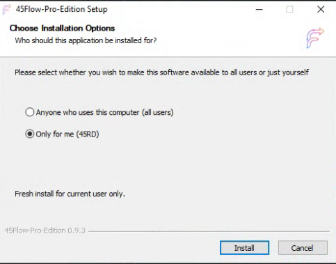

### How do I install it on a Mac?

1. Download the file ending in **`-mac-universal.dmg`**. It works on every Mac, old or new.
2. Double-click it.
3. Drag the **45Flow** icon into the **Applications** folder.
4. Open **45Flow** from Applications or Launchpad.

> **Mac says it can't open the app?** Go to **System Settings → Privacy & Security**, scroll down and click **Open Anyway**.

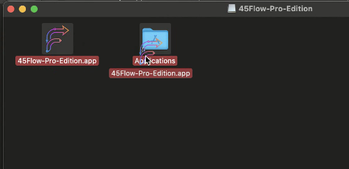

### How do I install it on Linux?

Pick the file that matches your system:

| Your system | Download | Then |
|---|---|---|
| Ubuntu or Debian | the **`.deb`** file | Double-click it, or in a terminal run `sudo apt install ./45Flow-*-linux-amd64.deb` |
| Rocky, RHEL or Fedora | the **`.rpm`** file | In a terminal run `sudo dnf install ./45Flow-*-linux-x86_64.rpm` |
| Not sure / any Linux | the **`.AppImage`** file | Right-click it → **Properties** → allow it to run as a program, then double-click it. No install needed. |

Then open **45Flow** from your applications menu.

---

## 4. Signing in and setting up your server

### How do I sign in the first time?

1. Open 45Flow. You'll see a card that says **"Sign in to 45Flow"**.
2. Type the server **Username** and **Password**.
3. Tick **"Remember my password on this computer"** if you don't want to type it every time.
4. Under **Server**, pick your server from **"Choose a server"**. If it isn't listed, type its address in **"Or enter the server address"**.
5. Click **Sign In**.

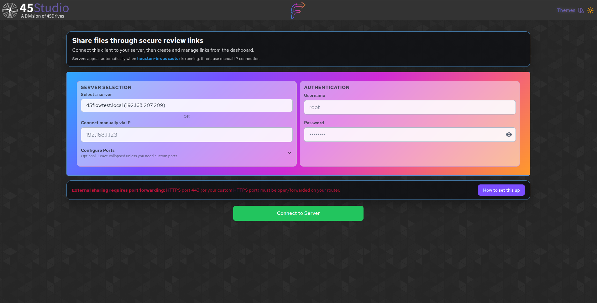

The first time, this can take a few minutes. You'll see messages like *"Preparing SSH…"* and *"Bootstrapping…"*. That's 45Flow installing what it needs on your server. Let it finish.

### It asked me to "Trust this SSH server?" What do I do?

This is a safety check, and it only appears the first time. It's making sure you're talking to the right server. If you set up the server yourself or you're on your office network, it's normally fine to accept. If you're not sure, ask your IT person to confirm the code it shows.

### What is the "Set up 45Flow" window?

On a brand-new server, 45Flow walks you through a short setup. Only the first step is required. You can skip the rest and come back later in **Settings**.

1. **Storage** (required): pick the main folder on your server where all your 45Flow work will live. Choose your big storage drive, not the system drive.
2. **Staff users**: pick which server accounts are allowed to run 45Flow. You can skip this.
3. **Sharing**: how links will reach people. You can skip this for now (see [Section 10](#10-sharing-outside-your-office-over-the-internet)).
4. **Upload security**: 45Flow can scan files clients upload for viruses. Click to install the scanner if it offers. Recommended.
5. **Watermarks**: an optional shared folder for your watermark images.
6. **First project**: give your first job a name and a folder. You can also do this later.

> Choosing the storage folder restarts the server software. Keep the window open, and it will reconnect by itself.

### Other people on my team need to sign in. Do they set up again?

No. Setup happens once per server. Your teammates just install the app and sign in with their own server account. If they see *"Server setup is not finished. Ask your administrator"*, the first person hasn't finished the setup steps yet.

---

## 5. Opening 45Flow day to day

### How do I get into 45Flow after the first time?

Open the **45Flow** app on your computer and click **Sign In**. If you ticked "Remember my password", that's it.

### Can I use 45Flow in a web browser instead?

In Community Edition you use the **desktop app**.

> **⭐ Pro:** With Pro, anyone on your office network or VPN can also open 45Flow in a web browser at `https://<your-server>/app/` with nothing to install.

### Can I connect to more than one server?

In Community Edition you work with **one server at a time**. To switch, click **Log Out**, then sign in to the other server.

> **⭐ Pro:** Pro lets you stay connected to several servers at once and switch between them from the top of the screen, or see all their links in one list.

### How do I sign out?

Click **Log Out** at the top of the screen.

---

## 6. Projects

### What is a project?

A project is a folder on your server for one job, like "Acme spring ad" or "Smith wedding". All the links for that job stay together inside it. After you sign in, you always land on your list of projects.

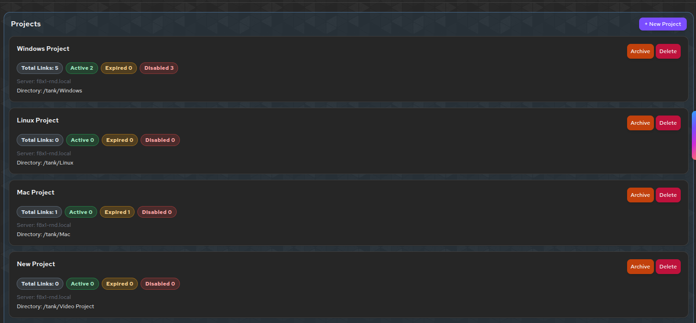

### How do I make a project?

1. On the Projects screen, click **+ New Project**.
2. Type a **Project name**.
3. Pick the **Project folder** on your server. Click **New Folder** if you want a fresh one.
4. Add **Notes** if you like (for example, the client's name).
5. Click **Create Project**.

The project opens right away.

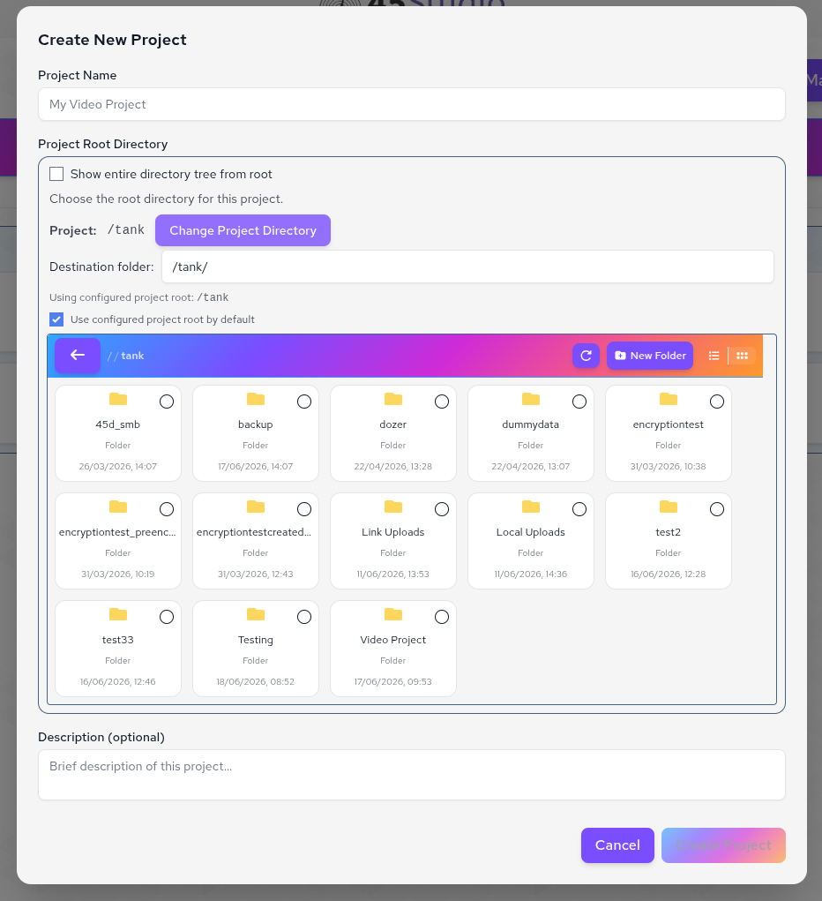

> **Watch for warnings.** If 45Flow shows a yellow or red warning about space while you pick a folder, choose a folder on a bigger drive. Videos fill up space fast.

### What's inside a project?

Two big buttons, and your list of links:

| Button | What it does |
|---|---|
| **Create Link** | Make a link to send files to someone, get files from them, or both. |
| **Add Files** | Copy files from your computer into this project on the server. |

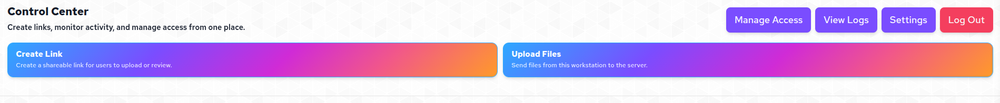

### I'm done with a job. Should I delete the project?

Usually, **archive** it instead. Archiving turns off all its links and hides it from your list, but deletes nothing. You can bring it back any time by ticking **Show archived projects** and clicking **Unarchive**.

**Delete** removes the project for good. Your original files stay on the server either way.

---

## 7. Putting files on the server

### How do I copy files from my computer to the server?

1. Open a project and click **Add Files**.
2. Drag files onto the screen, or click **Choose Files** or **Choose Folder**.
3. Check **Upload to**. It starts as the project folder, which is usually what you want.
4. Click **Upload**.

You'll see each file's progress. You can leave the screen and keep working; the upload carries on.

### What's the bar at the bottom of the screen?

That's the **Transfer Dock**. It shows everything uploading or being processed, with speed and time left. Click **Close** to tuck it away. Your transfers keep going.

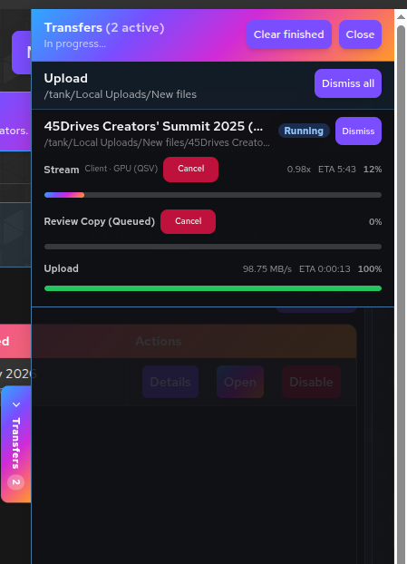

### What does "Processing" mean?

For videos, 45Flow makes **proxy files**: lighter copies that play smoothly in a browser. By default the server does this after the upload. If you have a fast computer, you can let your own computer do it instead in **Settings → Video processing**.

### Some of my file names changed. Why?

Characters like `'` or `:` don't work on every system, so 45Flow swaps them for `_`. A message tells you when it does this.

---

## 8. Sharing files with a link

### What's the quickest way to share something?

Use **QuickShare**:

1. Drag one or more files from your computer onto the 45Flow window.
2. Check the destination (it uses the open project's folder).
3. Choose how long the link lasts and who can open it.
4. Click **Upload & Share**.

The link is **copied for you**. Paste it into an email or chat. Done.

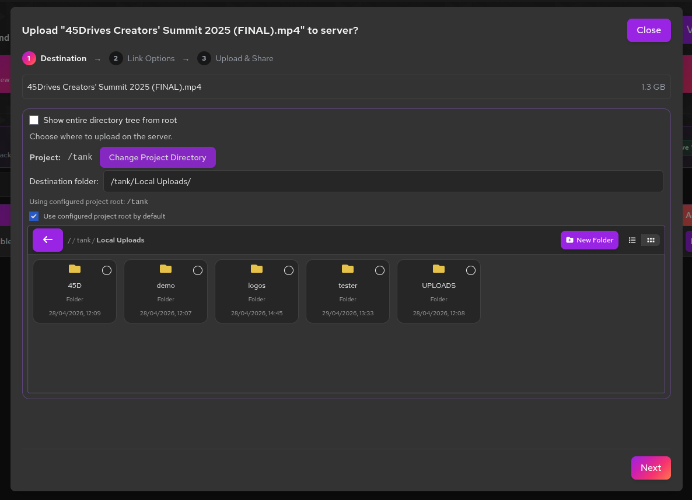

### How do I share files that are already on the server?

1. Open a project and click **Create Link**.
2. *(Optional)* Give it a **Link name** so you can find it later, like "Rough cut v2".
3. Under **Files to share**, tick the files or folders you want to send.
4. Pick your **Link options** (see the next questions).
5. Click **Generate Flow link**.
6. Click **Copy** and send the link to your client.

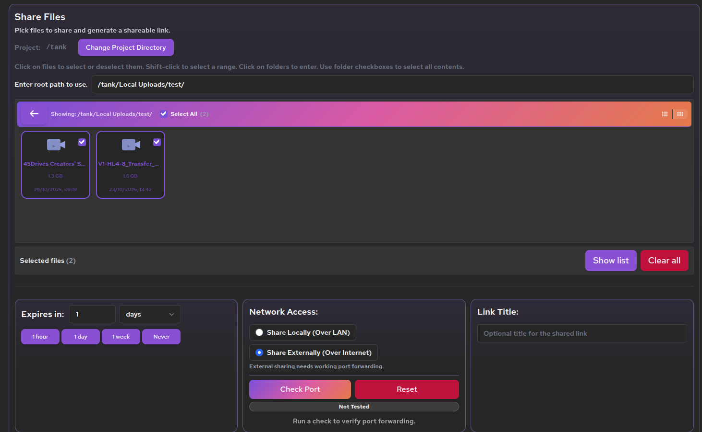

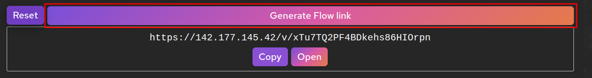

### Who can open my link?

You choose one of three options:

| Option | Good for |
|---|---|
| **Anyone with the link** | Quick, casual sharing. No login. You can also tick **Allow comments**. |
| **Anyone with the link + password** | A bit more private. Send the password separately. |
| **Only invited clients & teams** | The most private. Each person signs in with their own login. See [Section 11](#11-clients-teams-and-what-they-can-do). |

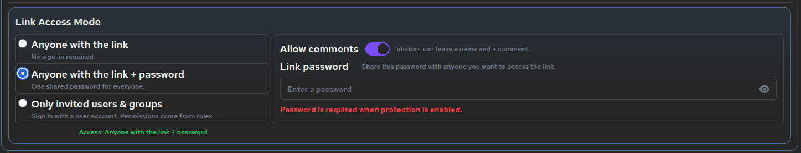

### How long does a link last?

You set it under **Expires in**. Pick **1 hour**, **1 day**, **1 week**, **Never**, or type your own. When it expires, the link simply stops working. You can extend it later.

### What's "Share Externally" vs "Share Locally"?

- **Share Locally (Over LAN)**: only works for people in your office or on your VPN. Nothing extra to set up.
- **Share Externally (Over Internet)**: works for anyone, anywhere. Needs a one-time setup first. See [Section 10](#10-sharing-outside-your-office-over-the-internet).

### Can I email the link straight from 45Flow?

Yes, if your administrator has set up email in **Settings → Email (SMTP)**. Above the generate button, turn on **Send link by email** and add addresses. The button changes to **Generate & Send Flow link**.

### Can I put my logo on videos and pictures?

Yes. When you share videos or images, turn on **Watermark** and choose an image. In Community Edition the watermark goes in the **bottom-right corner** at a standard size.

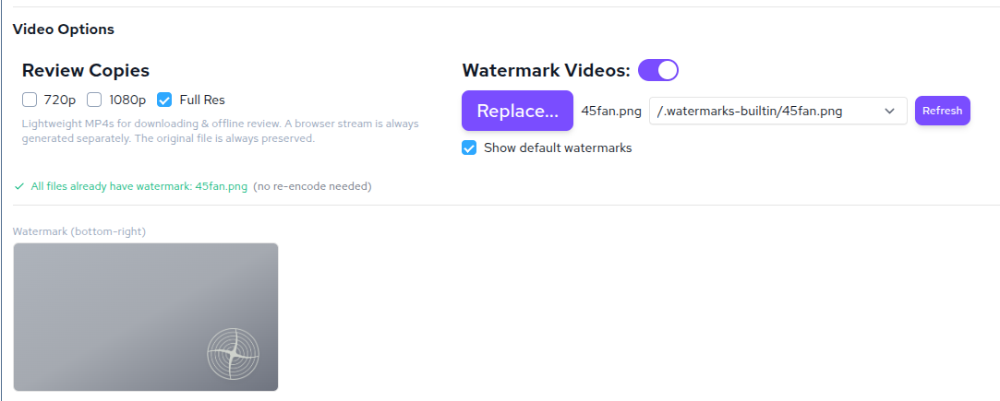

> **⭐ Pro:** Pro lets you place the watermark anywhere, change its size, see-through level and angle, add text watermarks, save your favourite setups as presets, and even give each invited person their own personally watermarked copy.

### What file types can I share?

Almost anything. Videos (MP4, MOV, MKV and many more), pictures, audio, PDFs, Word documents and spreadsheets. Videos and pictures play or preview right in the browser. Documents and spreadsheets get a quick preview, and clients can download the original.

---

## 9. Getting files from a client (upload links)

### How do I get a client to send me files?

1. Open a project and click **Create Link**.
2. Leave **Files to share** empty.
3. Tick **Let client upload to** and pick the folder where their files should land.
4. Click **Generate Flow link** and send it.

Your client opens the link and drags in their files. They land in the folder you chose.

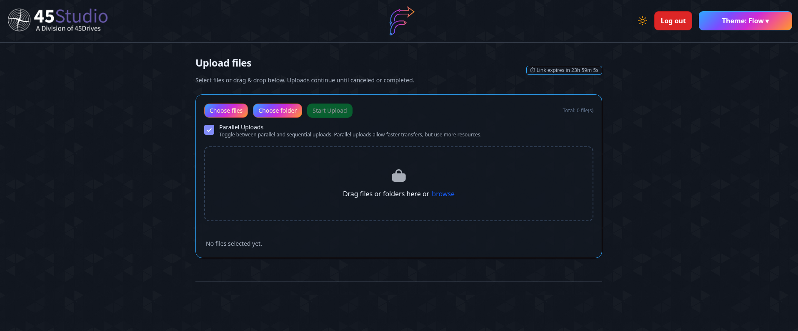

### Can one link do both: send files and get files back?

Yes. Tick some files under **Files to share** **and** tick **Let client upload to**. The line under the generate button tells you which kind of link you're about to make.

### Are uploaded files checked for viruses?

Yes, if a virus scanner is installed on your server. You can install one in **Settings → Upload security** (or during first setup).

> **⭐ Pro:** Pro can also check uploads against your rules (file type, codec, resolution, frame rate, length), and either reject files that don't match or flag them for you.

---

## 10. Sharing outside your office (over the internet)

### Do I need to do anything special to share over the internet?

Yes, once. Sharing inside your office works straight away. To reach people outside, your router needs to let them through to your server. This is called **port forwarding**. If you have an IT person, hand them this section.

### How do I set up port forwarding?

1. Log in to your router (often by typing `192.168.1.1` or `192.168.0.1` into a browser).
2. Find **Port Forwarding** (sometimes called **NAT** or **Virtual Server**).
3. Add a rule: port **443**, protocol **TCP**, sent to your **server's address**.
4. Save.

Every router looks different. If you're stuck, your internet provider can help.

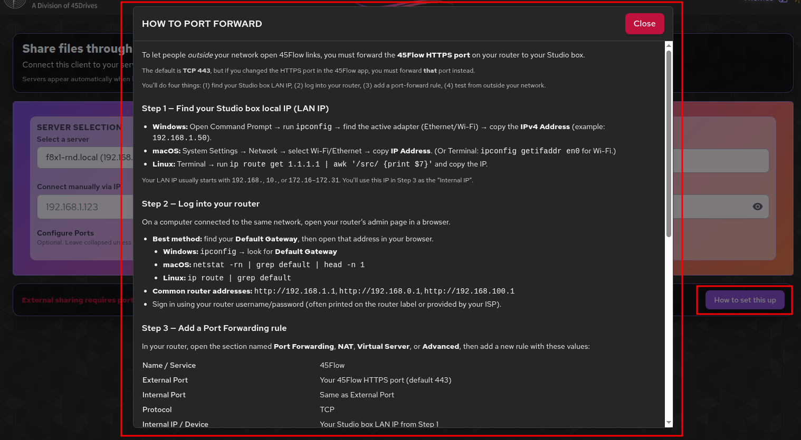

### How do I know it worked?

When you create a link with **Share Externally** selected, click **Check port**. Green means you're good. Red means the router isn't passing traffic through yet.

### Do I need a web address like share.mycompany.com?

For internet links, yes. 45Flow won't put your server's raw number address in an internet link. Go to **Settings → Share addresses** and follow **Set up a public address**:

1. **Get a hostname.** At your domain provider (GoDaddy, Cloudflare, Namecheap and so on), add a record like `share.mycompany.com` that points to your office's internet address. The setup screen shows you that address.
2. **Use it.** Click **Use *your hostname*** and **Save**.
3. **Get a free security certificate.** Click **HTTPS certificate** and follow the steps to get a free Let's Encrypt certificate. Your router also needs to forward port **80** while this runs.

When the steps show **Ready**, you can make internet links.

> **⭐ Pro:** No domain? Pro can set up a free No-IP hostname for you and keep it updated automatically, even if your office's internet address changes.

### How do I check everything is ready?

**Settings → Internet sharing** shows a simple green, yellow or red status. If something's wrong, try **Repair Public Sharing**.

---

## 11. Clients, teams and what they can do

### Do my clients need an account?

Only if you use **Only invited clients & teams** links. For the other two link types, they don't.

### How do I add a client?

1. Open a project and click **Client Access** at the top.
2. Click **Add client**.
3. Fill in their **Name**, a **Username**, and a **Temporary Password** (click **Generate a password** to make one).
4. Add their email if you have it.
5. Click **Add Client**.

Send them their username and password privately.

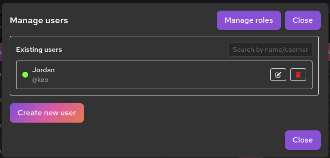

### What are teams?

A team is a group of clients, like "Agency" or "Producers". Invite the team to a link and everyone in it gets access. Add someone to the team later, and they get access to every link the team has. Make one in **Client Access → Teams**.

### How do I control what a client can do?

With **roles**. Every invited person has one:

| Role | View | Comment | Download | Upload |
|---|:-:|:-:|:-:|:-:|
| **Editor** | ✅ | ✅ | ✅ | ✅ |
| **Feedback** | ✅ | ✅ | ✅ | ❌ |
| **Viewer** | ✅ | ❌ | ❌ | ❌ |

You can make your own roles in **Client Access → Roles**.

---

## 12. What your client sees

### What happens when my client opens the link?

It opens in their web browser. No app, no account (unless you chose invite-only).

- **Open links** go straight to the files.
- **Password links** ask for the password first.
- **Invite-only links** ask them to sign in with the username and password you gave them.

### Can clients play videos?

Yes. Videos play right in the browser, with play, pause, volume, full screen and speed controls. They can pick the quality, or let it adjust to their internet speed.

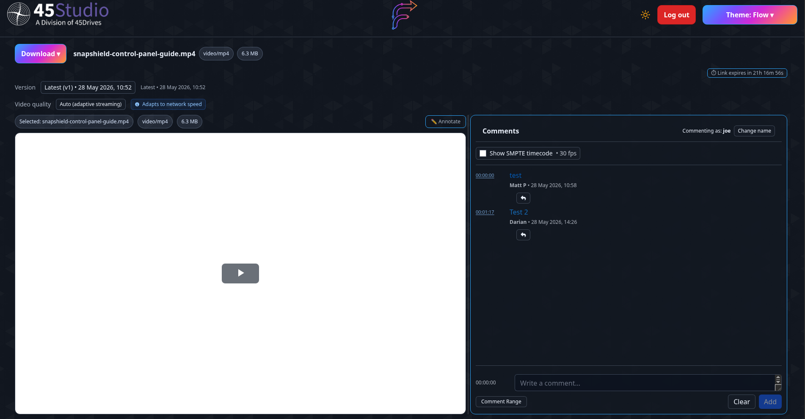

### Can clients leave comments?

Yes, if comments are on for that link. They pause the video, type a note and send it. The comment is pinned to that exact moment. Click any comment's time to jump to that point. Anyone can reply to a comment, and comments can be sorted into **categories** like "Audio" or "Colour".

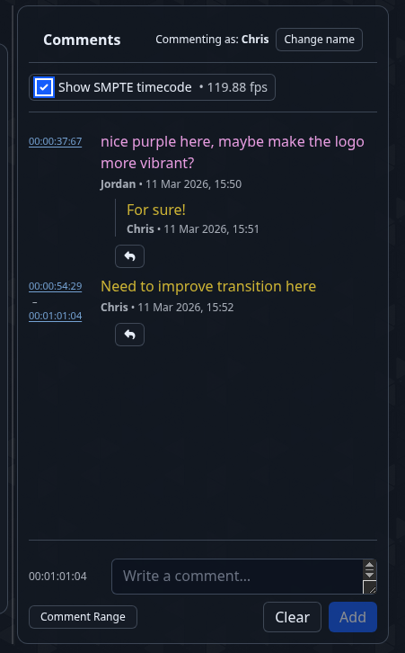

> **⭐ Pro:** With Pro, reviewers can **draw** on the video frame (circles, arrows, boxes) to point at exactly what they mean, and your team can mark feedback as **resolved**.

### If I update a file, do old comments get lost?

No. 45Flow keeps versions. Comments are tagged with the version they were made on, and notes from older versions show up under **Previous Version Notes**.

> **⭐ Pro:** Pro adds **Compare versions**, so you and your client can view two versions side by side, with one play button for both.

---

## 13. Keeping track of your links

### Where are all my links?

Inside each project, below the big buttons. You can search, and filter by type (Share, Upload, Combined) or status (Active, Expired, Disabled).

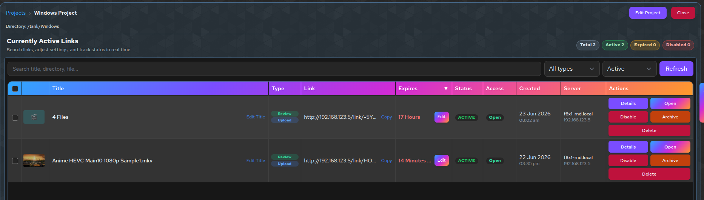

### How do I see who opened my link?

Click **Details** on the link, then the **Activity** tab. You'll see views, downloads and uploads, with times.

### How do I change a link after sending it?

Click **Details**, then **Edit**. You can change who can open it, the password, the expiry date, and the files. Click **Save & close**. Changes work right away, and the link address stays the same.

### How do I stop a link working?

- **Disable**: turns it off straight away. Click **Enable** to turn it back on.
- **Delete**: removes the link for good. Your original files stay on the server. You can choose to also delete the extra proxy files to free up space.

### How do I read all the comments on a link?

Open the link yourself (click **Open**) to read the comments beside each file. You'll also see new comments and replies in the **bell** at the top of the app.

> **⭐ Pro:** Pro adds a **Comments** button in **Details** with a full review panel: filter by person, file, category or version, resolve notes in bulk, and **export** all comments as PDF, spreadsheet (CSV), text, subtitles or an **EDL** for Premiere, Resolve or Avid.

### What's the bell at the top?

**Notifications**. It shows new comments, finished uploads, errors and other updates. A red number means you have unread ones. Choose which comment alerts you get in **Settings → Preferences**.

---

## 14. Settings worth knowing about

Click **Settings** at the top of the screen. Most people only ever need these:

| Where | What it's for |
|---|---|
| **New link defaults** | Starting choices for new links: invite-only or not, comments, proxy files, watermark. |
| **Share addresses** | The web address your links use, inside and outside the office. |
| **Internet sharing** | A green / yellow / red check that internet links will work. |
| **HTTPS certificate** | Get a free trusted certificate so clients don't see browser warnings. |
| **Preferences** | 12- or 24-hour time, which links you see first, and which notifications you get. |
| **Video processing** | Let your own computer prepare videos (faster on a good graphics card). |
| **Server health** | How busy the server is and how full the storage is. |
| **Email (SMTP)** | Lets 45Flow send link emails (admins only). |
| **Help & tours** | Open the full user guide, or turn the on-screen tips on or off. |
| **Go Pro** | Start a free 30-day Pro trial or enter a license key. |

Remember to click **Save** after changing anything. New settings apply to **new** links, not ones you've already made.

---

## 15. Updating 45Flow

### How do I update the app?

In Community Edition, updates are manual:

1. Go to the **[45Flow Releases page](https://github.com/45Drives/45flow/releases)**.
2. Download the newest file for your computer.
3. Install it the same way as the first time ([Section 3](#3-installing-the-app)). Your settings and servers are kept.

> **⭐ Pro:** Pro servers get **automatic updates**. A pop-up tells you a new version is ready. Click **Download Update**, then **Restart & Install**.

### How does the server get updated?

When a new version of the server software is ready, whoever manages 45Flow sees a **Server Update Available** message with an **Update** button. Click it. You're signed out for a minute or two while the server updates, then you can sign back in.

---

## 16. Something's not working

### My server isn't in the "Choose a server" list.

Type the server's address into **"Or enter the server address"** instead. The list only finds servers on the same part of your network.

### Sign-in fails the first time.

- Check the username and password.
- The first sign-in needs an account that can install software (`root` or a "sudo" account).
- Make sure SSH is on and the server has internet access.

### My client can't open an internet link.

1. Check **Settings → Internet sharing**. Fix anything yellow or red, or click **Repair Public Sharing**.
2. Make sure port **443** is forwarded on your router (see [Section 10](#10-sharing-outside-your-office-over-the-internet)).
3. Make sure the link isn't **expired** or **disabled**.

### My client sees a "not secure" warning in their browser.

Your server is using its built-in certificate. Get a free trusted one in **Settings → HTTPS certificate**.

### A video is stuck on "Processing".

Big videos take a while. Watch the **Transfer Dock** for progress. If it failed, open the link's **Details → Files** and click **Retry**.

### Where can I see what went wrong?

Click **Activity Log** at the top. Look for anything marked **Error**. If you contact support, they may ask you for this.

### I deleted a link by mistake. Are my files gone?

No. Deleting a link or a project **never** deletes your original files. They're still in the folder on your server.

---

## 17. What does Pro add?

Pro turns on for everyone the moment your **server** gets a license. There's nothing new to install. You can try it free for 30 days: **Settings → Go Pro → Start Trial**.

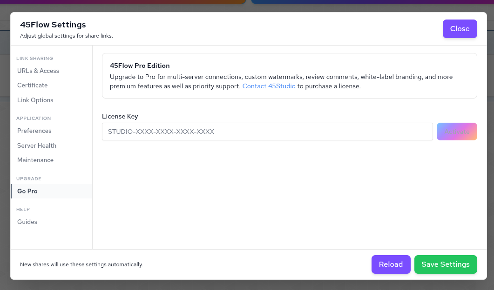

| Pro extra | In plain words |
|---|---|
| **Use it in a browser** | Open 45Flow from any computer on your network, no install. |
| **Your branding** | Your logo, colours and company name on every page your clients see. |
| **Better watermarks** | Put them anywhere, any size or angle, add text, save presets. |
| **Personal watermarked copies** | Each invited person gets their own copy marked with their name or email. |
| **Drawing on videos** | Reviewers circle and point at things right on the frame. |
| **Comment review and export** | Filter, resolve and export feedback to PDF, CSV or your editing software. |
| **Compare versions** | Watch two versions side by side. |
| **Upload rules** | Only accept files that match your specs. |
| **Several servers at once** | Switch between servers without signing out. |
| **Free No-IP address** | Share over the internet without buying a domain. |
| **Automatic updates** | New versions install with one click. |
| **Priority support** | Faster help from 45Drives. |

See the [45Flow Pro Edition FAQ](45Flow_Pro_Edition_FAQ.md) for how each one works.

---

*Need more detail? See the full [45Flow User Guide](45Flow_User_Guide.md), or contact your 45Drives representative at [45drives.com](https://www.45drives.com).*
