<p align="center">
  
</p>

# 45Flow Pro Edition: The Simple Guide (FAQ)

This guide covers **everything** in 45Flow, including all the **Pro** features. It is written for everyone, not just IT people. You don't need to know anything technical to follow it.

Anything marked **⭐ Pro** only works on a server with a Pro license (or a free trial). Everything else works on every server.

> Only using the free version? The [45Flow Community Edition FAQ](45Flow_Community_Edition_FAQ.md) is shorter and leaves out the Pro features.

---

## Contents

**Getting started**

1. [The basics](#1-the-basics)
2. [Before you start](#2-before-you-start)
3. [Installing the app](#3-installing-the-app)
4. [Signing in and setting up your server](#4-signing-in-and-setting-up-your-server)
5. [Turning on Pro (license or free trial)](#5-turning-on-pro-license-or-free-trial)
6. [Opening 45Flow: desktop app or web browser](#6-opening-45flow-desktop-app-or-web-browser)

**Everyday use**

7. [Projects](#7-projects)
8. [Putting files on the server](#8-putting-files-on-the-server)
9. [Sharing files with a link](#9-sharing-files-with-a-link)
10. [Getting files from a client (upload links)](#10-getting-files-from-a-client-upload-links)
11. [Sharing outside your office (over the internet)](#11-sharing-outside-your-office-over-the-internet)
12. [Clients, teams and what they can do](#12-clients-teams-and-what-they-can-do)
13. [What your client sees](#13-what-your-client-sees)
14. [Keeping track of your links](#14-keeping-track-of-your-links)

**Pro features**

15. [Your branding on every page ⭐](#15-your-branding-on-every-page-)
16. [Advanced watermarks ⭐](#16-advanced-watermarks-)
17. [Reviewing and exporting feedback ⭐](#17-reviewing-and-exporting-feedback-)
18. [Comparing versions side by side ⭐](#18-comparing-versions-side-by-side-)
19. [Upload rules ⭐](#19-upload-rules-)
20. [Working with several servers ⭐](#20-working-with-several-servers-)

**Looking after 45Flow**

21. [Settings worth knowing about](#21-settings-worth-knowing-about)
22. [Updating 45Flow](#22-updating-45flow)
23. [Something's not working](#23-somethings-not-working)

---

## 1. The basics

### What is 45Flow?

45Flow lets you send files to clients and get files back from them, using links. Think of it like a private Dropbox or WeTransfer that runs on **your own** 45Drives storage server, so your files never leave your building unless you send them.

It's built for video and media work. Clients can play videos in their web browser, leave comments at exact moments in a video, draw on the frame, and download or upload files.

### What are the pieces?

| Piece | What it is |
|---|---|
| **The 45Flow app** | A program you install on your Windows, Mac or Linux computer. |
| **The 45Flow web app** ⭐ | The same 45Flow, opened in a web browser on your office network. No install. |
| **Your server** | The 45Drives storage box (or any supported Linux machine) where your files live. 45Flow sets up the software it needs on it for you. |

Your **clients never install anything**. They just open the link you send them in their web browser.

### A few words you'll see

| Word | Meaning |
|---|---|
| **Project** | A folder on your server for one job, client or production. Keeps that job's links together. |
| **Link** | A web address you send to someone so they can view, download or upload files. |
| **Client** | Someone outside your team you share with. You can give them their own login. |
| **Proxy file** | A smaller, lighter copy of a video that plays smoothly in a browser. Your original stays untouched. |
| **Watermark** | A logo, image or text placed over your videos or pictures. |
| **License** | What turns on Pro. It belongs to the **server**, not to a person. |

### How do Community and Pro differ?

It's the **same app**. There is nothing different to download.

- **Community** is free. It's what you get on a server with no license.
- **Pro** turns on automatically when your **server** has a license. **Everyone** who signs in to that server gets Pro. You only need one license per server, not one per person.

The top of the app shows which one you're on: **Community Edition**, **Pro Edition**, or **Pro Trial — X days left**.

| Feature | Community | Pro |
|---|:-:|:-:|
| Share links, upload links, or both in one link | ✅ | ✅ |
| Passwords, invite-only links, expiry dates | ✅ | ✅ |
| Projects, clients, teams and roles | ✅ | ✅ |
| Video playback in the browser with proxy files | ✅ | ✅ |
| Comments pinned to a moment in the video, with replies and categories | ✅ | ✅ |
| Approve / request changes / reject a version | ✅ | ✅ |
| Two-step sign-in for staff | ✅ | ✅ |
| Basic watermark (image, bottom-right corner) | ✅ | ✅ |
| Virus scanning of uploads | ✅ | ✅ |
| Emailing links, activity history, server health | ✅ | ✅ |
| **Use 45Flow in a web browser** | ❌ | ✅ |
| **Your logo, colours and company name on client pages** | ❌ | ✅ |
| **Watermark anywhere, any size, text watermarks, presets** | ❌ | ✅ |
| **Personal watermarked copies for each person** | ❌ | ✅ |
| **Drawing on video frames and images** (PDF pages work on both) | ❌ | ✅ |
| **Comment review panel, resolving and exporting** | ❌ | ✅ |
| **Compare two versions side by side** | ❌ | ✅ |
| **Upload rules (file type, resolution and so on)** | ❌ | ✅ |
| **Several servers at once** | ❌ | ✅ |
| **Free No-IP web address set up for you** | ❌ | ✅ |
| **Automatic app updates** | ❌ | ✅ |
| **Priority support** | ❌ | ✅ |

---

## 2. Before you start

### What do I need?

- **A computer** running Windows 10 or newer (64-bit), macOS 11 or newer, or Linux (Ubuntu 20.04+ or Rocky Linux). 4 GB of memory is enough; 8 GB is better.
- **A server** running Ubuntu 20.04+ or Rocky Linux 8/9. This is usually your 45Drives storage server.
- **The server's username and password.** The first time, this must be an account that is allowed to install software (the `root` account or an account with "sudo" rights). Ask whoever set up your server if you don't know it.
- **The server's address**, like `192.168.1.50`. Often 45Flow finds it for you.
- **An internet connection on the server** for the first setup.
- **Your Pro license key** from 45Drives. No key yet? You can start a free 30-day trial instead.

### Does my server need anything turned on first?

Only **SSH**, which is on by default on most servers. SSH is how the app talks to the server to set things up. If you're not sure, ask your IT person.

---

## 3. Installing the app

> Want to skip installing and just use a browser? You still need **one** person to install the desktop app once, to set up the server and turn on Pro. After that, everyone else can use the browser. See [Section 6](#6-opening-45flow-desktop-app-or-web-browser).

### Where do I download it?

Go to the **[45Flow Releases page](https://github.com/45Drives/45flow/releases)**. Under the newest release, open **Assets** and pick the file for your computer.

### How do I install it on Windows?

1. Download the file ending in **`-win-x64.exe`**.
2. Double-click it.
3. Follow the steps in the installer.
4. Open **45Flow** from the Start Menu or the desktop shortcut.

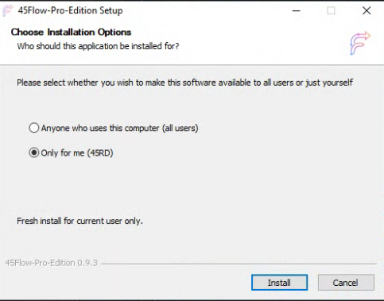

### How do I install it on a Mac?

1. Download the file ending in **`-mac-universal.dmg`**. It works on every Mac, old or new.
2. Double-click it.
3. Drag the **45Flow** icon into the **Applications** folder.
4. Open **45Flow** from Applications or Launchpad.

> **Mac says it can't open the app?** Go to **System Settings → Privacy & Security**, scroll down and click **Open Anyway**.

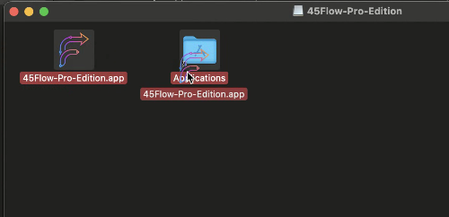

### How do I install it on Linux?

| Your system | Download | Then |
|---|---|---|
| Ubuntu or Debian | the **`.deb`** file | Double-click it, or in a terminal run `sudo apt install ./45Flow-*-linux-amd64.deb` |
| Rocky, RHEL or Fedora | the **`.rpm`** file | In a terminal run `sudo dnf install ./45Flow-*-linux-x86_64.rpm` |
| Not sure / any Linux | the **`.AppImage`** file | Right-click it → **Properties** → allow it to run as a program, then double-click it. No install needed. |

Then open **45Flow** from your applications menu.

---

## 4. Signing in and setting up your server

### How do I sign in the first time?

1. Open 45Flow. You'll see a card that says **"Sign in to 45Flow"**.
2. Type the server **Username** and **Password**.
3. Tick **"Remember my password on this computer"** if you don't want to type it every time.
4. Under **Server**, pick your server from **"Choose a server"**. If it isn't listed, type its address in **"Or enter the server address"**.
5. Click **Sign In**.

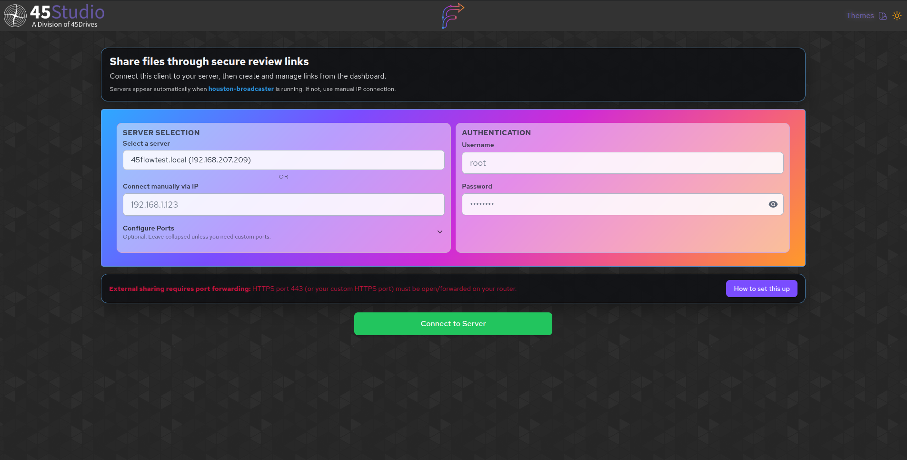

The first time, this can take a few minutes. You'll see messages like *"Preparing SSH…"* and *"Bootstrapping…"*. That's 45Flow installing what it needs on your server. Let it finish.

### It asked me to "Trust this SSH server?" What do I do?

This is a safety check that appears the first time. It's making sure you're talking to the right server. If you set up the server yourself or you're on your office network, it's normally fine to accept. If you're not sure, ask your IT person to confirm the code it shows.

### What is the "Set up 45Flow" window?

On a brand-new server, 45Flow walks you through four quick steps. Only the first and last are required. You can skip the middle two and come back later in **Settings**.

1. **Storage** (required): pick the main folder on your server where all your 45Flow work will live. Choose your big storage drive, not the system drive.
2. **Staff users**: pick which server accounts are allowed to run 45Flow.
3. **Sharing settings**: the web address links use outside your office. Click **Skip for now** if you only share inside the office.
4. **Projects** (required): give your first job a name and a folder, then click **Finish setup**.

Virus scanning for uploads is in **Settings → Upload security**. It's on when a scanner is installed; install one there if it isn't.

> Choosing the storage folder restarts the server software. Keep the window open, and it will reconnect by itself.

### Other people on my team need to sign in. Do they set up again?

No. Setup happens once per server. Teammates install the app (or use the browser, see [Section 6](#6-opening-45flow-desktop-app-or-web-browser)) and sign in with their own server account.

---

## 5. Turning on Pro (license or free trial)

### How do I turn on Pro with my license key?

1. Sign in with the **desktop app**.
2. Click **Settings**, then **Go Pro** on the left.
3. Type your **License Key**.
4. Click **Activate License**.

Pro turns on straight away, for everyone on that server.

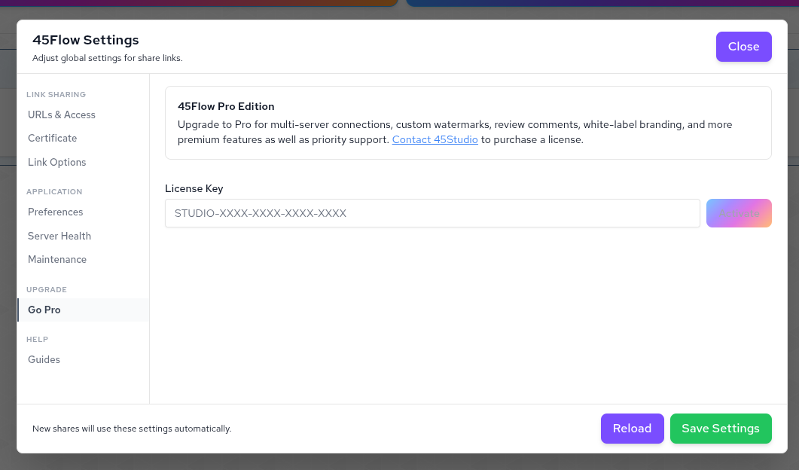

### Can I try Pro for free first?

Yes. In **Settings → Go Pro**, find **Start Free 30-Day Trial** and click **Start Trial**. You get every Pro feature for 30 days. The top of the app shows how many days are left.

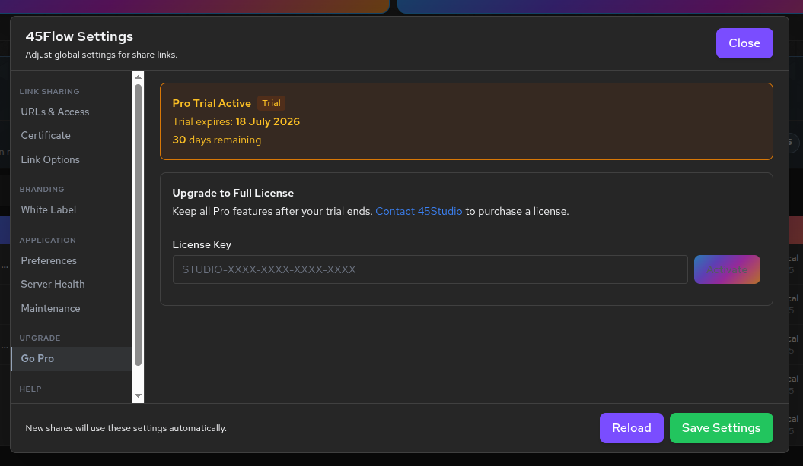

### What happens when my trial ends?

The server goes back to **Community**. All your links and files stay. The Pro extras turn off until you enter a license key.

### What happens if my full license runs out?

You don't lose what you paid for. The app switches to **Pro — Legacy**:

- Every Pro feature you had **keeps working**.
- **Automatic updates stop**, and you won't get Pro features released after that date.
- Enter a renewed key in **Settings → Go Pro** or **Settings → Server health** any time to get everything back up to date.

### Do I need a license for every person?

No. One license per **server**. Everyone who signs in to it gets Pro.

---

## 6. Opening 45Flow: desktop app or web browser

### How do I open the desktop app?

Open **45Flow** on your computer and click **Sign In**. If you ticked "Remember my password", that's it.

### ⭐ How do I open 45Flow in a web browser?

1. Make sure you're **in the office or on your VPN**. The web app is blocked from the open internet on purpose.
2. Open your browser (Chrome, Edge, Firefox or Safari) and go to:

   ```
   https://<your-server>/app/
   ```

   Replace `<your-server>` with your server's address, for example `https://192.168.1.50/app/`.
3. Type your **Username** and **Password** and click **Sign In**. There's no server to pick; it always uses the server you opened it from.

Tip: bookmark the page so you don't have to type it again.

### The browser says "Your connection is not private". Is that OK?

On your own office server, yes. Your server uses its own built-in certificate until you set up a trusted one, and browsers warn about that. Check the address is your server, then click **Advanced** and **Continue**. To get rid of the warning for good, set up a trusted certificate in **Settings → HTTPS certificate**.

### It says "The 45Flow web app is a Pro feature".

The server doesn't have an active license (or the trial ended). Turn on Pro in the desktop app first ([Section 5](#5-turning-on-pro-license-or-free-trial)).

### I get "404 Not Found" at /app/ right after turning on Pro.

The server adds the web app by itself after Pro is turned on. This can take **up to about 15 minutes**, and the server needs internet access. Try again shortly.

### Will the browser sign me out?

- Reloading the page keeps you signed in.
- After **15 minutes without doing anything**, you're signed out. About two minutes before, a message appears. Click **Stay signed in** to carry on.
- You're signed out after **12 hours** no matter what.
- Your password is never saved in the browser.

### Is the browser version different from the app?

Almost everything works the same: projects, links, uploads, QuickShare drag-and-drop, clients, settings. A few things only work in the desktop app:

| Desktop app only | Why it matters |
|---|---|
| First-time server setup | Someone needs the app once to set up the server. |
| Preparing videos on your own computer | In the browser, the server does it instead. Just a bit slower for big videos. |
| Several servers at once | The browser only talks to the server you opened it from. |
| Resuming an upload after closing the page | In the browser, **closing the tab stops uploads**. Keep the tab open until they finish. |

> **Tip:** Want to know when a browser upload finishes while you're in another tab? Turn on **Notify when uploads finish** in **Settings → Preferences**.

### Can staff use two-step sign-in?

Yes, on every server. In **Settings → Two-step sign-in**, click **Set up my two-step sign-in**, re-enter your password, get approval from another administrator (or a code issued on the server), then scan the QR code with an authenticator app on your phone. Save your recovery codes. Then turn on **Staff sign-in policy** to require it for all staff; they get 14 days to set up. Clients never need it.

### How do I sign out?

Click **Log Out** at the top of the screen.

---

## 7. Projects

### What is a project?

A project is a folder on your server for one job, like "Acme spring ad" or "Smith wedding". All the links for that job stay together inside it. After you sign in, you always land on your list of projects.

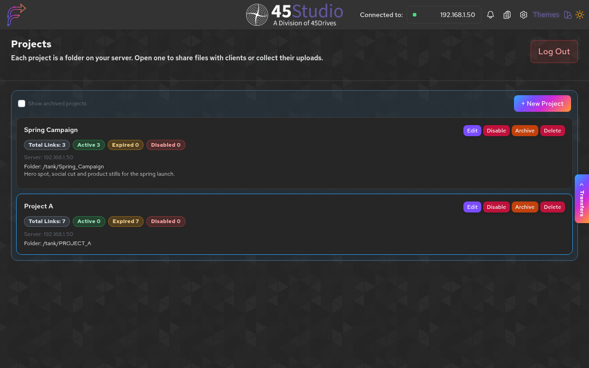

### How do I make a project?

1. On the Projects screen, click **+ New Project**.
2. Type a **Project name**.
3. Pick the **Project folder** on your server. Click **New Folder** if you want a fresh one.
4. Add **Notes** if you like.
5. Click **Create Project**.

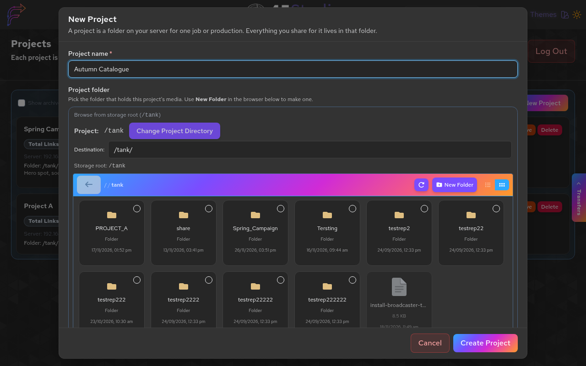

> **Watch for warnings.** If 45Flow shows a yellow or red warning about space, choose a folder on a bigger drive. Videos fill up space fast.

### What's inside a project?

| Button | What it does |
|---|---|
| **Create Link** | Make a link to send files to someone, get files from them, or both. |
| **Add Files** | Copy files from your computer into this project on the server. |

Below them is the list of this project's links.


### I'm done with a job. Should I delete the project?

Usually, **archive** it instead. Archiving turns off all its links and hides it from your list, but deletes nothing. Bring it back any time with **Show archived projects** → **Unarchive**.

**Delete** removes the project for good. Your original files stay on the server either way.

---

## 8. Putting files on the server

### How do I copy files from my computer to the server?

1. Open a project and click **Add Files**.
2. Drag files onto the screen, or click **Choose Files** or **Choose Folder**.
3. Check **Upload to**. It starts as the project folder.
4. Click **Upload**.

You can leave the screen and keep working; the upload carries on.

### What's the bar at the bottom of the screen?

That's the **Transfer Dock**. It shows everything uploading or being processed, with speed and time left. Click **Close** to tuck it away. Your transfers keep going.

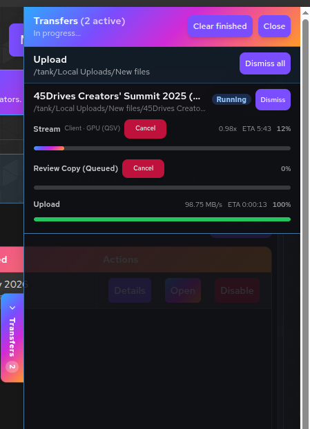

### What does "Processing" mean?

For videos, 45Flow makes **proxy files**: lighter copies that play smoothly in a browser. By default the server does this after the upload. In the desktop app you can let your own computer do it instead (often faster with a good graphics card) in **Settings → Video processing**.

---

## 9. Sharing files with a link

### What's the quickest way to share something?

Use **QuickShare**:

1. Drag one or more files from your computer onto the 45Flow window.
2. Check the destination (it uses the open project's folder).
3. Choose how long the link lasts and who can open it.
4. Click **Upload & Share**.

The link is **copied for you**. Paste it into an email or chat.

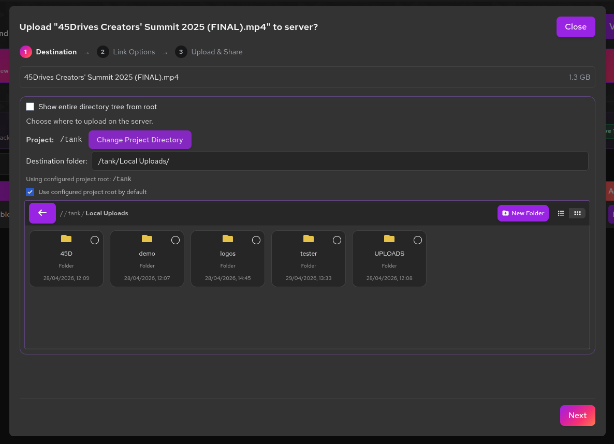

### How do I share files that are already on the server?

1. Open a project and click **Create Link**.
2. *(Optional)* Give it a **Link name**, like "Rough cut v2".
3. Under **Files to share**, tick the files or folders you want to send.
4. Pick your **Link options** (below).
5. Click **Generate Flow link**.
6. Click **Copy** and send the link.

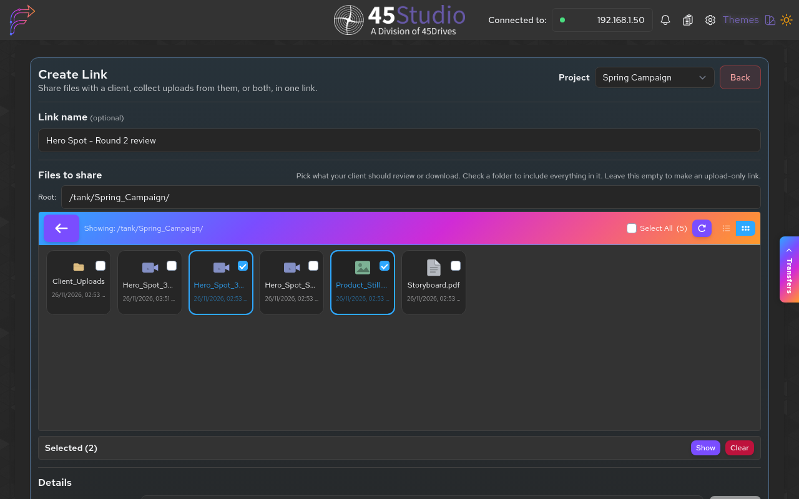

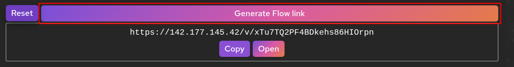

### Who can open my link?

| Option | Good for |
|---|---|
| **Anyone with the link** | Quick, casual sharing. No login. You can also tick **Allow comments**. |
| **Anyone with the link + password** | A bit more private. Send the password separately. |
| **Only invited clients & teams** | The most private. Each person signs in with their own login. Needed for personal watermarked copies. |

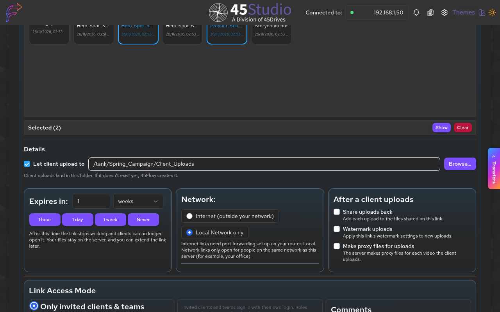

### How long does a link last?

You set it under **Expires in**: **1 hour**, **1 day**, **1 week**, **Never**, or your own. Expired links simply stop working. You can extend them later.

### What's "Internet" vs "Local Network only"?

- **Local Network only**: only for people in your office or on your VPN.
- **Internet (outside your network)**: for anyone, anywhere. Needs a one-time setup ([Section 11](#11-sharing-outside-your-office-over-the-internet)).

### Can I email the link straight from 45Flow?

Yes, once your administrator has set up email in **Settings → Email (SMTP)**. Turn on **Send link by email** and add addresses. The button changes to **Generate & Send Flow link**.

### Can I watermark videos and pictures?

Yes. Turn on **Watermark** and pick an image. With Pro you can place it anywhere, add text, and more. See [Section 16](#16-advanced-watermarks-).

### What file types can I share?

Almost anything: videos, pictures, audio, PDFs, Word documents and spreadsheets. Videos and pictures play or preview in the browser. Documents and spreadsheets get a quick preview.

---

## 10. Getting files from a client (upload links)

### How do I get a client to send me files?

1. Open a project and click **Create Link**.
2. Leave **Files to share** empty.
3. Tick **Let client upload to** and pick the folder their files should go to.
4. Click **Generate Flow link** and send it.

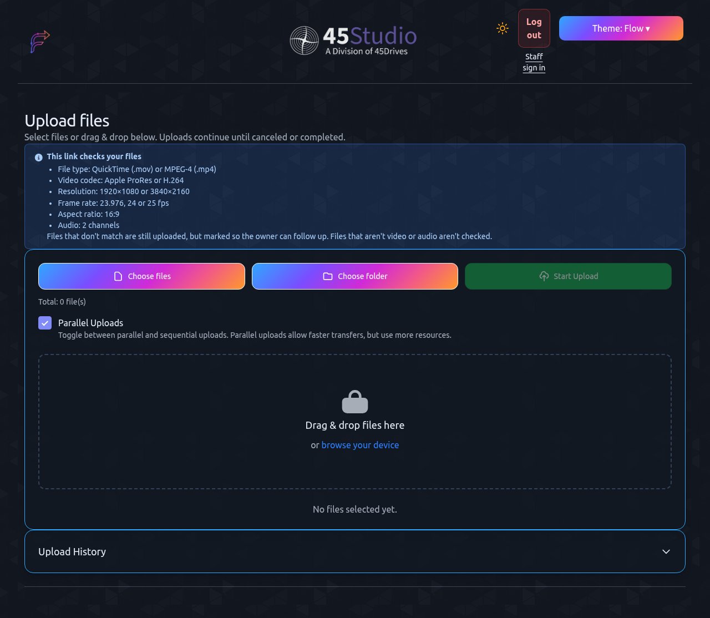

### Can one link do both: send files and get files back?

Yes. Tick some files **and** tick **Let client upload to**. The line under the generate button tells you which kind of link you're making.

### Can I make sure clients only send the right kind of file? ⭐

Yes, with **upload rules**. See [Section 19](#19-upload-rules-).

### Are uploaded files checked for viruses?

Yes, if a virus scanner is installed. Install one in **Settings → Upload security**.

---

## 11. Sharing outside your office (over the internet)

### Do I need to do anything special to share over the internet?

Yes, once. Your router needs to let people outside through to your server. This is called **port forwarding**. If you have an IT person, hand them this section.

### How do I set up port forwarding?

1. Log in to your router (often `192.168.1.1` or `192.168.0.1` in a browser).
2. Find **Port Forwarding** (sometimes **NAT** or **Virtual Server**).
3. Add a rule: port **443**, protocol **TCP**, sent to your **server's address**.
4. Save.

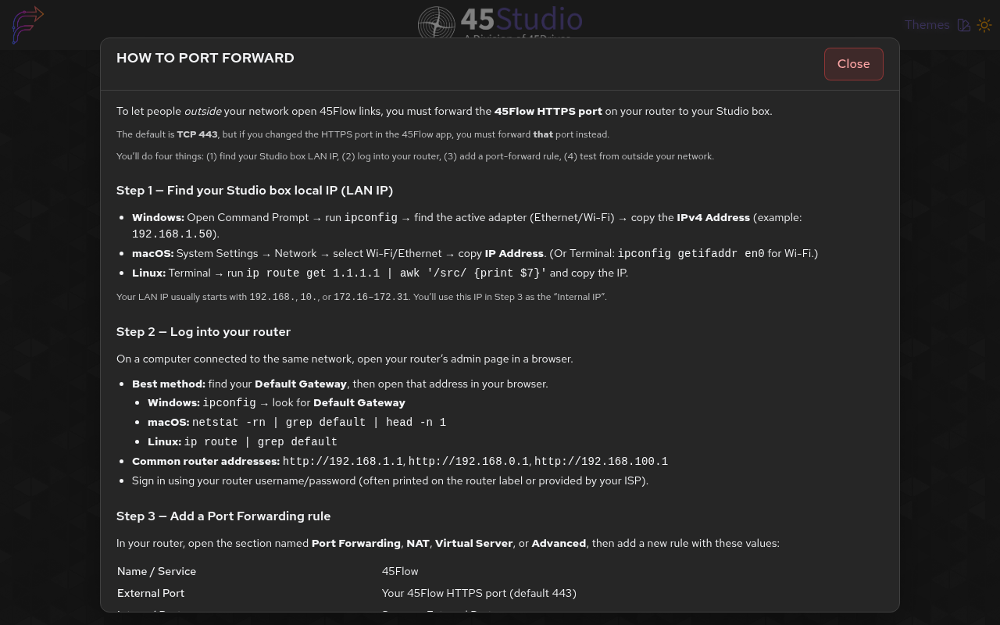

### How do I know it worked?

When you create a link with **Internet (outside your network)** selected, click **Check Port**. Green is good. Red means the router isn't passing traffic through yet.

### Do I need a web address like share.mycompany.com?

Yes. 45Flow won't put your server's raw number address in an internet link. Go to **Settings → Share addresses** and follow **Set up a public address**. You have two choices:

**Option A: Use your own domain**

1. At your domain provider (GoDaddy, Cloudflare, Namecheap and so on), add a record like `share.mycompany.com` that points at your office's internet address. The setup screen shows you that address.
2. Type the name in and click **Use *your hostname***, then **Save**.

**Option B ⭐: Use a free No-IP address (no domain needed)**

1. Make a free account and hostname at [noip.com](https://www.noip.com), for example `mystudio.ddns.net`.
2. In the setup screen, choose **No-IP (Pro)**.
3. Enter the hostname, your No-IP username (or email) and password. Leave **Keep it updated** on.
4. Click **Save No-IP**, then **Use *your hostname*** and **Save**.

45Flow keeps the No-IP address pointing at your office, even if your internet address changes.

**Then, for both options: get a free security certificate**

Click **HTTPS certificate** and follow the steps for a free Let's Encrypt certificate. Your router also needs to forward port **80** while this runs. When the steps show **Ready**, you can make internet links.

### How do I check everything is ready?

**Settings → Internet sharing** shows a simple green, yellow or red status. If something's wrong, try **Repair Public Sharing**.

---

## 12. Clients, teams and what they can do

### Do my clients need an account?

Only for **Only invited clients & teams** links.

### How do I add a client?

1. Open a project and click **Client Access** at the top.
2. Click **Add client**.
3. Fill in their **Name**, a **Username**, and a **Temporary Password** (click **Generate a password** to make one).
4. Add their **email** and **company**. With Pro, these can appear in personal watermarks.
5. Click **Add Client**.

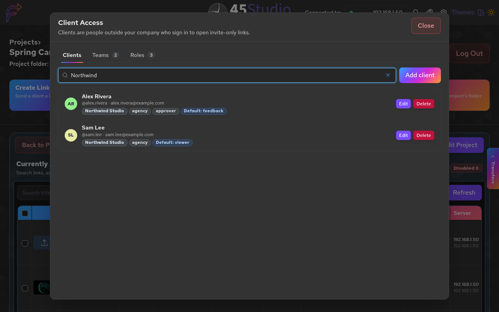

### What are teams?

A team is a group of clients, like "Agency" or "Producers". Invite the team to a link and everyone in it gets access. Make one in **Client Access → Teams**.

### How do I control what a client can do?

With **roles**:

| Role | View | Comment | Download | Upload |
|---|:-:|:-:|:-:|:-:|
| **Editor** | ✅ | ✅ | ✅ | ✅ |
| **Feedback** | ✅ | ✅ | ❌ | ❌ |
| **Viewer** | ✅ | ❌ | ❌ | ❌ |

You can change what each role allows, or make your own, in **Client Access → Roles**.

---

## 13. What your client sees

### What happens when my client opens the link?

It opens in their web browser. With Pro, it shows **your** logo and colours (see [Section 15](#15-your-branding-on-every-page-)).

- **Open links** go straight to the files.
- **Password links** ask for the password first.
- **Invite-only links** ask them to sign in.

### Can clients play videos?

Yes, right in the browser, with all the usual controls. They can pick the quality or let it adjust to their internet speed.

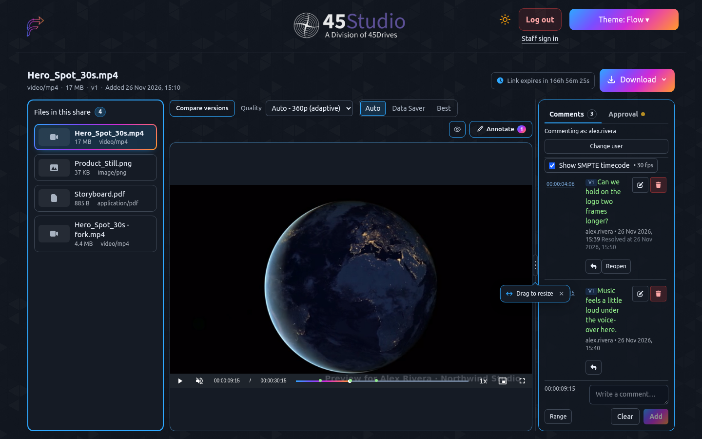

### How do clients leave comments?

If comments are on for the link, they pause the video, type a note and send it. The note is pinned to that exact moment. Anyone can reply, and notes can be sorted into **categories** like "Audio" or "Colour".


### ⭐ Can clients draw on the video?

Yes. When writing a comment, they click the **draw** tool, then draw freehand, boxes, circles or arrows in any colour. The drawing is saved with the comment and shows up on the frame when anyone clicks it.

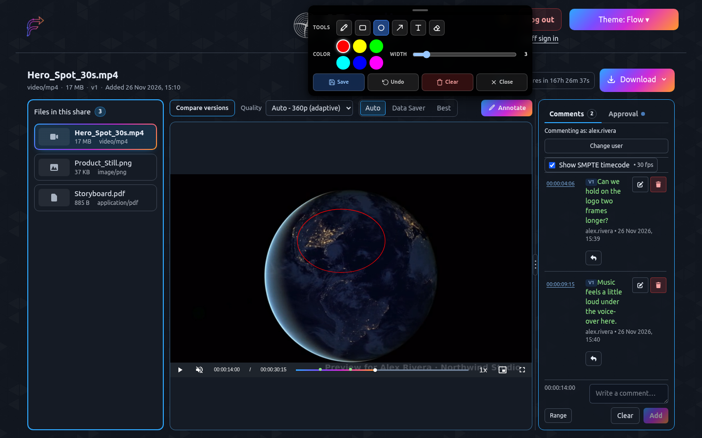

### ⭐ Can my team mark feedback as done?

Yes. Your staff can **resolve** a comment on the share page once it's dealt with, or **reopen** it. The person who wrote it can reopen their own comment too.

### Can my client approve a version?

Yes. On an **Only invited clients & teams** link, pick one invited person as the approver: open the link's **Details → Edit → Access** and choose them under **Who approves**. (Invite them directly, not only through a team.) On the share page they get an **Approval** tab with **Approve this version**, **Request changes** and **Reject**. You see the result in the link's **Review** tab and in the **Review** column of your links list.

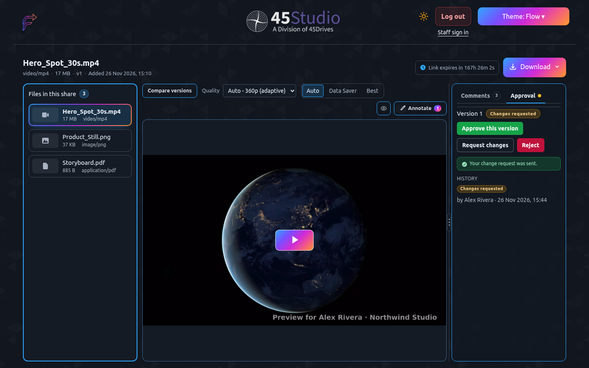

### If I update a file, do old comments get lost?

No. Comments are tagged with the version they were made on. Notes from older versions show under **Previous Version Notes**.

---

## 14. Keeping track of your links

### Where are all my links?

Inside each project, below the big buttons. Search, or filter by type (Review, Upload, Review + Upload) or status (Active, Expired, Disabled).

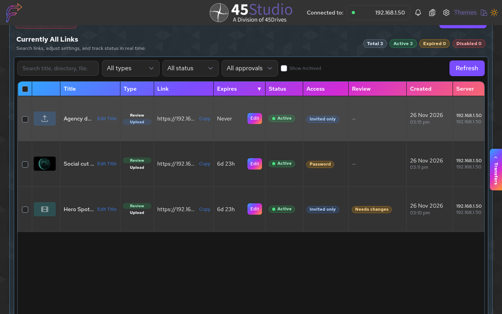

### How do I see who opened my link?

Click **Details**, then the **Activity** tab.

### How do I change a link after sending it?

Click **Details**, then **Edit**. Change who can open it, the password, expiry, files, watermark and more. Click **Save & close**. The link address stays the same.

### How do I stop a link working?

- **Disable** turns it off straight away. **Enable** turns it back on.
- **Delete** removes it for good. Your original files stay on the server.

### What's the bell at the top?

**Notifications**: new comments, replies, finished uploads and problems. Choose which comment alerts you get in **Settings → Preferences**.

---

## 15. Your branding on every page ⭐

### What does branding change?

Every page your clients see: the share page, the video player, the upload page and the password page. They'll see **your logo, colours and company name** instead of 45Flow's. A small "Powered by 45Flow" line stays at the bottom.

### How do I set it up?

1. Go to **Settings → Branding**.
2. Turn on **Enable custom branding**. The settings are on four tabs, with a live preview at the top.
3. **Identity** tab: type your **Company name** and upload your **Logo** (PNG, JPEG, SVG or WebP, up to 2 MB). If it doesn't show up well on dark pages, turn on **Use a separate logo for dark backgrounds** and upload a second one. Add a **Favicon** for the browser tab, a **Support email** and **Support URL**, and the **Preview title** and **description** people see when your link is pasted into Slack, Teams or a text message.
4. **Look** tab: pick a **Recipient theme**, or choose **Custom (your brand colors)** and pick your two brand colours. You can also lock light or dark mode, and change the font, corner style, button style, logo size and background.
5. **Page content** tab *(optional)*: add a **Welcome message**, **Footer text**, and links to your privacy policy and terms of use.
6. **Custom CSS** tab *(optional)*: for anything else, if you or your web person know CSS.
7. Click **Save changes**.

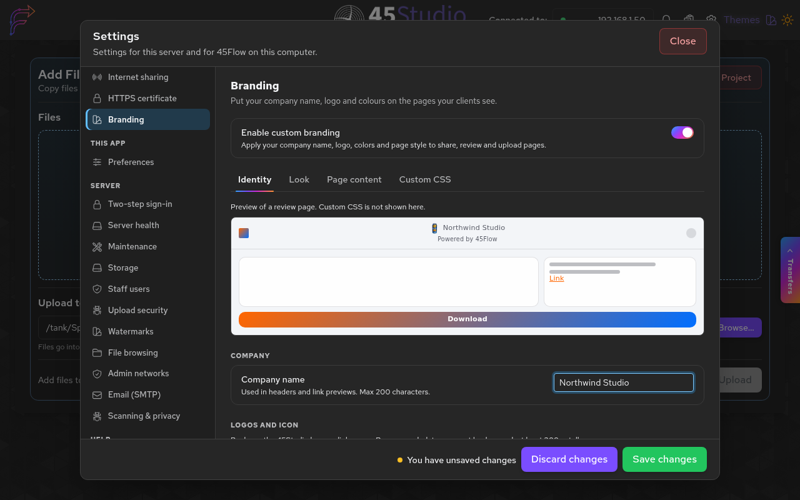

### Can I go back to the normal look?

Yes. Click **Clear custom branding** at the bottom, or just turn the switch off and save.

---

## 16. Advanced watermarks ⭐

### What can I do with watermarks in Pro?

| | Community | Pro |
|---|:-:|:-:|
| Image watermark on videos and pictures | ✅ | ✅ |
| Choose where it goes (9 spots) | Bottom-right only | ✅ |
| Change size, see-through level and angle | ❌ | ✅ |
| Text watermarks | ❌ | ✅ |
| Save setups as presets and reuse them | ❌ | ✅ |
| A personal copy for each invited person | ❌ | ✅ |

### How do I set one up?

1. When you create a link, turn on **Watermark** in the video or image options.
2. Pick an image (or add text).
3. Choose the **position**, **size**, **opacity** (see-through level) and **rotation**.
4. Save it as a **preset** if you'll use it again.

You can also set a default watermark for every new link in **Settings → New link defaults**.

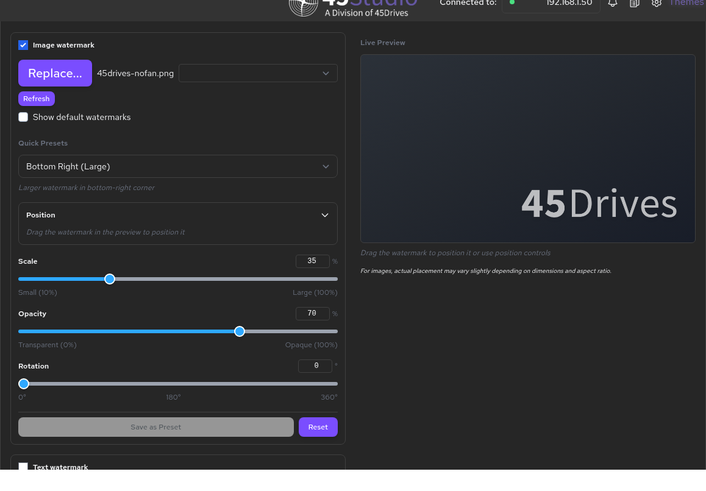

### What are personal watermarked copies?

On **invite-only** links, each person can get their own copy with **their** details stamped on it. If a copy leaks, you know whose it was.

1. Make an **Only invited clients & teams** link.
2. Add a **text watermark** that uses `{recipient}`, `{email}` or `{company}`. For example: `Preview for {recipient}`.
3. After the link is made, open **Details**. Under **Personal watermarked copies** you'll see each person and whether their copy is ready.

Each person only ever sees their own copy.

---

## 17. Reviewing and exporting feedback ⭐

### Where do I see all the comments on a link?

Open the link's **Details** and click **Comments** at the top.

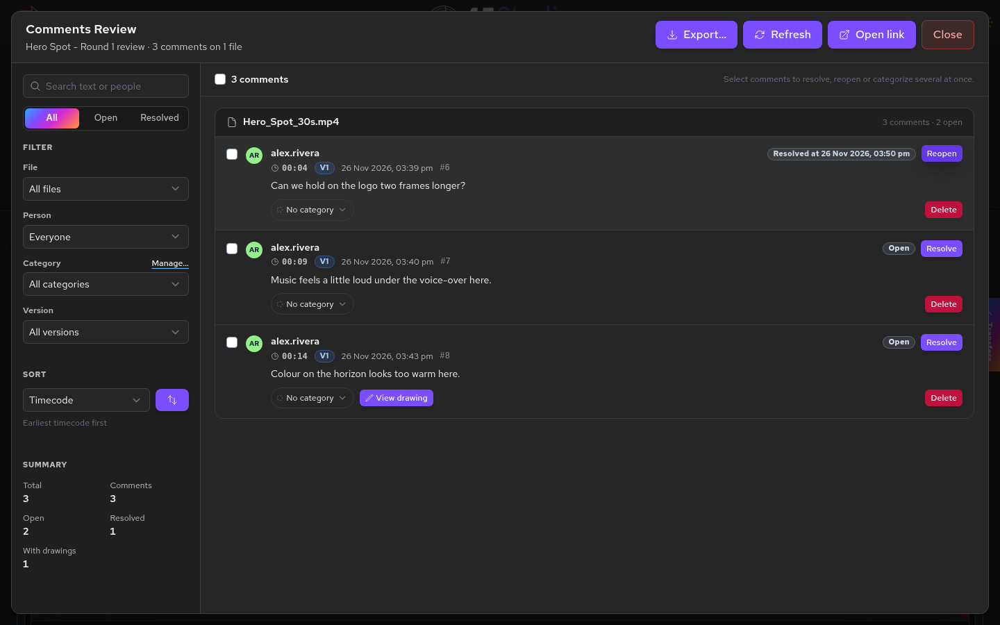

### What can I do in there?

- **Filter** by file, person, category, version, or open/resolved.
- **Sort** by time in the video, date, person or status.
- **Resolve** or **Reopen** comments, one at a time or many at once.
- Set or change **categories**. Click **Manage…** to create your own, with colours.
- Click **View drawing** to see what someone drew on the frame.

### How do I export the comments?

Click **Export…**, choose all files or one file, pick a format, and click **Export**:

| Format | Best for |
|---|---|
| **PDF** | A tidy report to send to someone. |
| **CSV** | Opening in Excel or Google Sheets. |
| **EDL** | Importing notes as markers into **Premiere, Resolve or Avid**. |
| **WebVTT** | Showing notes as captions in a video player. |
| **Markdown** | Pasting into an email or document. |
| **JSON** | Feeding into other software. |

---

## 18. Comparing versions side by side ⭐

### How do I compare two versions?

1. Open the link's **Details** and go to the **Versions** tab.
2. Choose the file.
3. Click **Compare with…** on one version, then choose the other.
4. Click **Open comparison**.

The two versions open side by side in your browser. For videos, click **Sync A & B** to play them together (or **Line up at A** to match their times). You choose which side's sound you hear.

### Can my client compare too?

Yes. On the share page they'll see a **Compare versions** button. They don't need their own license.

### Can they comment while comparing?

Yes. Under **Comment on**, they pick side **A** or **B** before writing, so the note lands on the right version.

### What's a fork?

A **fork** is a separate copy of one version, for when a file goes two ways (for example, a short social cut made from v2 of the main edit). Make one with **Fork from this version** in the **Versions** tab. Forks and their source can be compared too. Making forks works in Community as well; comparing them needs Pro.

---

## 19. Upload rules ⭐

### What are upload rules?

Rules that check what a client sends you, so you don't get the wrong format by mistake.

### How do I set them up?

1. When making a link, tick **Let client upload to**.
2. In **File requirements**, turn on **Check uploads against file requirements**, then click **Edit requirements…**.
3. Under **When a file doesn't match**, choose:
   - **Reject it and tell the uploader why**, or
   - **Accept it, but flag it** (so you can check it later).
4. Tick what's allowed: **File type**, **Video codec**, **Resolution**, **Frame rate**, **Aspect ratio**, **Audio** channels, and the **Length**. Rows with nothing ticked aren't checked.
5. Click **Done**. A summary of your rules appears.

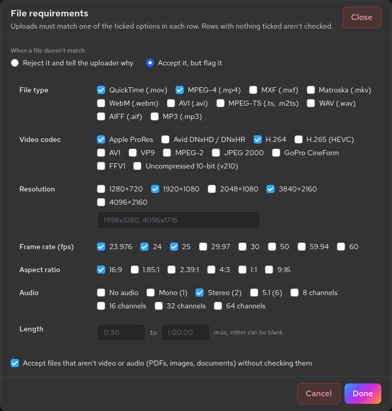

Your client sees the rules on the upload page before they send anything. You can change the rules later in the link's **Details → Edit → Uploads**.

---

## 20. Working with several servers ⭐

### Can I be connected to more than one server?

Yes, in the desktop app. Once you're signed in to one server, open the **server switcher** at the top of the screen and add another.

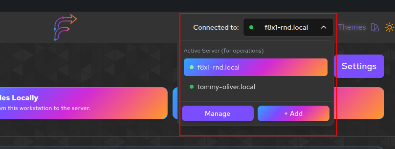

### How do I choose which server I'm working on?

Pick it in the server switcher at the top. Whatever you do next (new projects, links, uploads) happens on that server.

### Can I see links from all my servers in one list?

Yes. Use **Show links from → All Servers**. Each link shows which server it's on.

---

## 21. Settings worth knowing about

Click **Settings** at the top of the screen.

| Where | What it's for |
|---|---|
| **New link defaults** | Starting choices for new links: invite-only or not, comments, proxy files, watermark. |
| **Share addresses** | The web address your links use, plus No-IP setup ⭐. |
| **Internet sharing** | A green / yellow / red check that internet links will work. |
| **HTTPS certificate** | A free trusted certificate, so nobody sees browser warnings. |
| **Branding** ⭐ | Your logo, colours and company name. |
| **Preferences** | Time format, which links you see first, notifications. |
| **Two-step sign-in** | Require an authenticator code for staff sign-ins. |
| **Video processing** | Let your own computer prepare videos (desktop app only). |
| **Server health** | How busy the server is, and its license status (enter a renewed key here if your license expired). |
| **Email (SMTP)** | Lets 45Flow send link emails (admins only). |
| **Go Pro** | Start a trial or enter a license key (unlicensed and trial servers). |
| **Help & tours** | Open the full user guide, or turn the on-screen tips on or off. |

Click **Save** after changing anything. New settings apply to **new** links, not ones you've already made.

---

## 22. Updating 45Flow

### How do I update the desktop app? ⭐

Pro updates are automatic:

1. A pop-up appears in the bottom-right corner when a new version is ready.
2. Click **Download Update**.
3. When it's done, click **Restart & Install**.

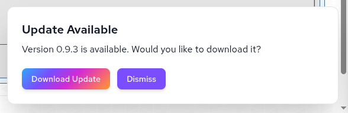

**Linux `.deb` or `.rpm` users:** the update downloads to your Downloads folder, and 45Flow shows you the exact command to paste into a terminal.

> Automatic updates need an **active** license. On an expired license (**Pro — Legacy**) or Community, download new versions from the [Releases page](https://github.com/45Drives/45flow/releases) instead.

### How do I update the web app?

You don't. It updates on the server. Just reload the page.

### How does the server get updated?

When a new version of the server software is ready, whoever manages 45Flow sees a **Server Update Available** message with an **Update** button. Click it. You're signed out for a minute or two while the server updates, then you can sign back in. On **Pro — Legacy**, server updates are paused until you renew.

---

## 23. Something's not working

### My server isn't in the "Choose a server" list.

Type the server's address into **"Or enter the server address"** instead.

### Sign-in fails the first time.

- Check the username and password.
- The first sign-in needs an account that can install software (`root` or a "sudo" account).
- Make sure SSH is on and the server has internet access.

### I can't open the web app.

| What you see | What to do |
|---|---|
| "Your connection is not private" | Normal on an office server. Check the address and continue. |
| "The 45Flow web app is a Pro feature" | Turn on Pro in the desktop app, or your trial has ended. |
| "403 Forbidden" or a blocked page | You're not in the office or on the VPN. Connect to the VPN. |
| "404 Not Found" | Pro was just turned on. Wait about 15 minutes and try again. |
| "You were signed out after a period of inactivity" | Normal. Sign in again. |

### My client can't open an internet link.

1. Check **Settings → Internet sharing**. Fix anything yellow or red, or click **Repair Public Sharing**.
2. Make sure port **443** is forwarded on your router.
3. Make sure the link isn't **expired** or **disabled**.

### My branding isn't showing.

Check **Settings → Branding** is switched on and saved. If your license expired and you're not on Pro — Legacy, client pages go back to the normal 45Flow look.

### A Pro feature disappeared.

Check the top of the app. If it says **Community Edition**, your trial or license has ended. Go to **Settings → Go Pro** to add a key.

### A video is stuck on "Processing".

Big videos take a while. Watch the **Transfer Dock**. If it failed, open the link's **Details → Files** and click **Retry**.

### Where can I see what went wrong?

Click **Activity Log** at the top and look for anything marked **Error**. In the browser, click **Download** on the **Browser Logs** tab to save a copy for support.

### I deleted a link by mistake. Are my files gone?

No. Deleting a link or a project **never** deletes your original files.

---

*Need more detail? See the full [45Flow User Guide](45Flow_User_Guide.md). Pro customers get priority support from 45Drives at [45drives.com](https://www.45drives.com).*
