<p align="center">
  
</p>

# 45Flow User Guide

Welcome to **45Flow** — the secure file sharing and collaboration platform by 45Drives. This guide walks you through installing the application, connecting to your server, and using every feature from start to finish.

Server administrators should also read the [security and server administration
guides](security/README.md) for credential handling, network boundaries, storage
configuration, upgrades and rollback.

## About 45Flow Editions

45Flow is available in two modes:

- **Community Edition** — Free, on any unlicensed server. Includes everything you need to share and review: review and upload links, projects, clients, teams and roles, video playback with proxy files, timecoded comments and replies, approvals, basic watermarks, PDF markup, malware scanning, email, two-step sign-in for staff, and the full audit log.
- **Pro Edition** — Unlocked when your server is licensed. Adds the browser web app, custom branding (white label), advanced and text watermarks, personal watermarked copies, file requirements for uploads, drawing on video and image frames, resolving feedback, the comment review panel and exports, side-by-side version comparison, multi-server management, No-IP hostname setup, automatic app updates, and priority support.

**The app works the same way for everyone** — it starts in Community mode and automatically upgrades to Pro when connected to a licensed server. There are no separate downloads. When the server is unlicensed, Pro features are hidden or disabled.

**Licensing is server-side** — your 45Flow license belongs to your server, not to individual users. Once a server is licensed, everyone who signs in to it gets Pro, and so do the clients opening its links.

### Feature Comparison

| Feature | Community | Pro |
|---------|:---------:|:---:|
| **Links & Projects** | | |
| Review links (single file or collection) | ✅ | ✅ |
| Upload links | ✅ | ✅ |
| Review + Upload links | ✅ | ✅ |
| Expiry, password protection, invite-only access | ✅ | ✅ |
| Projects | ✅ | ✅ |
| Email links and invitations | ✅ | ✅ |
| Web app (use 45Flow in a browser on your LAN/VPN) | ❌ | ✅ |
| Multi-server management (desktop) | ❌ | ✅ |
| No-IP hostname setup | ❌ | ✅ |
| **Uploads & Transfers** | | |
| Add Files, QuickShare and client upload links | ✅ | ✅ |
| Malware scanning of uploads | ✅ | ✅ |
| File requirements for uploads (type, codec, resolution, frame rate, aspect ratio, audio, length) | ❌ | ✅ |
| Client-side transcoding (GPU/CPU, desktop) | ✅ | ✅ |
| Transfer Dock with progress tracking | ✅ | ✅ |
| **Review & Playback** | | |
| Video player with adaptive streaming and proxy files | ✅ | ✅ |
| PDF, image, audio and Office document previews | ✅ | ✅ |
| Version history and forks | ✅ | ✅ |
| Side-by-side version comparison | ❌ | ✅ |
| **Watermarking** | | |
| Image watermark on videos and images (bottom-right) | ✅ | ✅ |
| Position, scale, opacity, rotation and presets | ❌ | ✅ |
| Text watermarks | ❌ | ✅ |
| Personal watermarked copies (one per invited recipient) | ❌ | ✅ |
| **Feedback & Approvals** | | |
| Timecoded comments, replies and categories | ✅ | ✅ |
| Approve / request changes / reject, with decision history | ✅ | ✅ |
| Drawing on PDF pages | ✅ | ✅ |
| Drawing on video frames and images | ❌ | ✅ |
| Resolving and reopening feedback | ❌ | ✅ |
| Comment review panel and export (PDF, CSV, Markdown, EDL, WebVTT, JSON) | ❌ | ✅ |
| Feedback notifications in the app, staff alert emails, guest email updates | ✅ | ✅ |
| **Branding & Customization** | | |
| Custom branding: logo, favicon, colours, themes, fonts, welcome message, footer, link previews, custom CSS | ❌ | ✅ |
| **Administration & Security** | | |
| Client, team and role management | ✅ | ✅ |
| Two-step sign-in for staff | ✅ | ✅ |
| Server health, maintenance and storage settings | ✅ | ✅ |
| Activity and tamper-evident audit log | ✅ | ✅ |
| Scanning & privacy (outbound calls, quarterly account review) | ✅ | ✅ |
| HTTPS certificates (Let's Encrypt) | ✅ | ✅ |
| Server (Broadcaster) update prompts | ✅ | ✅ |
| Automatic desktop app updates | ❌ | ✅ |

> **Note:** In-app desktop updates need an active license. Community users install new versions by downloading them from the [Releases page](https://github.com/45Drives/45flow/releases). See [Automatic Updates](#21-automatic-updates).

---

## Table of Contents

1. [System Requirements](#1-system-requirements)
   - [Client App — 45Flow Community / Pro](#client-app--45flow-community--pro)
   - [Server — houston-broadcaster](#server--houston-broadcaster)
   - [Required Server System Packages](#required-server-system-packages)
2. [Installation](#2-installation)
   - [macOS](#macos)
   - [Windows](#windows)
   - [Linux](#linux)
3. [Getting Started — Connecting to Your Server](#3-getting-started--connecting-to-your-server)
   - [Logging In](#logging-in)
   - [Signing In with Two-Step Sign-In](#signing-in-with-two-step-sign-in)
   - [First-run server setup](#first-run-server-setup)
   - [Automatic Server Discovery](#automatic-server-discovery)
   - [Entering the Server Address](#entering-the-server-address)
   - [Custom Port Configuration](#custom-port-configuration)
   - [License Status & Activation](#license-status--activation)
4. [Port Forwarding for External Sharing](#4-port-forwarding-for-external-sharing)
   - [Setting Up a Public Address](#setting-up-a-public-address)
5. [Projects — Organizing Your Workspace](#5-projects--organizing-your-workspace)
   - [What Are Projects](#what-are-projects)
   - [Links Without a Project](#links-without-a-project)
   - [The Project Workflow](#the-project-workflow)
   - [Creating a Project](#creating-a-project)
   - [Managing Projects](#managing-projects)
6. [Dashboard Overview](#6-dashboard-overview)
   - [Top Bar](#top-bar)
   - [Notifications](#notifications)
   - [Main Action Buttons](#main-action-buttons)
   - [Links Table](#links-table)
   - [Logging Out](#logging-out)
7. [Settings](#7-settings)
   - [New Link Defaults](#new-link-defaults)
   - [Share Addresses](#share-addresses)
   - [Internet Sharing](#internet-sharing)
   - [HTTPS Certificate](#https-certificate)
   - [Preferences](#preferences)
   - [Video Processing](#video-processing)
   - [Two-step Sign-in](#two-step-sign-in)
   - [Server Health](#server-health)
   - [Maintenance](#maintenance)
   - [Storage](#storage)
   - [Staff Users](#staff-users)
   - [Upload Security](#upload-security)
   - [Watermarks](#watermarks)
   - [File Browsing](#file-browsing)
   - [Admin Networks](#admin-networks)
   - [Email (SMTP)](#email-smtp)
   - [Scanning & Privacy](#scanning--privacy)
   - [Help & Tours](#help--tours)
   - [Go Pro — License Activation](#go-pro--license-activation)
8. [Custom Branding (White Label) — Pro Feature](#8-custom-branding-white-label--pro-feature)
   - [Identity](#identity)
   - [Look](#look)
   - [Page Content](#page-content)
   - [Custom CSS](#custom-css)
   - [How Branding Appears to Recipients](#how-branding-appears-to-recipients)
9. [Drag and Drop QuickShare](#9-drag-and-drop-quickshare)
   - [How to Use QuickShare](#how-to-use-quickshare)
   - [QuickShare Options](#quickshare-options)
   - [After Creating a QuickShare Link](#after-creating-a-quickshare-link)
10. [Creating Links — Review, Upload, or Both](#10-creating-links--review-upload-or-both)
    - [What Kind of Link Is It?](#what-kind-of-link-is-it)
    - [Files to Share](#files-to-share)
    - [Details](#details)
    - [Link Access Mode](#link-access-mode)
    - [Video and Media Options](#video-and-media-options)
    - [Watermark Settings — Video and Image Support](#watermark-settings--video-and-image-support)
    - [Text Watermarks (Pro)](#text-watermarks-pro)
    - [Personal Watermarked Copies (Pro)](#personal-watermarked-copies-pro)
    - [File Requirements for Uploads (Pro)](#file-requirements-for-uploads-pro)
    - [Emailing the Link](#emailing-the-link)
    - [Generating the Link](#generating-the-link)
11. [Add Files](#11-add-files)
    - [Add Files to the List](#add-files-to-the-list)
    - [Check Where the Files Go](#check-where-the-files-go)
    - [Media Options](#media-options)
    - [Upload & Monitor Progress](#upload--monitor-progress)
12. [Transfer Dock](#12-transfer-dock)
    - [Transfer Dock Overview](#transfer-dock-overview)
    - [Transfer Entry Details](#transfer-entry-details)
    - [Transcode Status](#transcode-status)
13. [Managing Links](#13-managing-links)
    - [Searching & Filtering Links](#searching--filtering-links)
    - [Link Table Columns](#link-table-columns)
    - [Link Actions](#link-actions)
14. [Link Details](#14-link-details)
    - [Overview](#overview)
    - [Files](#files)
    - [Review](#review)
    - [Activity](#activity)
    - [Versions](#versions)
    - [Forks and Comparing Versions](#forks-and-comparing-versions)
    - [Comments Review & Export](#comments-review--export)
15. [Editing a Link](#15-editing-a-link)
16. [Accessing a Shared Link](#16-accessing-a-shared-link)
    - [Opening the Link](#opening-the-link)
    - [Password-Protected Links](#password-protected-links)
    - [Invite-Only Links](#invite-only-links)
    - [Staff Sign-In on a Share Page](#staff-sign-in-on-a-share-page)
    - [Upload Pages](#upload-pages)
17. [Video Player, Comments & Annotations](#17-video-player-comments--annotations)
    - [The Share Page](#the-share-page)
    - [Playback Controls](#playback-controls)
    - [Quality Selection](#quality-selection)
    - [Timecoded Comments](#timecoded-comments)
    - [Approving a Version](#approving-a-version)
    - [Annotations & Drawing Tools](#annotations--drawing-tools)
    - [PDFs, Images and Documents](#pdfs-images-and-documents)
    - [Multi-File Shares](#multi-file-shares)
18. [Client Access](#18-client-access)
    - [Viewing Existing Clients](#viewing-existing-clients)
    - [Adding a Client](#adding-a-client)
    - [Managing Teams](#managing-teams)
    - [Editing & Deleting Clients](#editing--deleting-clients)
19. [Role Management](#19-role-management)
    - [Built-in Roles](#built-in-roles)
    - [Permission Definitions](#permission-definitions)
    - [Creating Custom Roles](#creating-custom-roles)
    - [Editing & Deleting Roles](#editing--deleting-roles)
20. [Multi-Server Management](#20-multi-server-management)
    - [Adding Servers](#adding-servers)
    - [Switching Active Server](#switching-active-server)
    - [Server Filter (All Servers View)](#server-filter-all-servers-view)
21. [Automatic Updates](#21-automatic-updates)
    - [Update Notifications](#update-notifications)
    - [Downloading & Installing Updates](#downloading--installing-updates)
    - [Linux Package Updates](#linux-package-updates)
22. [Activity Log](#22-activity-log)
    - [Client Logs](#client-logs)
    - [Server Logs (Audit Log)](#server-logs-audit-log)
    - [Multi-Server Log Viewer](#multi-server-log-viewer)
    - [Searching & Filtering Logs](#searching--filtering-logs)
23. [Using 45Flow in a Browser](#23-using-45flow-in-a-browser)
    - [Opening the Web App](#opening-the-web-app)
    - [Signing In and Out](#signing-in-and-out)
    - [Staying Signed In](#staying-signed-in)
    - [What Works in the Browser](#what-works-in-the-browser)
    - [What Needs the Desktop App](#what-needs-the-desktop-app)
    - [Browser Logs](#browser-logs)
    - [For Administrators: Hosting the Web App](#for-administrators-hosting-the-web-app)
    - [Troubleshooting the Web App](#troubleshooting-the-web-app)
24. [Frequently Asked Questions](#24-frequently-asked-questions)

---

## 1. System Requirements

### Client App — 45Flow Community / Pro

| Component | Minimum | Recommended |
|-----------|---------|-------------|
| **OS** | Linux Ubuntu 20.04+, Windows 10 64-bit, macOS 11+ (Intel or Apple Silicon) | Latest LTS / latest supported release for each OS |
| **CPU** | Dual-core x86_64 or Apple Silicon | 4+ cores |
| **RAM** | 4 GB | 8 GB; 16 GB if doing client-side transcoding of large files |
| **Disk** | 500 MB for app install | 500 MB for app install, plus 1.5× source video size as temporary space during client-side transcodes |
| **GPU** | Not required; CPU transcoding works | NVIDIA GTX 1060+ with NVENC, Intel 6th-gen+ with QSV, or Apple Silicon with VideoToolbox for hardware-accelerated client-side transcoding |
| **Network** | LAN access to server | Gigabit LAN for large file uploads |

> **Note:** The client app is built with Electron and is Chromium-based, so any machine that can run a modern browser should be able to run the app. Client-side transcoding is optional — if disabled, the server handles transcoding instead.

### Server — houston-broadcaster

| Component | Minimum | Recommended |
|-----------|---------|-------------|
| **OS** | Ubuntu 20.04+ (Focal/Jammy) or Rocky Linux 8/9 (RHEL-compatible) | Ubuntu 22.04 LTS or Rocky Linux 9 |
| **CPU** | 2 cores x86_64 | 4–8+ cores; transcoding is CPU-intensive, more cores allow more concurrent transcode jobs |
| **RAM** | 2 GB | 8–16 GB; FFmpeg transcoding uses approximately 1–2 GB per concurrent 1080p job |
| **Disk** | Enough storage for source media plus transcoded proxy files; approximately 2–3× source size per link when proxy files are generated | Fast SSD/NVMe for the database and transcode scratch space; bulk media storage on ZFS/spinning disk is fine |
| **GPU** | Not required | Intel QSV (6th-gen+ iGPU), NVIDIA with driver, or VAAPI for significantly faster server-side transcodes |
| **Network** | 1 Gbps LAN | 10 Gbps if serving many concurrent viewers/uploads |
| **Node.js** | 20+ | 20 LTS |

### Required Server System Packages

These packages are automatically installed by the houston-broadcaster software:

| Package | Purpose |
|---------|---------|
| **ffmpeg** | Video/audio transcoding and media processing |
| **nginx** | Web server / reverse proxy |
| **sqlite3** | Local database support |
| **openssl** | TLS, certificates, and crypto utilities |
| **avahi-daemon** | Local network discovery / mDNS |
| **pamtester** | PAM authentication testing |
| **python3** | Supporting scripts and tooling |
| **dbus** | System service communication |
| **iproute2** | Network interface and routing utilities |
| **clamav** | Antivirus / malware scanning support |
| **ca-certificates** | Trusted certificate bundle |
| **curl** | HTTP requests and install/runtime utilities |

---

## 2. Installation

Download the latest version of 45Flow from the **[Releases page](https://github.com/45Drives/45flow/releases)**. Under the **Assets** section of the latest release, download the file matching your operating system.

### macOS

| Chip | File to Download |
|------|-----------------|
| Apple Silicon (M1, M2, M3, M4…) OR Intel | `45Flow-*-mac-universal.dmg` |

1. Double-click the downloaded `.dmg` file.
2. In the window that appears, drag the **45Flow** icon into the **Applications** folder.
3. Open **45Flow** from your Applications folder or Launchpad.

> **Tip:** If macOS warns the app is from an unidentified developer, go to **System Preferences → Security & Privacy** and click **Open Anyway**.

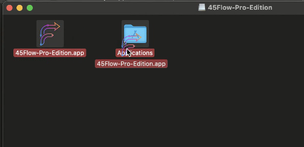

### Windows

| File to Download |
|-----------------|
| `45Flow-*-win-x64.exe` |

1. Double-click the downloaded `.exe` installer.
2. Follow the on-screen installation wizard steps.
3. Once complete, launch **45Flow** from the Start Menu or Desktop shortcut.

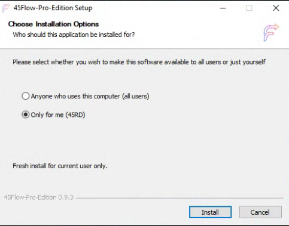

### Linux

Three package formats are available:

| Distribution | File | Install Command |
|-------------|------|-----------------|
| Ubuntu / Debian | `45Flow-*-linux-amd64.deb` | `sudo apt install ./45Flow-*-linux-amd64.deb` |
| Rocky / RHEL / Fedora | `45Flow-*-linux-x86_64.rpm` | `sudo dnf install ./45Flow-*-linux-x86_64.rpm` |
| Any Linux (portable) | `45Flow-*-linux-x86_64.AppImage` | No installation required |

**DEB / RPM Installation:**

1. Download the appropriate package file for your distribution.
2. Open a terminal and run the install command above, replacing `*` with the version number.
3. Launch **45Flow** from your application menu.

**AppImage (Portable):**

The AppImage is a self-contained portable executable that runs on any modern x86_64 Linux distribution without installation.

1. Download the `.AppImage` file.
2. Make it executable: `chmod +x 45Flow-*-linux-x86_64.AppImage`
3. Double-click the file or run it from the terminal: `./45Flow-*-linux-x86_64.AppImage`

The AppImage requires no root privileges and does not modify your system. It supports automatic updates — when a new version is available, the app will download and replace itself in place.

> **Tip:** Move the AppImage to a convenient location like `~/Applications/` or `/opt/` for easy access. You can also right-click → "Create Desktop Entry" in many file managers.

---

## 3. Getting Started — Connecting to Your Server

When you first open 45Flow, you'll see the **Login Screen**: a single card titled **"Sign in to 45Flow"**. This is where you connect the desktop client to your 45Drives server.

The card has two sections:

- **Login** — your **Username**, **Password**, and (desktop app only) **"Remember my password on this computer"**.
- **Server** (desktop app only) — the server to connect to: the **"Choose a server"** dropdown, the **"Or enter the server address"** box, and the collapsible **"Advanced: custom ports"** settings.

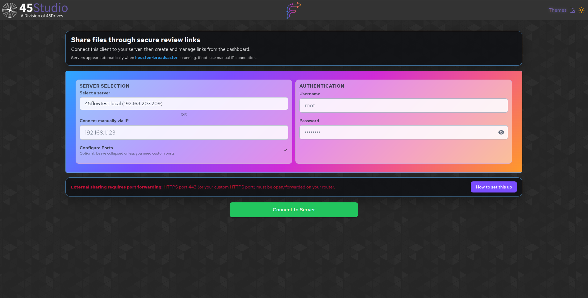

### Logging In

1. Enter your server **Username** (e.g., `root`).
2. Enter your **Password**.
3. *(Optional, desktop app only)* Check **"Remember my password on this computer"** so you don't have to type it next time.
4. In the **Server** section, choose your server from the dropdown or enter its address (see below).
5. Click **"Sign In"**.

The app will display status messages as it connects:
- *"Preparing SSH…"*
- *"Bootstrapping…"*
- *"Checking server health…"*
- *"Verifying the server certificate…"*

On success, you'll be taken to the **Projects** screen.

### Signing In with Two-Step Sign-In

If your administrator has turned on two-step sign-in for staff (see [Two-step sign-in](#two-step-sign-in)), an **Authenticator code** box appears after you enter your password:

1. Open the authenticator app on your phone (for example Google Authenticator, Microsoft Authenticator or 1Password).
2. Type the 6-digit code shown for 45Flow, or one of your **recovery codes** if you don't have your phone.
3. Click **Sign In**.

Each code works once. Five wrong codes lock the account for 15 minutes.

Not set up yet? Click **Set up two-step sign-in** under the password box. You re-enter your password, then either **Ask a 45Flow administrator** to approve you, or **Use a code issued on the server** by an administrator. After approval, scan the QR code with your authenticator app and save your recovery codes somewhere safe.

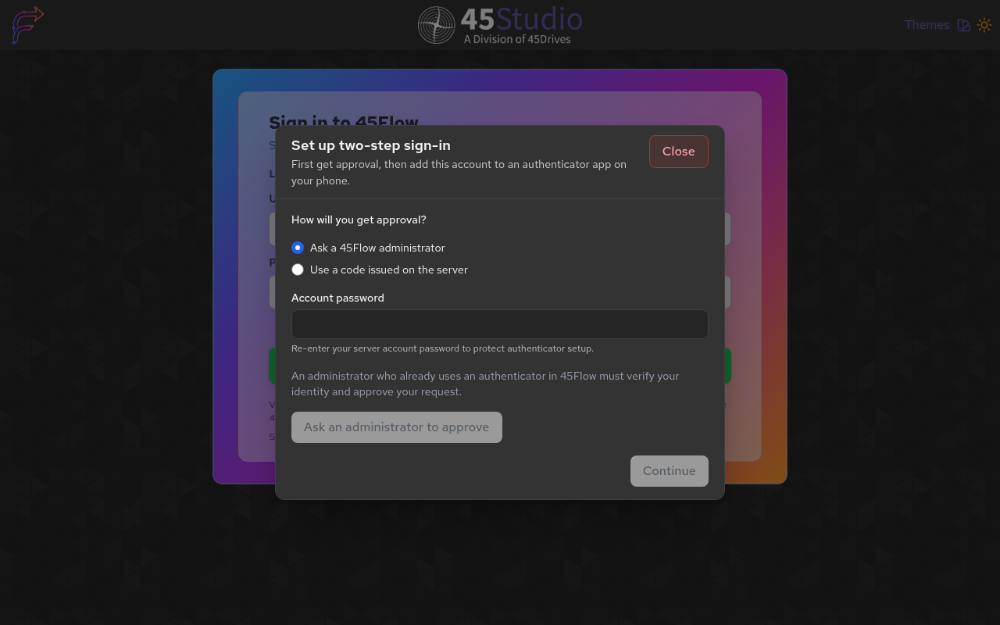

> **Note:** Two-step sign-in applies to staff (server accounts) only. Clients signing in to invite-only links never need an authenticator.

### First-run server setup

On a new server, administrators see the **Set up 45Flow** wizard before opening projects. An existing server with configured storage and at least one project goes straight to Projects. Other users see "Server setup is not finished. Ask your administrator" until the server is ready.

Older servers without setup support remain usable and show an update notice. Update Broadcaster to use the storage and staff-account setup controls.

The wizard has four steps. The step counter at the top shows where you are (for example *Step 2 of 4*).

1. **Storage** *(required)* — The main folder that holds every project. Choose a detected filesystem, then browse to a folder, or click **New Folder** to make one. ZFS filesystems appear first. Existing network mounts are labelled **Network**; 45Flow does not create mounts or store mount credentials. The system root itself cannot be selected.
2. **Staff users** — Add or remove existing server accounts that may administer 45Flow. These are separate from client accounts. You cannot remove yourself or the last staff member.
3. **Sharing settings** — Enter the **Public share address** (for example `https://files.example.com`) and click **Save address**, or click **Use automatic address**. **Test internet access** checks that people outside your network can reach the server. **Advanced: HTTPS certificate** sets up a free Let's Encrypt certificate.
4. **Projects** *(required)* — Create at least one project and choose its folder inside the storage location. On a server that already has projects, this step lists them so you can edit or remove them. Click **Finish setup** when done.

Steps 2 and 3 can be skipped with **Skip for now** and changed later in Settings. Upload scanning and the shared watermark folder are set in **Settings → Upload security** and **Settings → Watermarks**. Setup remembers your current step for this server in the current app or browser session, including after reconnecting. Guided tours wait until setup finishes.

Choosing a storage location restarts the server. Keep the setup window open while it reconnects. If it cannot reconnect automatically, check the server connection and choose **Check again**.


At the bottom of the card:

- **First-time setup** needs an account with **sudo** or **root** access, so 45Flow can install what it needs on the server.
- **"Set up port forwarding"** opens step-by-step help for sharing with clients outside your network. See [Port Forwarding](#4-port-forwarding-for-external-sharing).

### Automatic Server Discovery

If your server is running the **houston-broadcaster** service on the same network, it will appear automatically in the **"Choose a server"** dropdown. Each entry shows the server's hostname and IP address. While 45Flow is still searching, the dropdown shows *"Looking for servers on your network…"*.

Simply select your server from the dropdown to populate the connection.

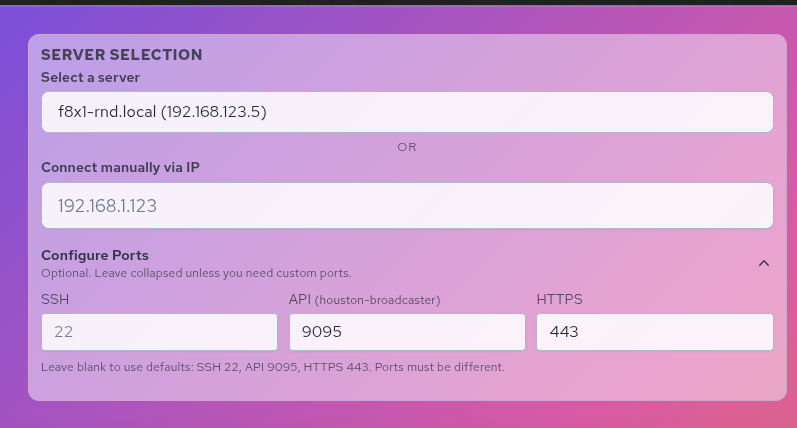

> **Note:** If no servers appear, the houston-broadcaster service may not be running, or you may be on a different subnet. Enter the server address instead, as described below.

### Entering the Server Address

If your server doesn't appear automatically:

1. Find the **"Or enter the server address"** box in the **Server** section.
2. Enter your server's IP address (e.g., `192.168.1.123`).

### Custom Port Configuration

In most cases, the default ports work without changes. If your server uses non-standard ports, click **"Advanced: custom ports"** to expand the port settings:

| Port | Default | Purpose |
|------|---------|---------|
| **SSH** | 22 | Secure shell communication, server setup, and verifying the server's HTTPS certificate |
| **Setup API** | 9095 | Finding and setting up the server |
| **HTTPS** | 443 | The app's encrypted connection to the server; share links, upload links, external access |

The app signs in and does all of its work over the HTTPS port, so that port must be reachable from your computer. It trusts the server's certificate, including the default self-signed one, by reading it over SSH; if the certificate cannot be verified, or the HTTPS port cannot be reached, the app does not connect rather than fall back to an unencrypted connection. Servers saved by an earlier version move to HTTPS automatically.

> **Important:** For external sharing the HTTPS port (443 by default) must be open/forwarded on your router. See [Port Forwarding](#4-port-forwarding-for-external-sharing) for details.

### License Status & Activation

After connecting to your server, 45Flow automatically checks the server's license status in the background. **Login is never blocked** — you can start using the app immediately, even if the server is unlicensed.

#### Community vs Pro Mode

- **Unlicensed server** — The app runs in Community mode. Pro features (custom branding, advanced watermarks, client-side comment review/export workflows, annotations, side-by-side version comparison) are hidden or disabled. The window title shows "45Flow (Community Edition)".

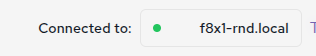

- **Licensed server** — The app automatically upgrades to Pro mode. All Pro features become available. The window title shows "45Flow (Pro Edition)".
- **Trial license** — If your server has an active trial license, the app shows "Pro Trial — X days left" in the header. When the trial expires, the app reverts to Community mode.

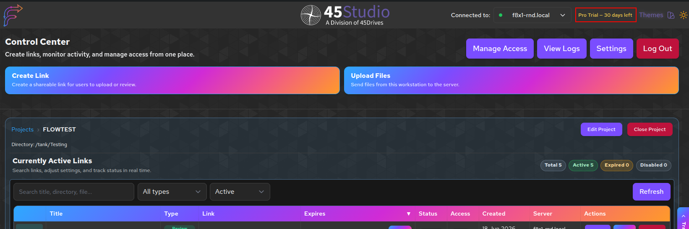

- **Pro — Legacy (expired license)** — If your server was previously licensed but the license has since expired, the app enters a "Pro — Legacy" state. In this mode:
    - All Pro features **you had at the time of expiry remain accessible** (branding, watermarks, client-side comment review/export workflows, annotations — whatever was available in the version you last updated to)
  - The window title shows "45Flow (Pro — Legacy)"
  - **Automatic updates are disabled** — you will not receive new app versions, bug fixes, or future Pro features until the license is renewed
  - Any **new Pro features released after your license expired will not be available** until you re-activate
  - You can re-activate a license at any time in **Settings → Go Pro** or **Settings → Server health** to restore full Pro status, unlock any new features, and resume receiving updates


> **Note:** Legacy mode ensures you are never abruptly locked out of features you already paid for. Think of it as: you keep everything your license covered, but the clock stops — no new features or updates until you renew. An active license means continuous access to every new feature and improvement as it's released.

#### Activating a License

If your server is unlicensed, you can activate a license at any time:

1. Open **Settings** from the Dashboard.
2. Navigate to **Go Pro** in the left sidebar.
3. Paste the **License Key** you received (it looks like `STUDIO-XXXX-XXXX-XXXX-XXXX`).
4. Click **"Activate License"** to validate and activate.

Once activated, the app immediately upgrades to Pro mode and all Pro features unlock.

> **Note:** Licenses are tied to the server, not individual users. Once a server is licensed, all users connecting to it automatically gain Pro features.

#### Starting a Trial

If you don't have a license key yet, open **Settings → Go Pro** and click **Start Trial** under **Start Free 30-Day Trial**. No email address is needed. Trials give you every Pro feature for 30 days.

After successful login, you'll always be directed to the **Projects** screen.

---

## 4. Port Forwarding for External Sharing

**If you plan to share links over the internet (externally), complete this step before creating any external links.** Port forwarding is not required for sharing within your local network (LAN/VPN), but it is essential for allowing anyone outside your network to access share links, upload links, or review pages.

To share files externally (over the internet), HTTPS port **443** (or your custom HTTPS port) must be forwarded from your router to your server.

**What is port forwarding?**  
Port forwarding tells your router to direct incoming traffic on a specific port to your server's local IP address, allowing people outside your network to access your share links.

**General Steps:**

1. Log into your router's admin panel (usually at `192.168.1.1` or `192.168.0.1`).
2. Find the **Port Forwarding** or **NAT** settings section.
3. Create a new rule:
   - **External port:** 443 (or your custom HTTPS port)
   - **Internal IP:** Your server's local IP address
   - **Internal port:** 443 (or your custom HTTPS port)
   - **Protocol:** TCP
4. Save the rule and test using the **"Check Port"** button in the 45Flow link creation screen.

> **Note:** Port forwarding configuration varies by router manufacturer and model. Some ISPs or shared building networks may restrict port forwarding. If you're unsure whether your network supports it, contact your ISP or network administrator.

**Set up port forwarding** on the sign-in screen opens **How to port forward**, a step-by-step guide: find the server's local IP, log into your router, add the rule, and test from outside your network.

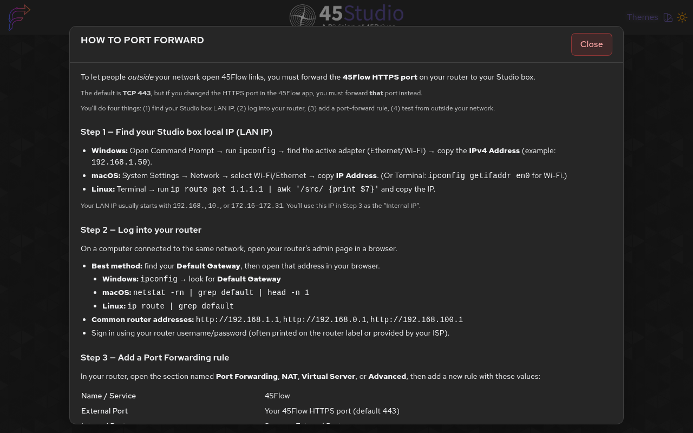

> **Tip:** After setting up port forwarding, set the internet address in [Settings → Share Addresses](#share-addresses) so links are generated correctly.

> **Important:** If you only plan to share files within your LAN or VPN, you can skip this step entirely. Links shared locally do not require port forwarding.

### Setting Up a Public Address

Internet links need a **hostname** (a name such as `share.yourstudio.com`) with a **trusted HTTPS certificate**. 45Flow never puts your server's IP address in an internet link, and it won't create or copy one until both are ready. Local Network links don't need any of this.

Open **Settings → Share addresses**. The **Set up a public address** steps at the top walk you through it:

**1. Get a hostname.** Pick one of these:

- **My own domain.** At your domain provider (GoDaddy, Cloudflare, Namecheap and so on), add an **A record** for a name such as `share.yourstudio.com` pointing at your server's public IP. The setup screen shows the IP 45Flow detected. Type the hostname into the screen.
- **No-IP (Pro).** If you don't have a domain, create a free hostname at [noip.com](https://www.noip.com), such as `yourstudio.ddns.net`. In the setup screen, choose **No-IP (Pro)**, enter the hostname with your No-IP username (or email) and password, leave **Keep it updated** on, and click **Save No-IP**. 45Flow points the hostname at your server straight away, then updates it whenever your internet address changes (it checks every 30 minutes and only contacts No-IP when the address has changed). Click **Update now** at any time to send an update.

  Your No-IP password is stored encrypted on the server and is never shown again. To change it, type a new one and save. **Remove** deletes it and stops updates.

**2. Use it for share links.** Click **Use *hostname***. This fills in **Internet address** below with `https://` and your hostname. Click **Save**.

**3. Get a trusted certificate.** Click **HTTPS certificate** and get a free Let's Encrypt certificate for the same hostname (see [HTTPS Certificate](#https-certificate)). Port 80 must also be forwarded to the server while Let's Encrypt checks it. When the step shows **Ready**, internet links can be created and copied.

**If No-IP shows a problem:**

| Message | What to do |
|---|---|
| No-IP didn't accept the username or password | Enter them again and click **Save No-IP**. |
| That hostname isn't in this No-IP account | Check the spelling, or create the hostname on noip.com, then save. |
| No-IP had a problem on its side | Nothing to do. 45Flow tries again in 30 minutes. |
| Couldn't reach No-IP | Check the server's internet connection. 45Flow tries again at the next check. |
| No-IP updates are turned off under Scanning & privacy | An admin turned off the No-IP outbound call. Turn it back on under **Settings → Scanning & privacy**. |

Updates stop after a sign-in, hostname or blocking problem so No-IP doesn't lock your account. Saving the settings again starts them again.

> **Note:** No-IP setup is part of 45Flow Pro. Servers that had Pro before keep it after their license ends. Without Pro you can still use your own domain, or keep a No-IP hostname updated with No-IP's own update tool.

---

## 5. Projects — Organizing Your Workspace

After signing in, you always land on the **Projects** screen. Each project is a folder on your server for one job or production. Open a project to share files with clients or collect their uploads, or create a new one to get started.

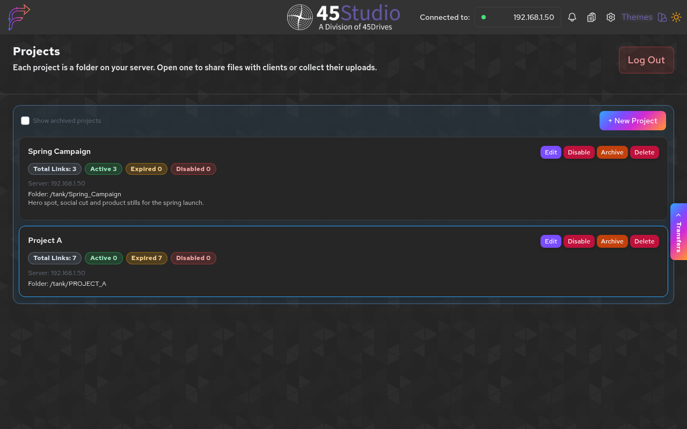

### What Are Projects

A project is a named workspace that:

- **Groups related links** — Keep all links for a client, campaign or job together in one place.
- **Has a project folder** — Each project points to a folder on your server, inside the storage location chosen during setup. When you create links or add files in a project, the file browser starts in that folder.
- **Tracks link counts** — See at a glance how many links each project has, and how many are active, expired or disabled.
- **Scopes your view** — When you open a project, only that project's links are shown.
- **Can be archived or deleted** — Archive finished projects to hide them without deleting anything, or permanently delete projects you no longer need.

### Links Without a Project

If you have older links that were created before projects (or links whose project was deleted), a collapsible **"Links Without a Project"** section appears below the project list. It only appears when such links exist. This includes:

- Older links created before projects
- Links whose project was deleted
- Links created via QuickShare without a project

Click the disclosure arrow to expand or collapse this section. These links are managed the same way as project links — you can view details, edit, disable or delete them, and move them into a project from **Edit → Details → Project**.

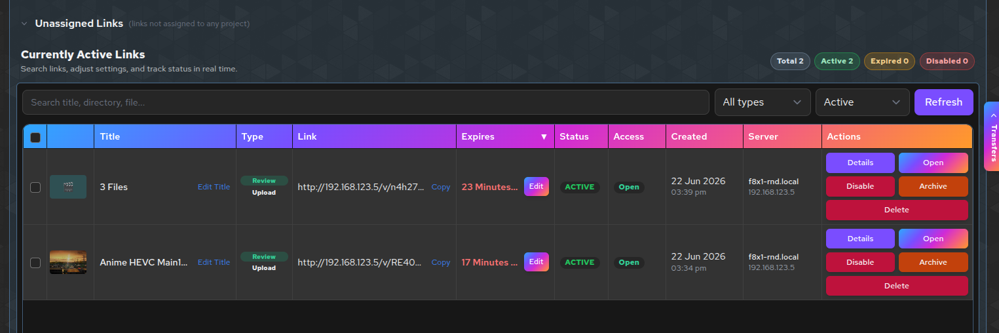

### The Project Workflow

1. **Sign in** to 45Flow.
2. **Open a project** (or create a new one) from the Projects screen.
3. **The project view loads**, showing only that project's links.
4. **Create links, add files and manage client access** — all within the open project.
5. Click **"Projects"** in the breadcrumb (or **"Back to Projects"**) to return to the project list.

### Creating a Project

From the Projects screen, click **"+ New Project"**:

1. Enter a **Project name** — for example "Spring Campaign" or "Acme Corp Review".
2. Pick the **Project folder** — the folder on the server that holds this project's media. The browser starts at the storage location (**Browse from storage root**). Click a folder to select it and see what's inside, or type its full path. Click **New Folder** to make a fresh one. Switch between **List** and **Grid** views with the buttons above the files.
3. For **.45flow folder visibility**, leave **Use server default** selected, or choose **Show .45flow** or **Hide .45flow** for this project.
4. *(Optional)* Add **Notes** — client, deliverables, anything your team should know.
5. Click **"Create Project"**. If the button is unavailable, the line beside it says what's missing (for example *"Enter a project name to continue."*).

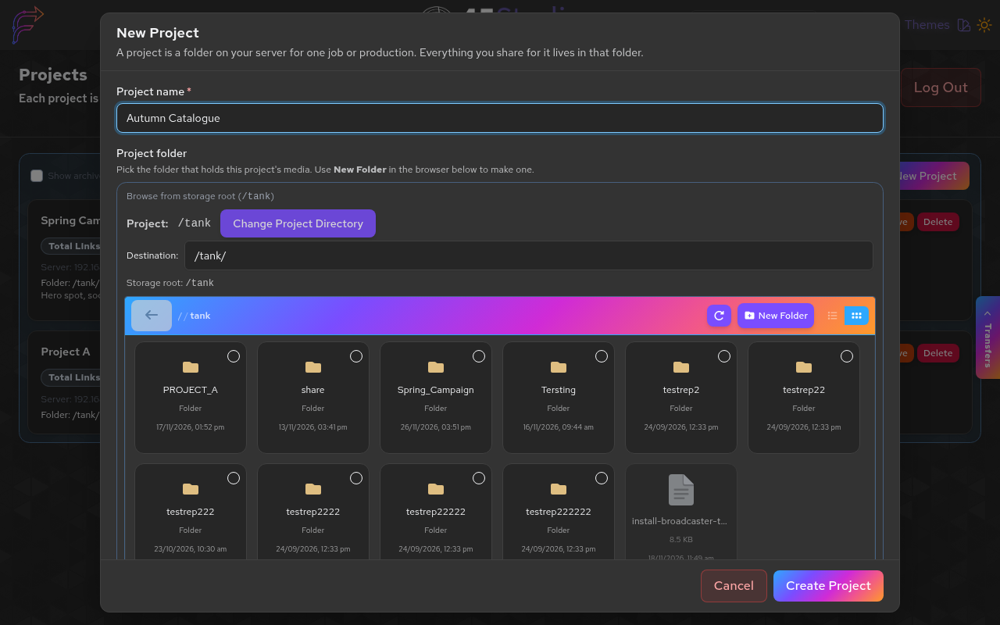

**Folder check:**

While you pick a folder, 45Flow checks it and shows what it finds:

- **On a storage pool** — A green check shows the ZFS pool the folder is on and how much space is free (for example *"On storage pool tank · 51.4 TB free of 51.4 TB"*).
- **Not on a storage pool** — A warning shows the disk the folder is on and how much space is free. Media can fill a small disk fast; if the folder is on the server's system disk, the server can stop working.
- **Low space** — A red warning appears when less than 50 GB is free or the disk is 90% or more used.
- **New folder** — If the folder doesn't exist yet, 45Flow notes that it will create it.

> **Note:** 45Flow keeps each project's proxy files and streams in a hidden `.45flow` folder inside the project folder. Links that are not in a project use the `.45flow` folder in the storage location (see [Storage](#storage)).

> **Tip for administrators:** Create project folders from 45Flow (**New Folder**) rather than over SSH as `root`. The server software runs as its own service account and must be able to write inside the folder; a folder it can't write to makes video processing fail with *"Permission denied"*.

Once created, the new project opens immediately.

### Managing Projects

**Viewing Projects:**

Projects appear as cards. Each card shows:

- Project name
- Link count badges: **Total Links**, **Active** (green), **Expired** (amber), **Disabled** (red)
- **Server** the project is on
- **Folder:** the project folder path
- Notes (if provided)

Check **"Show archived projects"** above the cards to include archived projects. When you have many projects, use the Previous/Next controls at the bottom to page through them.

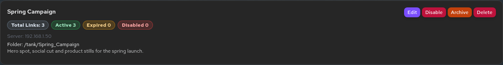

**Project Card Actions:**

Each card has buttons in its top-right corner (these don't open the project):

| Button | Description |
|--------|-------------|
| **Edit** | Opens the Edit Project dialog (see below). |
| **Disable / Enable** | Disables the project and all its links, or re-enables them. No files or links are deleted. |
| **Archive** | Disables all links and hides the project from the default view. Available on active projects. |
| **Unarchive** | Restores an archived project and re-enables its links. Available on archived projects. |
| **Delete** | Permanently removes the project (see below). |

**Editing a Project:**

Click **"Edit"** on a project card, or open the project and click **"Edit Project"** above its links. You can change the **Project Name**, **Project Folder** (with the same folder check as when creating), **.45flow folder visibility** and **Notes**. Choose **Use server default** to clear a project override. The dialog also has Archive/Unarchive and Delete Project buttons.

**Archiving a Project:**

Click **"Archive"**. The confirmation explains what happens:

- All active links in the project are **disabled**
- The project is hidden from the default project list
- **No files or links are deleted**
- You can unarchive at any time to restore everything

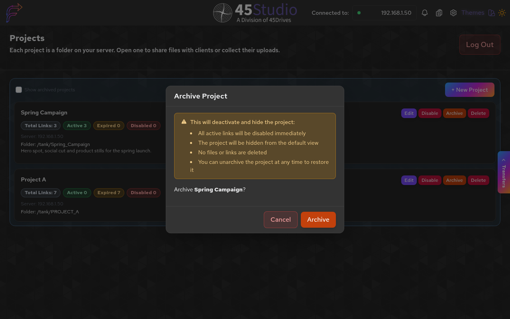

**Restoring an Archived Project:**

Check **"Show archived projects"**. Archived projects appear dimmed with an "Archived" badge. Click **"Unarchive"** to restore the project and re-enable its links.

**Deleting a Project:**

Click **"Delete"** on a card or **"Delete Project"** in the Edit Project dialog. The **Delete Project** dialog warns that this can't be undone:

- The project and all its details are permanently removed
- All links are unlinked from the project and move to **Links Without a Project** — unless you tick **"Delete all N link(s) in this project"**, which permanently removes those links, their activity history and access permissions. When you delete the links, you can also tick **Delete generated files** (proxy files, streams and watermarked copies); type **DELETE** to confirm that.

Original files in the project folder are never deleted. Click **"Delete Permanently"** to confirm.

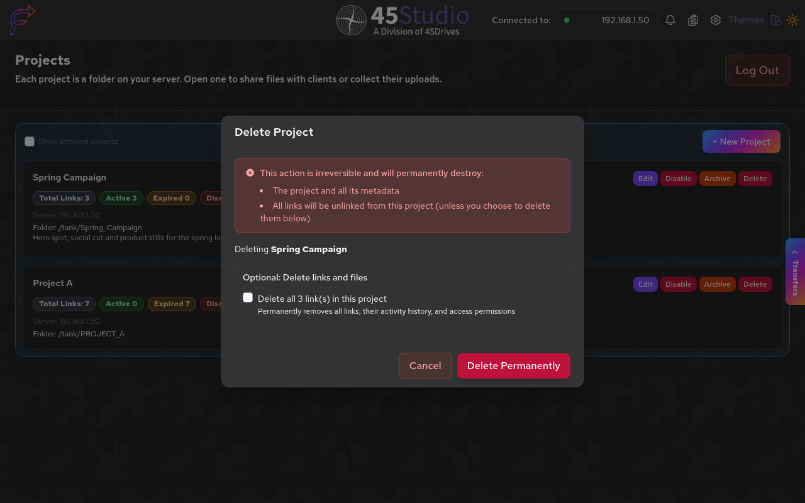

---

## 6. Dashboard Overview

The **Dashboard** is your central hub. It has two views:

- **Projects screen** — The project list, with **"+ New Project"**, **"Show archived projects"** and (when any exist) the **Links Without a Project** section.
- **Project view** — Opens when you click a project. The header shows a **"Projects ›"** breadcrumb, the project name, and **"Project folder:"** with the folder path and notes. Below are the action cards and the project's links.


### Top Bar

The bar across the top of every screen has:

| Item | Description |
|------|-------------|
| **Connected to:** | The server you are working on, with a green dot while connected. In the desktop app with Pro, click it to switch servers (see [Multi-Server Management](#20-multi-server-management)). Hidden on phone-sized screens. |
| **License chip** | Appears only when relevant: **Pro Trial — N days left**, **Trial Expired**, or **License Expired** (Pro — Legacy). |
| **Notifications** (bell icon) | Notification history and client feedback (see below). |
| **Activity Log** (clipboard icon) | Open the log viewer to see what the app and server have been doing. See [Activity Log](#22-activity-log). |
| **Settings** (gear icon) | Server and app settings. See [Settings](#7-settings). |
| **Themes** and the sun/moon icon | Change the colour theme and switch between light and dark mode. |

On the page itself:

| Button | Description |
|--------|-------------|
| **Client Access** | Add client accounts, organize them into teams and manage roles. Shown inside a project. See [Client Access](#18-client-access). |
| **Log Out** | Sign out and return to the sign-in screen. |

### Notifications

The **bell** shows a red badge with the number of unread notifications ("9+" when more than 9). Click it to open the panel.


The panel has two parts:

- **Feedback · *server name*** — Client feedback on the connected server: **New comment**, **Reply** and **Reopened** feedback. Each item shows the link, file, version, who wrote it and the comment, with **View link** to open the review. Click **Settings** in this section to choose which kinds of feedback appear (see [Preferences](#preferences)). Read and cleared state is kept for your staff account on that server, so it follows you between computers.
- **App notifications** — Messages from this app: uploads finished, errors, warnings and so on. Each has a colour-coded dot (red error, amber warning, blue info, green success), a title, a message (click to expand long ones) and a relative time such as "2m ago". The latest 50 are kept.

Click **"Clear all"** to clear the history.

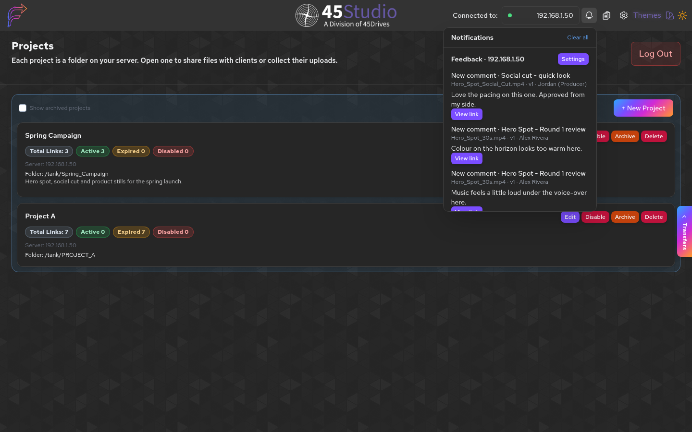

> **Note:** Feedback notifications are available on Community and Pro servers. They need a server version that includes them; older servers show an update notice instead.

### Main Action Buttons

Inside a project, two large cards perform the core tasks:

| Card | Description |
|--------|-------------|
| **Create Link** | Send a client a link to review files, upload files to you, or both. See [Creating Links](#10-creating-links--review-upload-or-both). |
| **Add Files** | Upload videos, images, audio, documents and other files from your computer into this project's folder on the server. See [Add Files](#11-add-files). |

Next to the project name, the **Quick Share** box is a reminder that you can drop files anywhere on the window to upload them and get a share link in one step. See [QuickShare](#9-drag-and-drop-quickshare).


### Links Table

Below the action cards, the project view lists the project's links with search, filters and status. Above the table, **"Edit Project"** opens the Edit Project dialog and **"Back to Projects"** returns to the project list. See [Managing Links](#13-managing-links).

### Logging Out

Click **"Log Out"** to sign out and return to the sign-in screen. In a browser this also ends your session on the server straight away.

---

## 7. Settings

Click the **Settings** (gear) icon in the top bar. Settings has a **Find a setting** search box and a sidebar grouped into sections:

- **Sharing** — New link defaults, Share addresses, Internet sharing, HTTPS certificate, Branding *(Pro)*
- **This app** — Preferences, Video processing *(desktop app only)*
- **Server** — Two-step sign-in, Server health, Maintenance, and for administrators: Storage, Staff users, Upload security, Watermarks, File browsing, Admin networks, Email (SMTP), Scanning & privacy
- **Help** (or **Pro & help**) — Help & tours, and **Go Pro** when the server is unlicensed or on a trial


Sections that you edit and then save show **Save changes** and **Discard changes** at the bottom, with *"You have unsaved changes"* when something is pending. Closing Settings with unsaved changes asks you to confirm first.

> **Important:** Link defaults only affect **newly created links**. Existing links keep their settings until you edit them.

### New Link Defaults

Starting values for every new link. You can still change them on each link.

| Setting | Description |
|---------|-------------|
| **Network** | **Local Network** or **Internet**. Internet links work anywhere (needs port forwarding and a public address); Local Network links only work on the same network or VPN as the server. |
| **Invite-only links (recommended)** | New links start as **Only invited clients & teams**. Turn off to start them as **Anyone with the link**. |
| **Allow comments on open links** | Let people comment on links that don't need a sign-in. |
| **Links never expire** / **Expire after** | Turn off "never expire" to give new links an end date, in hours, days or weeks. |
| **Make proxy files** | Create smaller copies of videos that stream smoothly in the browser. |
| **Proxy sizes for uploads** | The proxy files the server makes for uploaded videos when the upload doesn't choose its own: **720p**, **1080p**, **Original**. |
| **Server encoding** | How the server makes proxy files: **Faster** (sooner, slightly larger and softer files), **Balanced**, or **Higher quality** (takes longer). |
| **Watermark videos** | Stamp an image on videos in new links. See [Watermark Settings](#watermark-settings--video-and-image-support). |

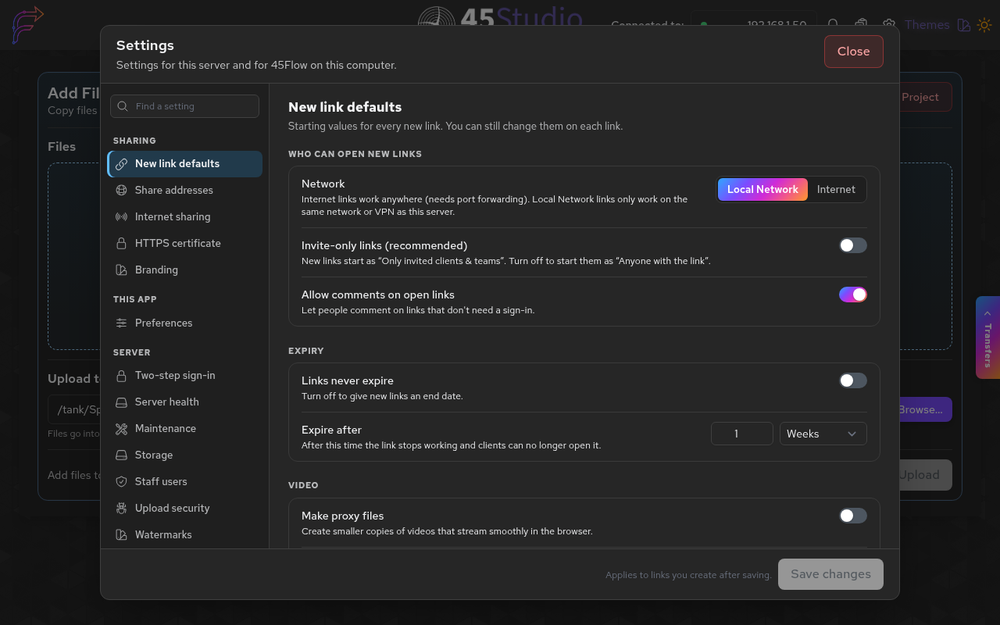

### Share Addresses

The web addresses your share links use on the internet and on your local network.

**Set up a public address** walks you through getting a hostname and a trusted certificate for internet links. See [Setting Up a Public Address](#setting-up-a-public-address).

**Internet address:**

| Setting | Description |
|---------|-------------|
| **Detect automatically** | Use this server's public IP address. Turn off to enter your own hostname. |
| **HTTPS port** | The port clients reach from the internet. Forward it on your router. Default `443`. |

**Local network address:**

| Setting | Description |
|---------|-------------|
| **Detect automatically** | Use this server's local IP address. |
| **Custom address** | A private IP or internal hostname. |

**Links will look like** previews the internet and local network addresses.

> **Note:** 45Flow never puts the server's IP address in an internet link. Internet links need a hostname with a trusted certificate; until both are ready, internet links can't be created or copied.

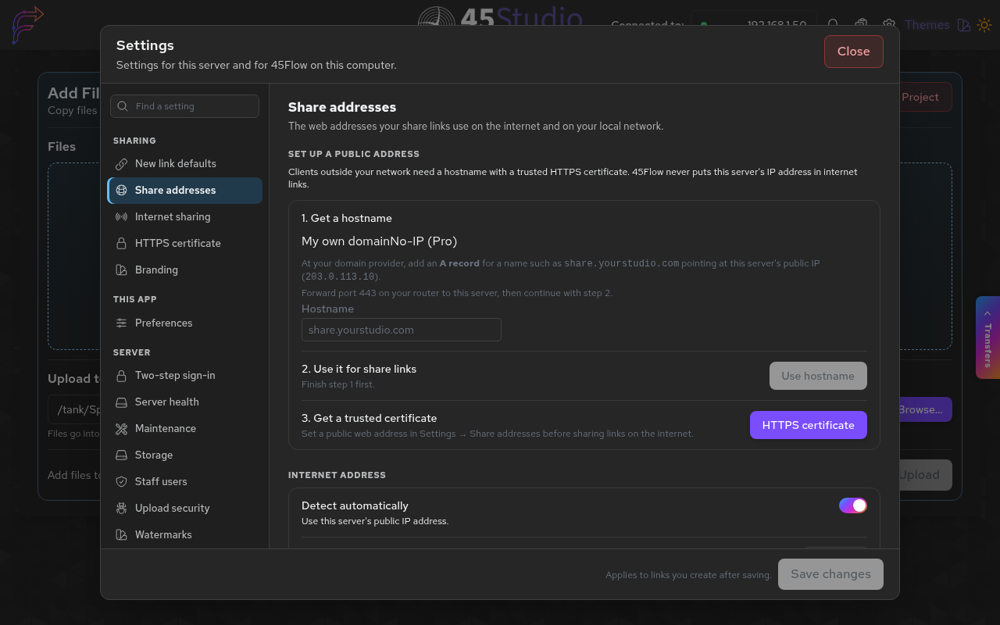

### Internet Sharing

A status check that clients outside your network can reach your links, with repair tools.

| Row | Description |
|-----|-------------|
| **Share URL** | The public URL recipients use. |
| **Internet links** | **Ready** or **Not ready**. Copied links use a domain name with a trusted certificate, never the server's IP address. |
| **HTTPS** | **Trusted** or **Local certificate (self-signed)**. With a self-signed certificate, recipients see a browser warning. |
| **Web routing** | Whether 45Flow has configured the web server (nginx). |
| **Firewall** | Whether HTTP and HTTPS are allowed through the server firewall. |
| **Last setup** | When 45Flow last configured public sharing. |

Status chips at the top summarize what needs attention (for example **Needs Trusted Certificate**). Click **Check Now** to recheck.

**Fix problems:**

- **Repair internet sharing** — Fixes common problems (restarts and regenerates the web server configuration).
- **Install a trusted certificate…** — Opens [HTTPS Certificate](#https-certificate).
- **Regenerate local certificate** — Makes a new self-signed certificate.

**Advanced details** shows the raw check results.

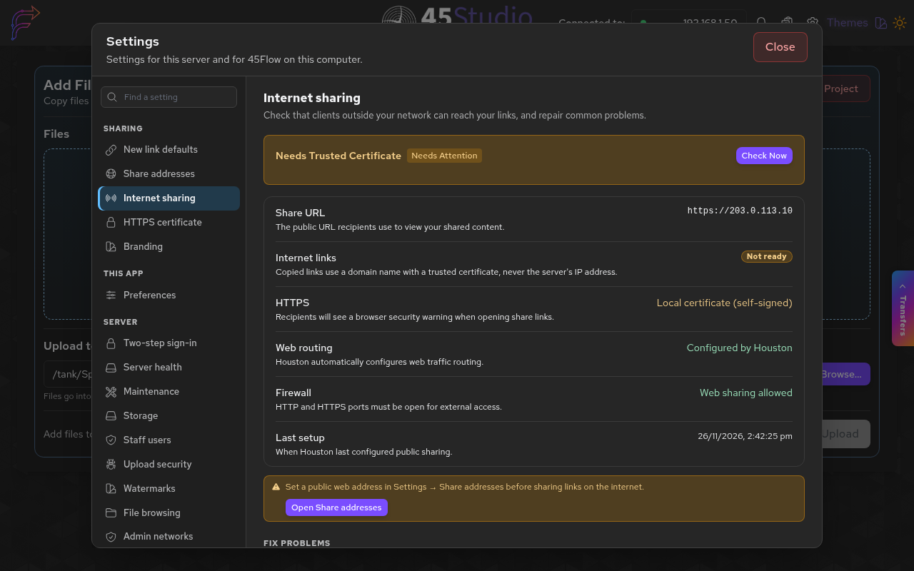

### HTTPS Certificate

Upgrade from the default self-signed certificate to a free, trusted **Let's Encrypt** certificate for your domain, so browsers don't show your clients a security warning.

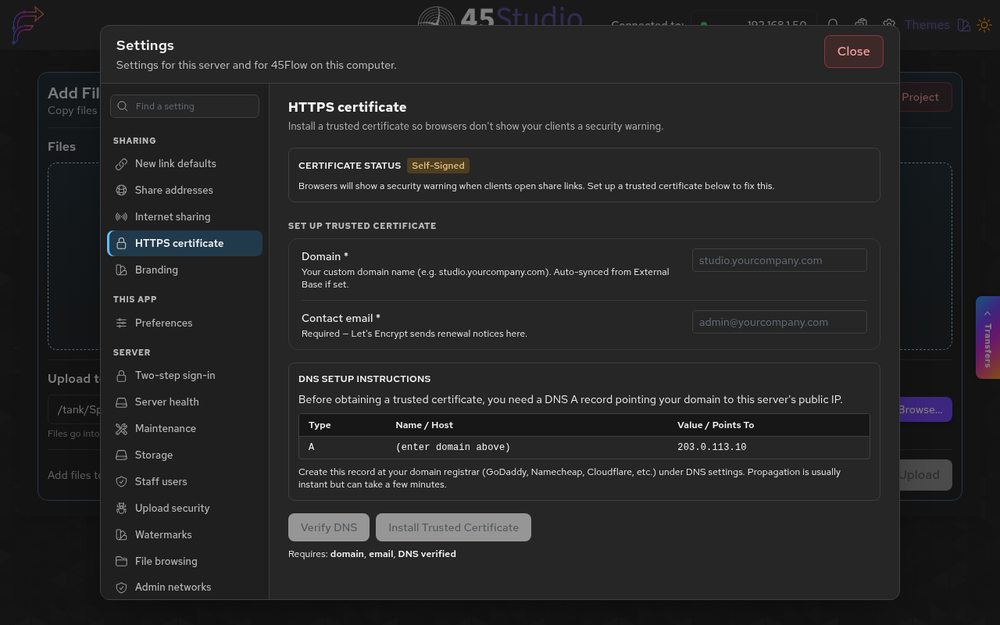

**Certificate Status:**

The top section shows your current certificate state:

| Field | Description |
|-------|-------------|
| **Type** | Self-Signed (default) or Trusted (Let's Encrypt) |
| **Domain** | The domain the certificate is issued for |
| **Expires** | Expiration date with days remaining |
| **Auto-renewal** | Whether automatic renewal is active (Let's Encrypt certificates auto-renew before expiry) |

**Setting Up a Trusted Certificate:**

1. **Domain** — Enter your domain name (e.g., `studio.yourcompany.com`). It fills in automatically from the internet address in [Share Addresses](#share-addresses) if that's set.
2. **Contact email** — Let's Encrypt sends renewal notices to this address.
3. **Create a DNS A record** — **DNS setup instructions** show the exact record to add at your domain registrar (GoDaddy, Namecheap, Cloudflare, etc.): type **A**, your domain, pointing to your server's public IP.
4. **Verify DNS** — Click **"Verify DNS"** to confirm the record is active.
5. **Install certificate** — Once DNS is verified, click **"Install Trusted Certificate"**. Until the domain, email and DNS check are all done, the button explains what's still required.

**Reverting to Self-Signed:**

If you need to remove the trusted certificate (e.g., domain change), click **"Revert to Self-Signed"**. This instantly switches back to the self-signed certificate.

> **Important:** Port 80 and 443 must both be accessible from the internet for Let's Encrypt validation to succeed. Ensure your firewall and port forwarding rules allow both ports.

### Preferences

How 45Flow looks and behaves on this computer, plus your feedback notification choices.

| Setting | Description |
|---------|-------------|
| **Time format** | 24-hour or 12-hour times throughout the app. |
| **Default link list view** | Show **All Links** or **Active Only** when you open a links list. |
| **Notify when uploads finish** *(browser)* | Show a browser notification when an upload finishes or fails while the tab is in the background. Click **Turn on**; your browser asks for permission once. |

**Feedback notifications** — Which client feedback shows in the notification bell: **New comments**, **Replies** and **Reopened feedback**. These save right away for your staff account on the connected server. The **Settings** button in the bell's Feedback section opens this page.

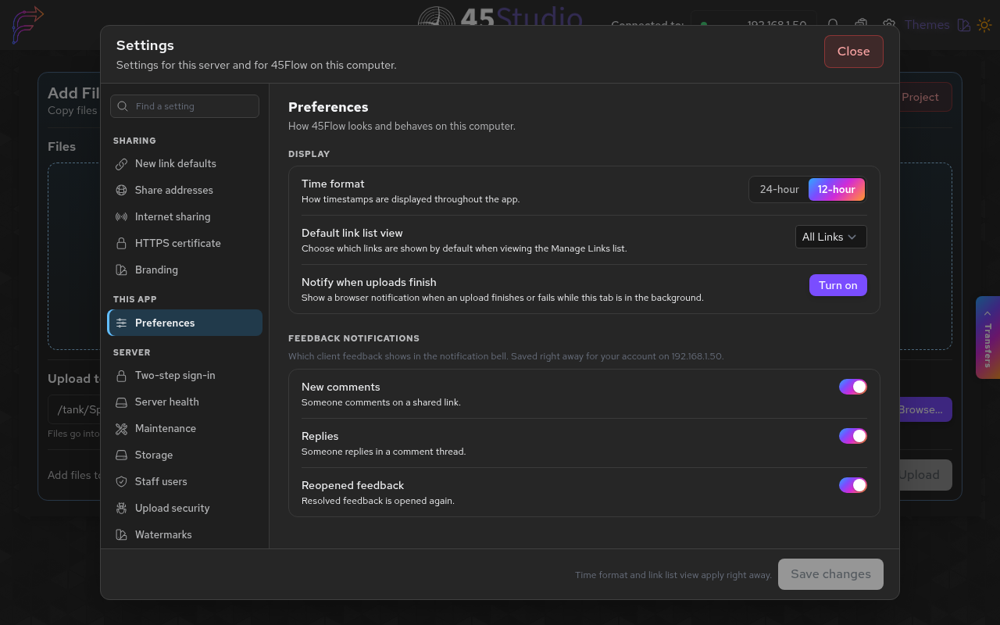

### Video Processing

*Desktop app only.* Process videos on your own computer before uploading, instead of on the server. In a browser, the server always does the processing.

| Setting | Description |
|---------|-------------|
| **Enable client-side transcoding** | Videos are processed on this computer (CPU or GPU) before upload. This makes proxy files faster and takes load off the server. When off, the server processes videos after they upload. |
| **Hardware Acceleration** — **Use hardware acceleration** | Use your GPU (NVIDIA NVENC, Intel Quick Sync, AMD AMF, Apple VideoToolbox). Falls back to the CPU when no compatible GPU is found. |
| **Encode Quality** | **Fast** (quicker, larger files), **Balanced**, or **Quality** (slower, best picture). |
| **Detected Encoders** | Which hardware encoders passed a test on this computer. |

> **Note:** Client-side transcoding is **off by default**.

#### Hardware Requirements for Client-side Transcoding

- **Minimum:** Any modern multi-core CPU (4+ cores recommended)
- **Recommended:** A GPU with hardware encoding (NVIDIA GTX 1060+ / Intel 6th-gen+ / Apple Silicon)
- **Storage:** Temporary disk space of about 1.5× the source video's size during processing
- **FFmpeg** is bundled with 45Flow; nothing extra to install

> **Tip:** If client-side transcoding fails (for example, not enough GPU memory or an unsupported codec), turn it off. The server will process videos instead; it just takes longer.

### Two-step Sign-in

Require staff to enter a code from an authenticator app (such as Google Authenticator, Microsoft Authenticator or 1Password) as well as their password. Available on Community and Pro servers. It applies to staff (server accounts) only, never to clients.

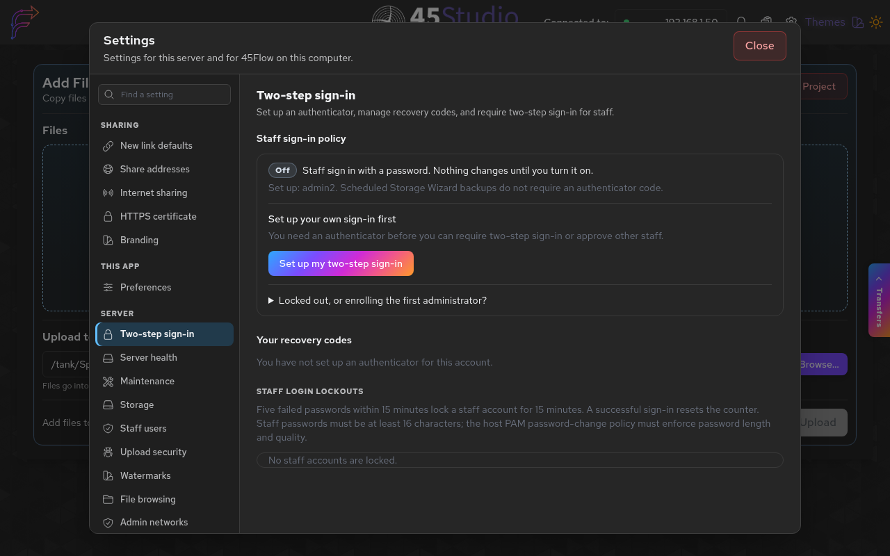

**Set up your own authenticator first:**

1. Click **Set up my two-step sign-in**.
2. Re-enter your account password.
3. Choose how you get approval:
   - **Ask a 45Flow administrator** — an administrator who already uses an authenticator approves your request with their own code. You can't approve yourself.
   - **Use a code issued on the server** — someone with root access on the server runs `/opt/45drives/houston-broadcaster/dist/mfa-admin.js issue-code <username>` and gives you the one-time code. It lasts 15 minutes and never signs anyone in by itself. Use this for the first administrator, or if you're locked out (see **Locked out, or enrolling the first administrator?**).
4. Scan the QR code with your authenticator app and enter the 6-digit code it shows.
5. Save your **recovery codes** somewhere safe. Each one signs you in once if you lose your phone.

Setting up an authenticator signs that account out everywhere, so sign in again with your new code.

**Require it for all staff:**

Under **Staff sign-in policy**, turn it on. You need your password and a current authenticator code (not a recovery code). Staff who haven't set up an authenticator get **14 days** to do so; after that they can't sign in until they enroll. From then on, every request needs a session that passed the code check, so older sessions stop working.

**Your recovery codes** — Click **Replace recovery codes** and enter a current authenticator code to get a new set. Your old recovery codes stop working.

**Approving another staff member** — When someone asks for approval, their request appears under **Waiting for approval**. Check it's really that person, and match the code they read to you, before approving.

**Staff login lockouts** — Five wrong passwords within 15 minutes lock a staff account for 15 minutes; a successful sign-in resets the count. Staff passwords must be at least 16 characters. The panel lists any locked accounts.

> **Note:** Scheduled Storage Wizard backups don't need an authenticator code. They use their own limited backup credentials, which carry no staff authority.

### Server Health

Live status of the servers this app is connected to. Click **Refresh** to update.

| Section | What it shows |
|---------|---------------|
| **License status** | **Licensed** / unlicensed, and the license type (for example **Perpetual** or trial). On an unlicensed server, paste a key and click **Activate License** here. |
| **Uptime** | How long the 45Flow server process and the whole system have been running. |
| **CPU** | Number of cores and load averages (1, 5 and 15 minutes). |
| **Memory** | Free and total system memory, and the memory the 45Flow process is using. |
| **Transcoding (server)** | The encoder the server uses for proxy files (for example `libx264`) and whether it runs on the **CPU** or a GPU. |

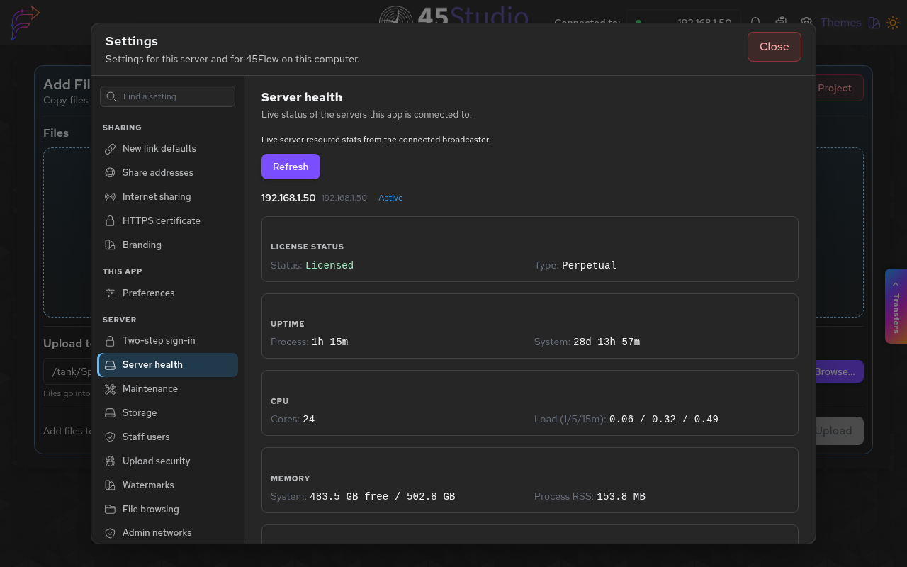

> **Note:** Server health needs a staff (server account) sign-in.

### Maintenance

Reopen setup, or clean up leftover files and records on the server.

**Setup wizard** — **Run setup again** reopens the four-step wizard (Storage, Staff users, Sharing settings, Projects) on this computer or browser. Nothing is reset or deleted, and you don't need to create another project if one already exists. In the **Projects** step, use the pencil button to edit a project's name, folder or notes, or the trash button to delete its 45Flow record (its folder, files and existing links are kept).

**Existing videos** — **Make proxy files for existing videos** queues the server's proxy sizes (see [New Link Defaults](#new-link-defaults)) for videos uploaded before those sizes were chosen. Videos that already have them, or that chose their own sizes, are skipped. Click **Start**; it runs in the background and you can close Settings.

**Cleanup:**

- **Delete orphan transcode directories** — Remove transcode output folders no longer linked to any file.
- **Prune missing source files** — Remove database rows for files that no longer exist.
- **Orphan min age** (hours) and **Max missing checks** limit the scan.
- Click **Run Scan** to preview what would be cleaned, then **Apply Cleanup**. **Export JSON** saves the scan results.

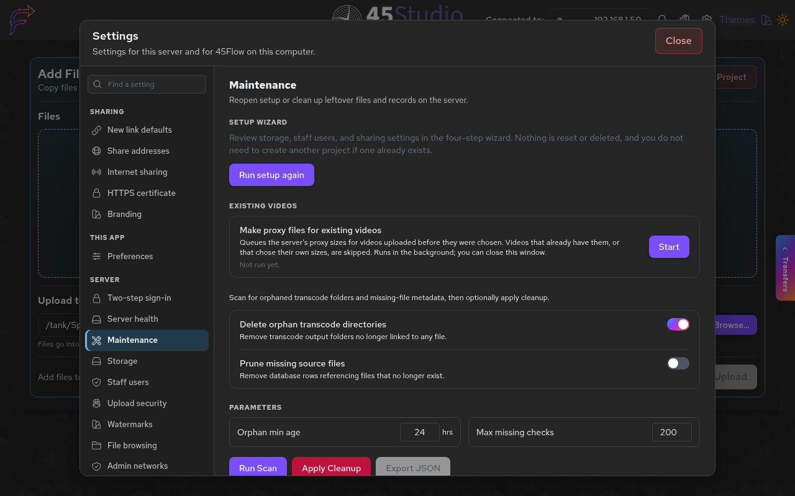

### Storage

The storage location is the main folder 45Flow uses across the server, not an individual project folder. Each project folder is selected separately and must be inside this location.

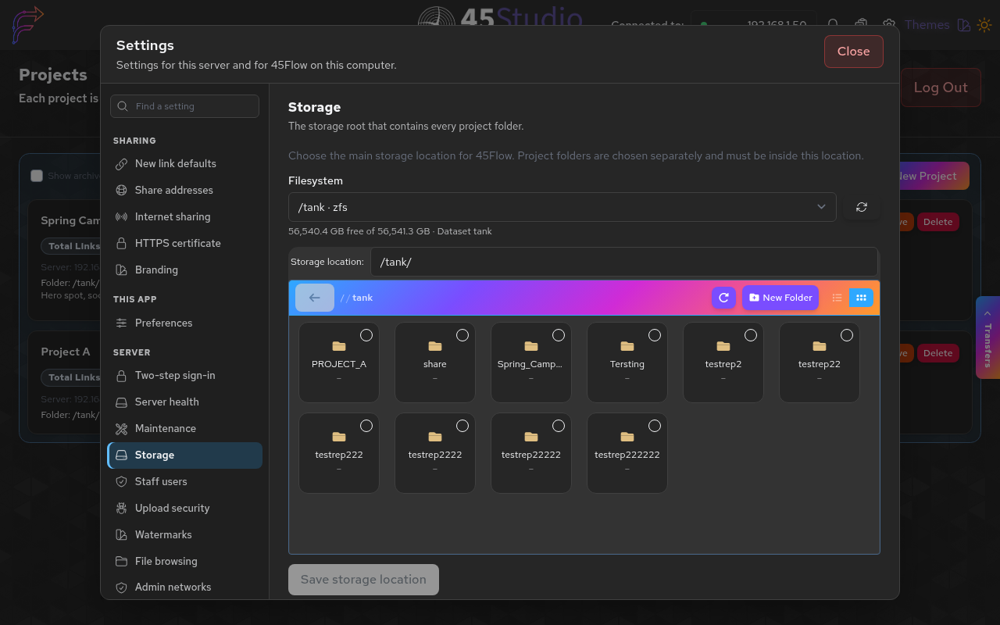

Administrators can view the current storage location, filesystem type and available space, then select another location. Before applying the change, review the listed projects outside the new location, active links, and running transfers or processing jobs, and explicitly confirm. The server restarts; files are never moved automatically. Projects outside the new location may become unavailable.

Folder pickers browse within the storage root. **Up** cannot browse above that boundary. The old **Default server folder** preference has been replaced by this server-wide setting.

When choosing a storage root, choose a filesystem from the dropdown to use the same
folder browser as project creation, including breadcrumbs, list/grid views,
typed paths and **New Folder**. Visited listings are reused until you choose
**Refresh file listing** or create a folder. Selecting or creating a folder does
not apply a storage change. Choose **Next** during setup, or **Save storage location**
in Settings, to review and confirm a change. Keeping the current location requires
no confirmation or restart.

### Staff Users

Choose which existing server accounts can administer 45Flow, using the same controls as first-run setup. The panel shows whether staff-group membership is required and lists current members. Click **Add to staff** or **Remove from staff** next to an account. These controls don't create server users or change client access. You can't remove yourself or the last staff member.

### Upload Security

**Malware scanner** shows whether a scanner is available. Turn on **Require malware scanning for uploads** and click **Save scanning policy**; **Check scanner** re-checks it. If scanning is required but no scanner is available, uploads are rejected. An administrator can install the scanner here or, if the policy is not locked by the server configuration, allow uploads without scanning. Unscanned uploads may contain malware.

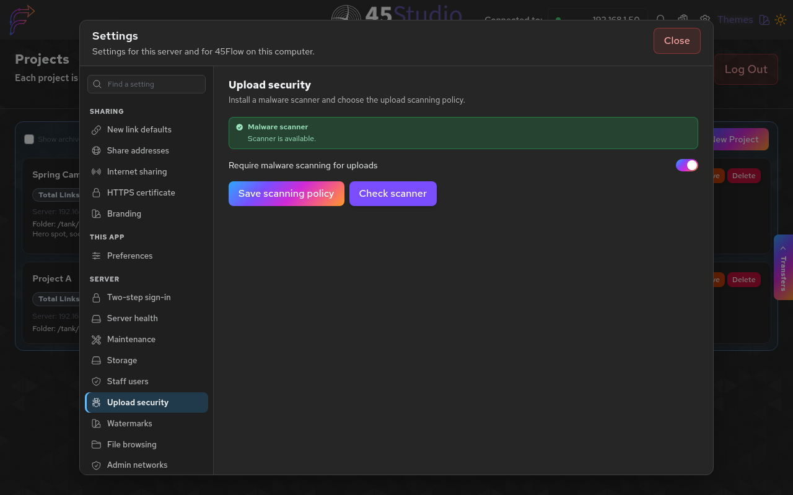

### Watermarks

The watermark picker lists built-in images, the enabled global folder, and images directly inside the selected project's `.45flow/watermarks` folder. It does not search nested folders or other projects.

To share images across projects, open **Settings → Watermarks**, turn on **Enable global watermark folder**, select a folder inside the storage root, and choose **Save watermarks**. Turning the switch off hides global-folder images without deleting files. New images uploaded for a project are stored with that project.

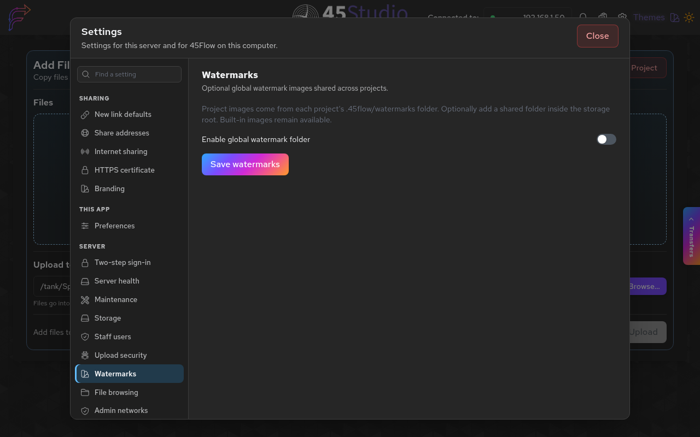

### File Browsing

Under **Server → File browsing**, turn on **Show .45flow by default** and click **Save changes**. The default is off. Changes apply to existing and new projects set to **Use server default** and to folders outside any project. Explicit project choices take precedence. If project folders overlap, the closest project folder governs; if projects use the same folder and disagree, **Hide .45flow** wins.

This setting only affects server file browsers. Other dotfiles and hidden folders stay hidden, and the setting does not change file permissions or existing share links. It is available on free and Pro servers; only server administrators can change the global default.

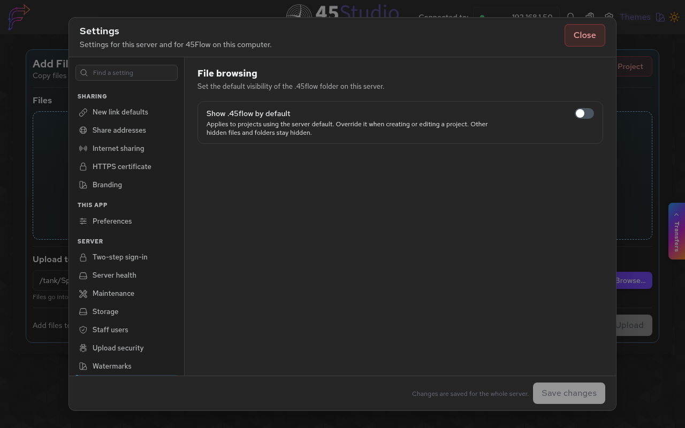

### Admin Networks

**Most users do not need to change this setting.** Use it when your server
administrator needs to limit which office or VPN networks can reach the server's
administrative HTTPS interface.

- **It controls:** access to administrative HTTPS routes, including administrative
  WebSocket connections. Allowed users still need to log in.
- **It does not control:** public share links, recipient passwords or permissions,
  SSH access, or direct connections to the backend port (9095 by default).
  Keep the backend port private using your firewall/router.
- **Who can change it:** users signed in with server credentials, on free or Pro
  servers. Giving a collaborator a role called "admin" does not grant this access.

The defaults cover common LAN and VPN address ranges, not just your own network.
Being on an allowed network does not make every device trustworthy.
You do not need a public domain, Let's Encrypt or port forwarding to use this
panel on a LAN-only server.

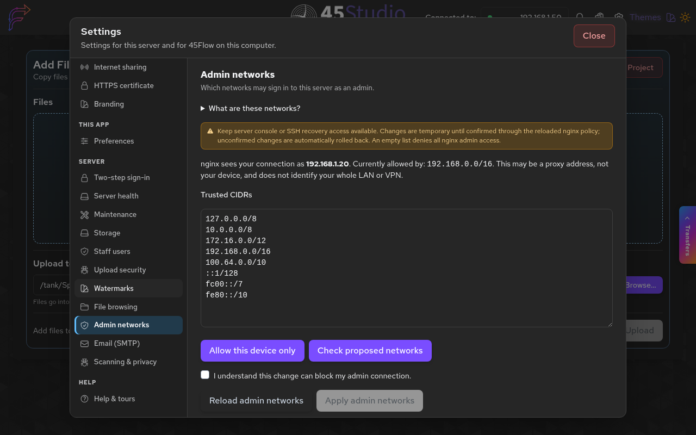

#### Changing the allowed networks

Keep a working server console or SSH connection available before making changes.
An incorrect list can block your administrative HTTPS connection.

1. Open **Settings → Admin Networks**. Note the connection address shown by the
   server. If you connect through a proxy, this may be the proxy's address.
2. Enter one trusted network per line. For example, `192.168.1.0/24` allows
   `192.168.1.0` through `192.168.1.255`; `192.168.1.25/32` allows one IPv4
   address. These are examples, not values to copy without checking your network.
   Open **What are these networks?** for more help.
3. If you only want the current connection address allowed, click
   **Allow this device only**. It uses the address shown by the server, not your
   whole LAN. A changing address or proxy can make this unsuitable.
4. Click **Check proposed networks**. For a normal change, make sure the result
   says your current connection is included. Do not use the exclusion override
   unless you deliberately want to block this connection and have another
   permitted connection available to confirm.
5. Acknowledge the warning, then click **Apply admin networks**.
6. Click **Reconnect and confirm** before the displayed deadline. This checks
   that you can still connect using the new rules and makes the change permanent.
   Without confirmation, the server automatically restores the previous rules.

**Apply admin networks** takes effect separately from **Save settings**.
An empty list blocks all administrative HTTPS access; `/0` ranges, which would
allow every address in an IP family, are rejected.

#### If you lose access or see a connection warning

- **After applying a change:** wait for the displayed rollback deadline, reconnect,
  then click **Reload admin networks**. Do not repeatedly apply changes.
  Leave the broadcaster service running so it can restore the old rules.
  If it was interrupted, recovery runs when it restarts; a reported recovery
  failure needs console/SSH assistance.
- **SSH trust prompt:** the desktop uses SSH to verify the server's HTTPS
  certificate, including self-signed certificates on private servers. If asked
  **Trust this SSH server?**, verify the fingerprint with your administrator or
  server console before accepting. A changed/revoked SSH identity, expired
  certificate or failed verification blocks the operation rather than bypassing
  the check.
- **Panel cannot connect:** confirm the server's HTTPS port is reachable
  (443 by default). For custom ports, check the connection ports on the login
  screen. Like the rest of the app, this panel uses HTTPS and never falls back
  to the backend port.
- **Connection safety unavailable:** ask your administrator to update the server
  and regenerate/reload its nginx configuration before retrying.

The address check and automatic rollback reduce accidental lockout; they cannot
guarantee access after your IP address, VPN, proxy or firewall changes.

### Email (SMTP)

45Flow sends email by signing in to a mail account you already have, such as your company's email, Microsoft 365 or Gmail. Email is used for link invitations, staff alerts, client notifications and security alerts. Administrators only.

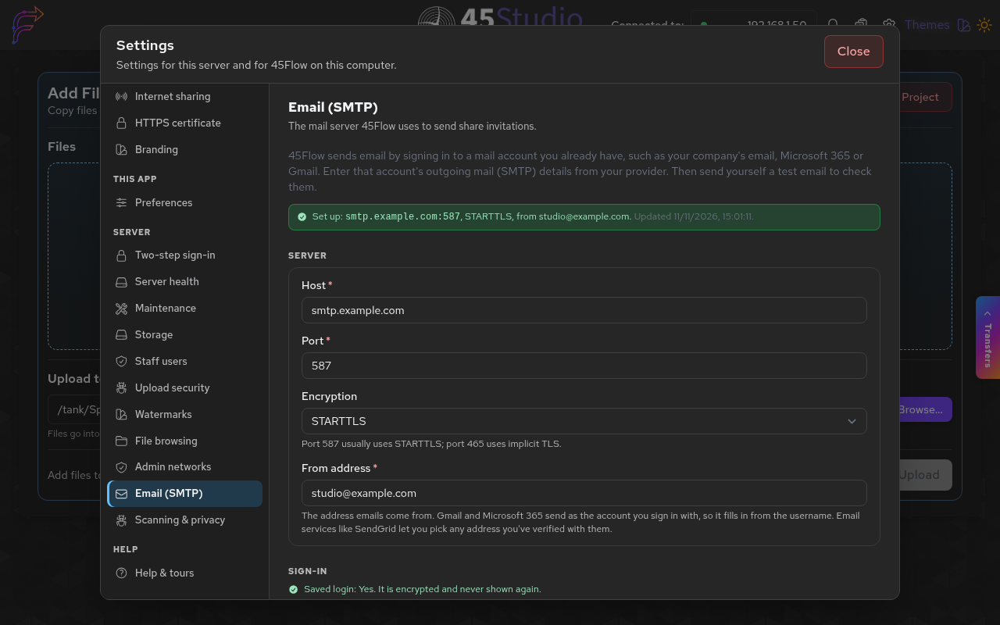

**Setting up email:**

1. Under **Server**, enter the **Host**, **Port** and **Encryption** (**STARTTLS** for port 587, **Implicit TLS** for port 465) from your mail provider.
2. Enter the **From address** emails come from. Gmail and Microsoft 365 send as the account you sign in with.
3. Under **Sign-in**, enter the account **Username** and **Password**. The login is encrypted and never shown again. To keep a saved login, leave both blank.
4. Click **Save email settings**.
5. Under **Test**, enter your address and click **Send test email**. 45Flow shows what the mail server said.

> **Gmail:** use an **app password**, not your normal Google password. 2-Step Verification must be on. Use `smtp.gmail.com`, port 587, STARTTLS, and your full Gmail address as the username. **Create a Google app password** opens Google's page.

**Delete saved settings** removes the configuration; **Reload** discards unsaved edits.

**Staff alerts** — Addresses (one per line, up to 20) that receive alerts across every link. For each address, choose which events it receives: new comments, replies, reopened feedback, review decisions (approvals, change requests, rejections) and first downloads. New feedback emails start off. Click **Save staff alerts**.

**Security alert emails** — Separate addresses for security alerts (one per line, up to 20). Leave empty to turn security emails off. Click **Save security alerts**.

**Delivery problems** — Emails the mail server refused, couldn't confirm or couldn't send, from every link. Retry them from the link's **Activity** tab. "Sent" means the mail server accepted the email, not that it reached the inbox.

> **Note:** If outbound email is turned off in [Scanning & Privacy](#scanning--privacy), 45Flow doesn't send any email and says so here.

### Scanning & Privacy

What the malware scanner does, and everything this server sends over the internet. Administrators only.

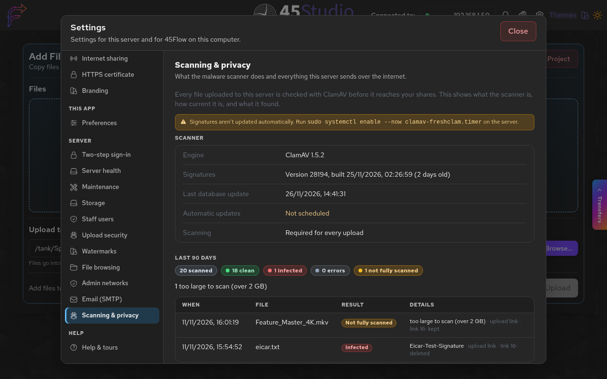

**Scanner** — Every uploaded file is checked with ClamAV before it reaches your shares. This shows the engine version, how old the virus signatures are, the last database update, whether automatic signature updates are scheduled, and whether scanning is required. If signatures aren't updated automatically, it shows the command to turn that on.

**Last 90 days** — Counts of files scanned, clean, infected, errors and not fully scanned (for example files over 2 GB, which are too large to scan). **Recent files that weren't clean** lists each one with the link it came through and whether it was kept or deleted. **What the scanner checks, and what it can't** explains the limits.

**Outbound calls** — Every call this server makes to the internet: where it goes, what it sends and how often, with a count of recent calls. Each call is written to the audit history.

| Call | Required? |
|------|-----------|
| License activation and refresh | Required for Pro. A server without a license never makes this call. |
| Server registry heartbeat | Optional. Lets desktop apps on other subnets find this server. |
| Port-forwarding check | Optional. Only when an admin runs an internet sharing check. |
| Public IP lookup | Optional. Used while the internet address is set to detect automatically. |
| Broadcaster update check | Optional. |
| Package installs | Optional. |
| Email (SMTP) | Optional. Turning it off stops all email. |
| Let's Encrypt certificate | Optional. |
| No-IP dynamic DNS | Optional *(Pro)*. |

Use the switch on an optional call to turn it off. Each card explains what stops working if you do.

**Quarterly account review** — Review staff access every quarter. The panel lists every server account with its last successful sign-in and the projects and links it owns. Accounts inactive for 90 days are flagged for review only; they are never disabled automatically. Click **Record quarterly review** when done. **Legacy unassigned records** lists older projects and links with no owner; choose a current staff member under **Assign to** and click **Assign ownership**.

### Help & Tours

- **Open User Guide** — Opens this documentation in your browser.
- **Open API Docs** — Opens the interactive API reference (Swagger) for the connected server.
- **Disable guided tours** — Turn off all onboarding walkthroughs.
- **Reset Tours** — Show the walkthroughs again on each page.

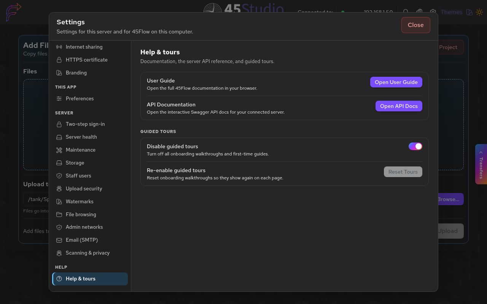

### Go Pro — License Activation

*Desktop app.* **Go Pro** appears in the Settings sidebar when the server is unlicensed (including after a trial ends), on a trial, or in **Pro — Legacy** mode. The **Go Pro** button on the Community banner in a project also opens it when the server is unlicensed. You can also enter a renewed key in **Settings → Server health**.

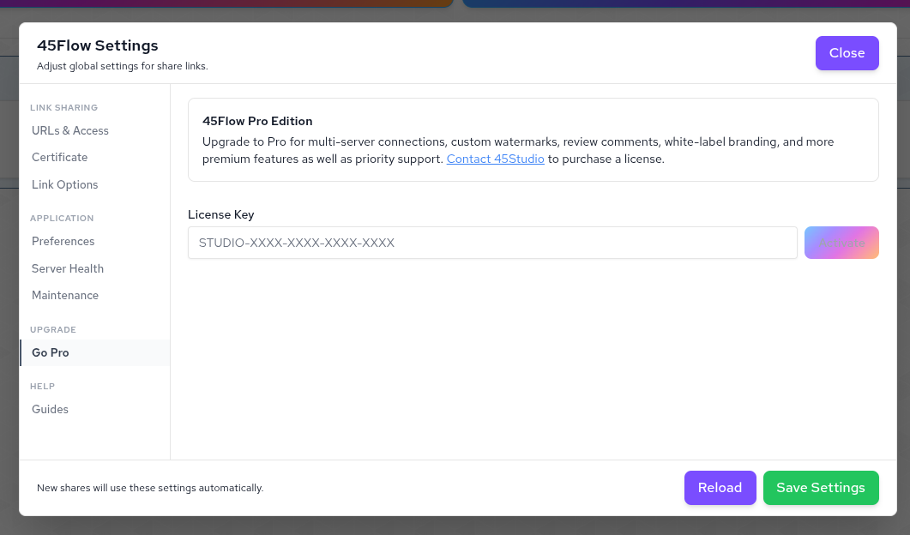

**Activating a license:**

1. Paste your **License Key** (it looks like `STUDIO-XXXX-XXXX-XXXX-XXXX`).
2. Click **"Activate License"**.
3. The server checks the key with the 45Studio license server. On success the app switches to Pro straight away, for everyone on that server.

**Starting a free trial:**

Under **Start Free 30-Day Trial**, click **"Start Trial"**. No email address is needed; the trial is activated on the server straight away. It gives every Pro feature for 30 days and is limited to one activation per trial.

**What the section shows:**

| State | What you see |
|-------|--------------|
| **Pro Trial Active** | Days remaining and the expiry date, with **Upgrade to Full License**, a **License Key** box and **Contact 45Studio**. |
| **Trial Expired** — Community Mode | Premium features are off. **Upgrade to Full License** with a **License Key** box. |

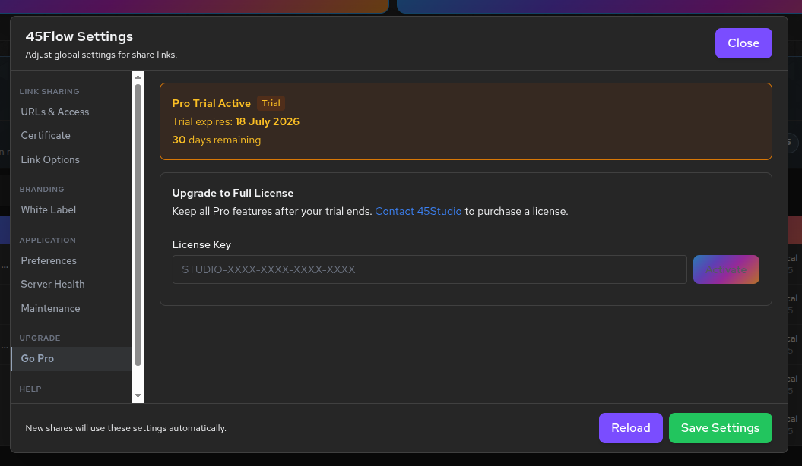

> **Note:** License status is also shown in **Settings → Server health**, where an unlicensed server can be activated too.

---

## 8. Custom Branding (White Label) — Pro Feature

**Custom branding requires a Pro license.** It changes how your share, review, upload and password pages look to clients. Recipients see your company's name, logo, colours and page style instead of the default 45Flow look.

Open **Settings → Branding** and turn on **Enable custom branding**. The settings are split into four tabs: **Identity**, **Look**, **Page content** and **Custom CSS**. A **live preview** of a review page sits at the top of the first three tabs and updates as you edit (custom CSS isn't shown in the preview).

Click **Save changes** to publish, or **Discard changes** to undo your edits. **Clear custom branding**, at the bottom of every tab, resets every branding setting to the 45Flow defaults and removes uploaded images.

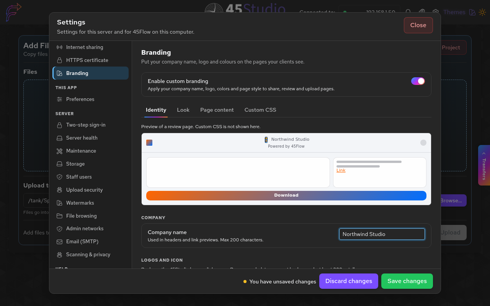

### Identity

| Setting | Description |
|---------|-------------|
| **Company name** | Used in page headers and link previews (max 200 characters). |
| **Logo** | Replaces the 45Studio logo on link pages. PNG, JPEG, SVG or WebP, max 2 MB. Use a transparent background, at least 200 px tall. **Replace** / **Remove**. |
| **Use a separate logo for dark backgrounds** | Upload a second logo for dark mode, if your logo has poor contrast on dark pages. |
| **Favicon** | The browser-tab icon. PNG, SVG or ICO, max 512 KB. Uses your logo when empty. |
| **Support email** | Shown on link pages and error screens. |
| **Support URL** | Your help documentation or support portal. |
| **Preview title** / **Preview description** | How links look when pasted into Slack, Teams, email or social media. The title defaults to the company name. |

### Look

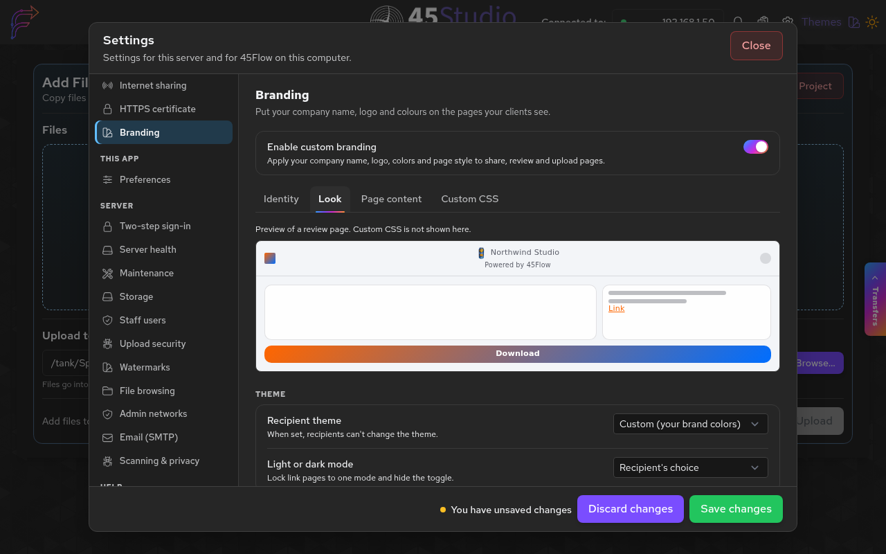

**Theme**

| Setting | Description |
|---------|-------------|
| **Recipient theme** | **Recipient's choice (no override)**, one of 22 built-in themes (Flow, Party, Prism, Synthwave, Cyber Pulse, Moon Mist, Flamingo, Spectrum, Fire, Sunset, Borealis, Solstice, Ultraviolet, Infrared, Blue Steel, Graphite, Deep Sea, Titanium, Enterprise, Homelab, Professional, Studio), or **Custom (your brand colors)**. When set, recipients can't change the theme. |
| **Light or dark mode** | **Recipient's choice**, **Always light** or **Always dark**. Locking a mode hides the toggle. |

**Brand colors** — **Primary brand color** (buttons, highlights and the gradient start) and **Secondary brand color** (gradient end, borders and supporting accents). A warning appears if a colour may be hard to read.

**Page style**

| Setting | Options |
|---------|---------|
| **Font** | Default (45Flow), System UI, Neo-grotesque (Helvetica-like), Humanist, Geometric, Rounded, Serif (transitional), Serif (old style), Monospace. System fonts only, so pages load fast; use custom CSS for a web font. |
| **Corners** | Rounded (default), Subtle, Square, Extra round (pill buttons). |
| **Buttons** | Gradient (default) or Solid. |
| **Logo size** | Small, Medium (default), Large, Extra large. |

**Page colors and background** — **Background color**, **Background image** (PNG, JPEG or WebP, max 5 MB), **Background texture** (the subtle 45Flow pattern), **Text color**, **Link color** and **Panel color**. Leave a colour empty to use the theme's.

### Page Content

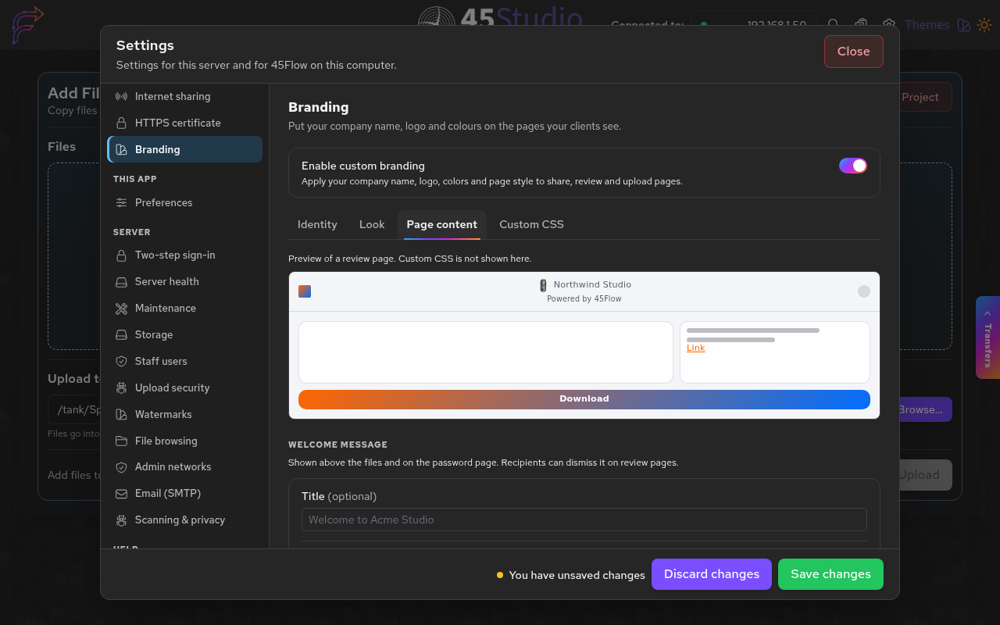

| Setting | Description |
|---------|-------------|
| **Welcome message** — **Title** and **Message** | Shown above the files and on the password page (up to 1,000 characters). Recipients can dismiss it on review pages. |
| **Footer text** | Copyright, address or a short note. Line breaks are kept. |
| **Privacy policy URL** / **Terms of use URL** | Adds those links to the footer. |
| **45Flow credit** | Where the small "Powered by 45Flow" credit appears: **Header, under your logo**, or **Footer only** (removes the 45Flow mark from the header). |

### Custom CSS

Add your own styles after the built-in ones on every share, review and upload page (up to 50,000 characters). Changes go live when you save. **Start from example** inserts a commented starting point. Expand **CSS reference** for the theme variables (set on `:root`) and page hooks you can target.

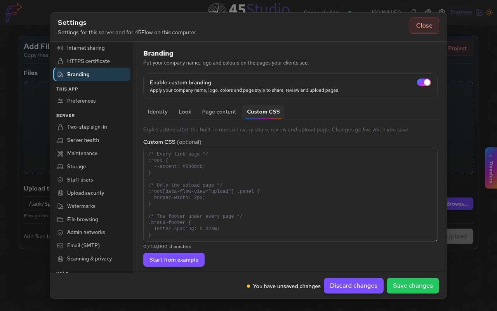

> **Tip:** Use custom CSS for anything the other tabs don't cover, such as a web font. Test on a phone as well as a computer.

### How Branding Appears to Recipients

When branding is on, recipients see:

- **Your logo** and **company name** in the header (with your dark-mode logo if you added one) and your **favicon** in the browser tab
- **Your theme, colours, font and page style**
- **Your welcome message** and **footer**
- **Your support contact** on password pages and expired-link pages
- **Your link preview** title and description when the link is pasted into chat or email
- A small **"Powered by 45Flow"** credit in the header or footer (required)

> **Important:** Branding is tied to your server's license. If a trial ends, link pages go back to the default 45Flow look. A full license that expires keeps its branding in **Pro — Legacy** mode.

---

## 9. Drag and Drop QuickShare

The **QuickShare** feature provides the fastest way to create a share link. Drag files from your desktop or file manager directly into 45Flow, configure a few options, and generate a shareable link in seconds.

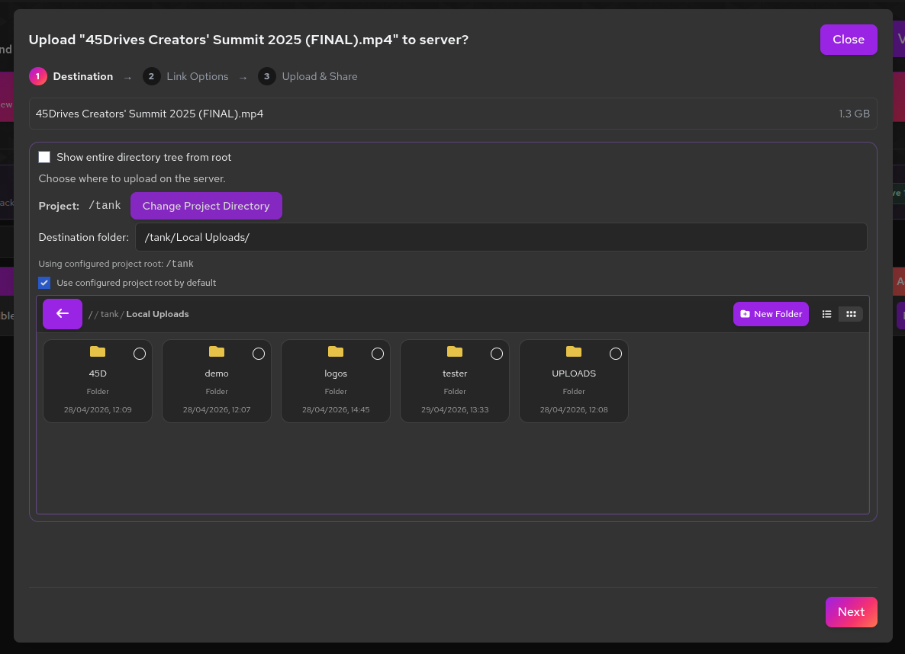

### How to Use QuickShare

1. **Drag Files:** From anywhere on your computer, drag one or more files onto 45Flow. The QuickShare screen opens.
2. **Check the Destination:** Files go into the current project's folder. Outside a project, pick the project first. To use a subfolder, type a path or click **"Browse…"**.
3. **Set Up the Link:** On the same screen, set the expiry, network, and who can open the link. Link title, proxy file qualities and watermark settings are under **Advanced Options**.
4. **Share:** Click **"Upload & Share"** to upload, transcode, and generate a shareable link. If the button is unavailable, the line beside it says what's missing (for example, inviting a client to an invite-only link).

Documents and spreadsheets: Share Excel, OpenDocument, CSV, TSV, and Word files. Spreadsheets have a read-only grid preview; DOCX has a text preview. Legacy DOC files require downloading.

Previews support files up to 10 MB and may show only part of larger documents or worksheets. Download the original for complete content and formatting, when permitted.

QuickShare checks all selected files before uploading. If any are unsupported or exceed upload limits, nothing uploads and the rejected files are listed.

**Video Processing:** When client-side transcoding is enabled (**Settings → Video processing**, desktop app only), video files are transcoded on your machine before upload — this generates both a **Stream** (HLS for browser playback) and **Proxy Files** (downloadable MP4s). With server-side mode, files upload first and the server handles processing.

### QuickShare Options

QuickShare lets you configure:

- **Destination folder** — Where files are stored on the server (the project folder unless you pick a subfolder)
- **Link expiration** — How long the link remains active (starts from your [new link defaults](#new-link-defaults))
- **Access mode** — Open (anyone with link), password-protected, or invited clients/teams
- **Proxy file qualities** — 720p, 1080p, and/or full resolution (for video)
- **Watermark** — Overlay a watermark on video and image files (Pro: full positioning; Community: basic)
- **Network** — **Internet (outside your network)** or **Local Network only**. With Internet selected, **"Check Port"** tests whether the server is reachable from the internet: a green light means it is, red means port forwarding isn't working yet.

These defaults can be changed in [Settings → New link defaults](#new-link-defaults).

### After Creating a QuickShare Link

Once the files upload and the link is made:

- The link is **shown on screen**. Click **Copy** to copy it (you'll see *"Link Copied"*), then paste it into email or chat.
- **Email this link (optional)** lets you send it straight away, unless you already used **Upload, Share & Email**.
- The link is **added to the project's links table**, where you can edit it, copy it again, see its activity or delete it.

> **Tip:** QuickShare is perfect for ad-hoc file sharing when you don't need custom settings. For more control over link configuration, use [Create Link](#10-creating-links--review-upload-or-both) inside a project instead.

---

## 10. Creating Links — Review, Upload, or Both

Every 45Flow link can let your client **review** files (view, download and comment), **upload** files to you, or both. Open a project and click **"Create Link"**. Everything happens on one screen, from top to bottom:

1. **Link name** *(optional)*
2. **Files to share**
3. **Details** — client uploads, expiry, network, and what happens after a client uploads
4. **Link Access Mode** — who can open the link, and comments
5. **Media Options** — proxy files and watermark (when you picked videos or images)
6. **File requirements** *(Pro, when uploads are on)*
7. **Send link by email**
8. **Generate Flow link**

The **Project** selector in the top-right corner shows which project the link belongs to. Changing it moves the file browser to that project's folder. Click **"Back"** (top) or **"Back to Project"** (bottom) to leave without creating a link.

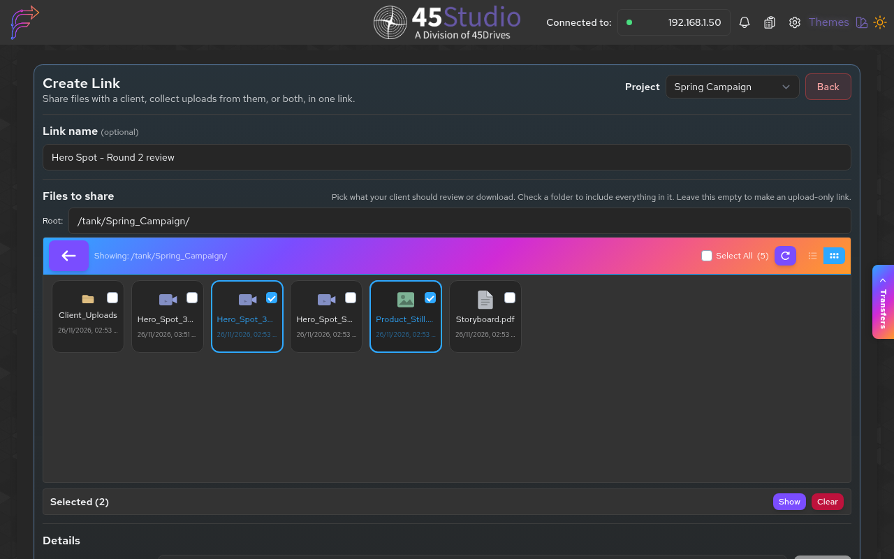

### What Kind of Link Is It?

The link type follows from what you pick. There is no separate mode switch:

| Type | How to make it | What the client can do |
|------|----------------|------------------------|
| **Review** | Pick files under **Files to share**. Leave **Let client upload to** unticked. | View, play, download (if their role allows) and comment. |
| **Upload** | Leave **Files to share** empty. Tick **Let client upload to**. | Send you files. |
| **Review + Upload** | Pick files **and** tick **Let client upload to**. | Both. |

A summary line under the **Generate Flow link** button always says what you are about to create, for example *"This link lets your client review and download 3 files."* or *"No files selected, so this is an upload-only link: your client can send you files."*

### Files to Share

The file browser starts in the project folder (**Showing:** shows the current path).

- Click a file to select it; tick a folder to include everything in it. **Select All** picks everything shown.
- Switch between **List** and **Grid** views.
- Selected files appear under **Selected (N)**. Click **Show** to review them, **✕** to remove one, or **Clear** to start over.
- Leave **Files to share** empty for an upload-only link.

### Details


**Let client upload to** — Tick it, then type a folder path (suggestions appear as you type) or click **Browse…** to pick one. Client uploads land in this folder; 45Flow creates it if it doesn't exist. The filesystem root (`/`) can't receive uploads.

**Expires in** — A number and **hours**, **days** or **weeks**, or a quick preset: **1 hour**, **1 day**, **1 week**, **Never**. After this time the link stops working. Your files stay on the server, and you can extend the link later.

**Network:**

- **Internet (outside your network)** — Works anywhere. Needs port forwarding and a public address with a trusted certificate (see [Port Forwarding](#4-port-forwarding-for-external-sharing)). If the address isn't ready, 45Flow explains what's missing. Click **Check Port** to test port forwarding: green means the server is reachable from the internet.
- **Local Network only** — Only opens for people on the same network or VPN as the server (for example, your office).

**After a client uploads** *(when uploads are on)*:

- **Share uploads back** — Let the client view and download each file right after they upload it, on the same link.
- **Watermark uploads** — Apply this link's watermark settings to new uploads.
- **Make proxy files for uploads** — The server makes proxy files for each uploaded video. Choose the **Proxy sizes**: **720p**, **1080p** and/or **Full Res (MP4)**.

### Link Access Mode

Choose who can open the link:

| Mode | Description |
|------|-------------|
| **Only invited clients & teams** | Each person signs in with their own login. Roles set what they can do (see [Role Management](#19-role-management)). Needed for approvals and personal watermarked copies. |
| **Anyone with the link + password** | One shared password for everyone. Enter it under **Link password**. |
| **Anyone with the link** | No sign-in required. Anyone it gets forwarded to can see it too. |

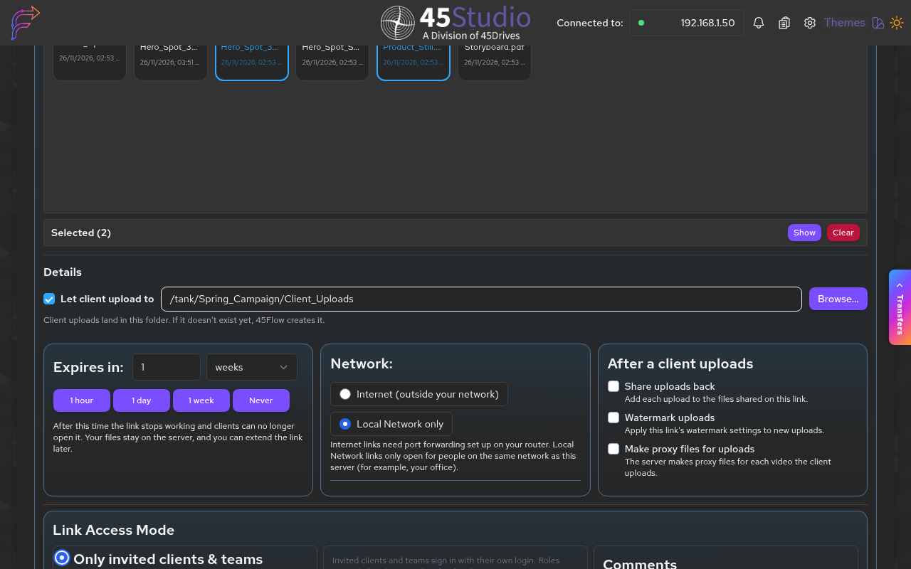

**Inviting clients and teams:** with **Only invited clients & teams** selected, click **"Invite clients & teams…"**. In the picker, tick clients and teams and choose a role for each, then click **"Add selected to link"**. **Manage teams**, **Manage roles** and **Add client** open those screens without leaving the picker. Afterwards the button reads **"Manage invited clients"** with a count.

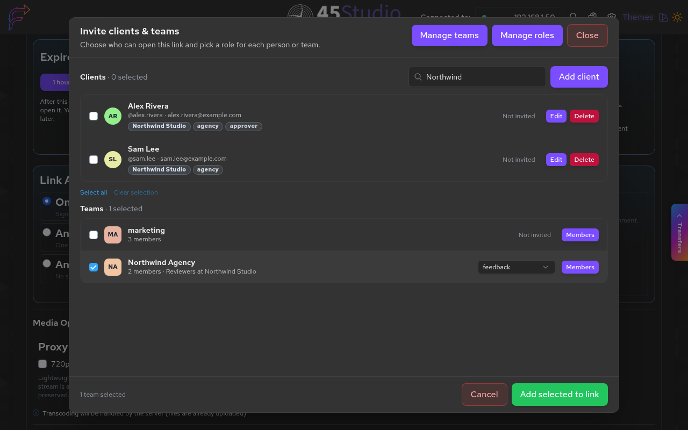

**Comments:**

- **Invite-only links** — Each invited person's role decides whether they can comment.
- **Open and password links** — Turn on **Allow comments** so visitors can leave a name and a comment.
- **Manage Comment Categories** lets you set labels reviewers can pick, such as *Audio*, *Color* or *Needs Revision*. Categories make filtering and exports easier later.

> **Approvals:** To have a client formally approve each file, invite them **directly** (not only through a team), then choose them under **Who approves** in **Link Details → Edit → Access**. See [Review & Approvals](#review).

### Video and Media Options

When you pick videos or images, a **Video Options**, **Image Options** or **Media Options** section appears.

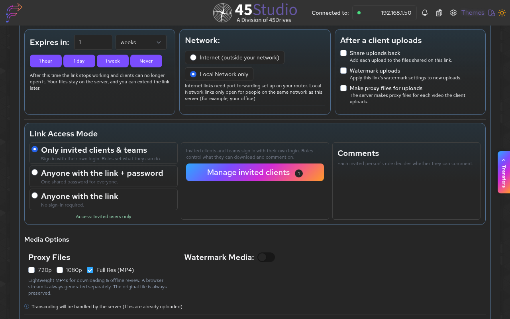

**Proxy Files** — Choose **720p**, **1080p** and/or **Full Res (MP4)**. These are lightweight MP4s for downloading and offline review. A browser stream is always made separately, and the original file is always kept. A note shows whether processing happens on this computer (desktop client-side transcoding) or on the server.

### Watermark Settings — Video and Image Support

Turn on **Watermark Videos** (or **Watermark Images** / **Watermark Media**) to stamp a watermark on the proxy files and streams (videos) or on the shared copy (images).

**Community vs Pro watermarking:**

| Feature | Community | Pro |
|---------|-----------|-----|
| Video and image watermarking (on/off, choose image) | ✅ | ✅ |
| Position | Bottom-right only | ✅ Drag anywhere, or exact anchor and offsets |
| Scale, opacity, rotation | Fixed defaults | ✅ Adjustable |
| Quick presets and saved presets | ❌ | ✅ |
| Text watermarks | ❌ | ✅ |
| Personal watermarked copies | ❌ | ✅ |

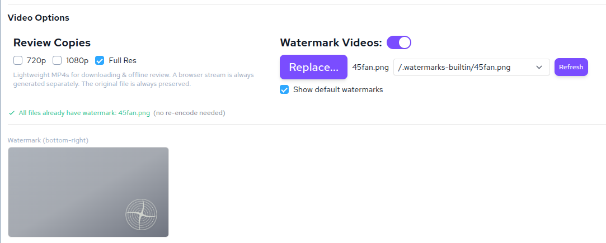

**Pro image watermark** (**Watermark Customization → Image watermark**):

- **Choosing the image** — Pick from **Select existing watermark file…** (project images from the project's `.45flow/watermarks` folder, the shared watermark folder, and built-in images when **Show default watermarks** is ticked), or upload your own with **Replace…**. **Refresh** reloads the list.
- **Quick Presets** — **Bottom Right (Small)**, **Bottom Right (Large)**, **Center (Translucent)**, **Top Left Corner**, **Diagonal (Rotated)**. **Custom Settings** shows your own adjustments; **My Presets** lists presets you saved.
- **Position** — Drag the watermark in the **Live Preview**, or set an **Anchor Point** with **Horizontal Offset** and **Vertical Offset**.
- **Scale**, **Opacity** and **Rotation** sliders.
- **Save as Preset** stores the current settings with a name and description for reuse. **Reset** returns to the defaults.

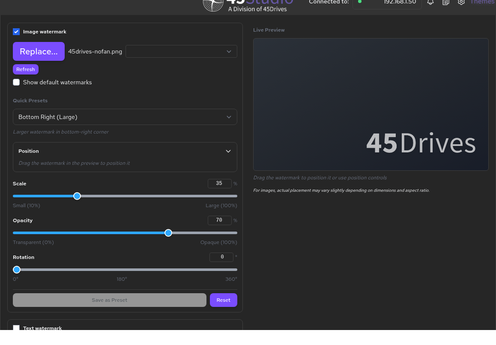

> **Note:** For images, actual placement may vary slightly depending on dimensions and aspect ratio.

### Text Watermarks (Pro)

On a Pro server, the watermark controls have two cards: **Image watermark** and **Text watermark**. Use one or the other.

1. Tick **Text watermark**.
2. Type the **Text**. Click a variable button to insert it:

   | Button | Inserts | Filled in with |
   |--------|---------|----------------|
   | **Recipient name** | `{recipient}` | The invited person's name |
   | **Email** | `{email}` | Their email address |
   | **Company** | `{company}` | Their company |
   | **Date** | `{date}` | The date |
   | **Link title** | `{link}` | The link's name |

3. Choose the **Font** (Sans or Sans Bold) and **Colour**. Tick **Outline** for a dark edge that stays readable on bright footage.
4. Choose **Once** (a single line) or **Tiled** (repeated across the whole frame, which is harder to crop out).
5. For a single line, pick a **Position** (**Top Left**, **Top Right**, **Center**, **Bottom Left**, **Bottom Right**) or drag it in the preview, then set **Text size**, **Text opacity** and **Text rotation**.

The **Live Preview** shows the result with sample values (for example *"Preview for John Smith"*).

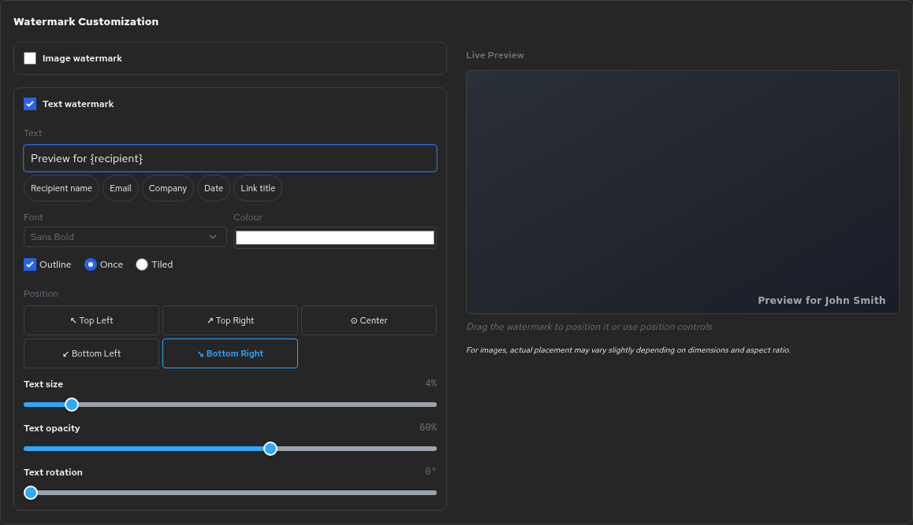

`{recipient}`, `{email}` and `{company}` only have values for invited people. On a link that anyone can open, they are left blank and 45Flow shows a warning.

You can add a text watermark when creating a link or in QuickShare. Editing a link changes its image watermark only; for invite-only links, change the text from **Personal watermarked copies** in **Link Details → Files** (see below).

### Personal Watermarked Copies (Pro)

Give each invited person their own copy, stamped with their own details. If a copy leaks, you can tell whose it was.

1. Set **Who can open it** to **Only invited clients & teams** and invite people or teams.
2. Add a **text watermark** that uses `{recipient}`, `{email}` or `{company}`, for example `Preview for {recipient} · {company}`.
3. Generate the link. 45Flow notes that *each invited person gets their own copy with their details filled in, and only ever sees that copy*.

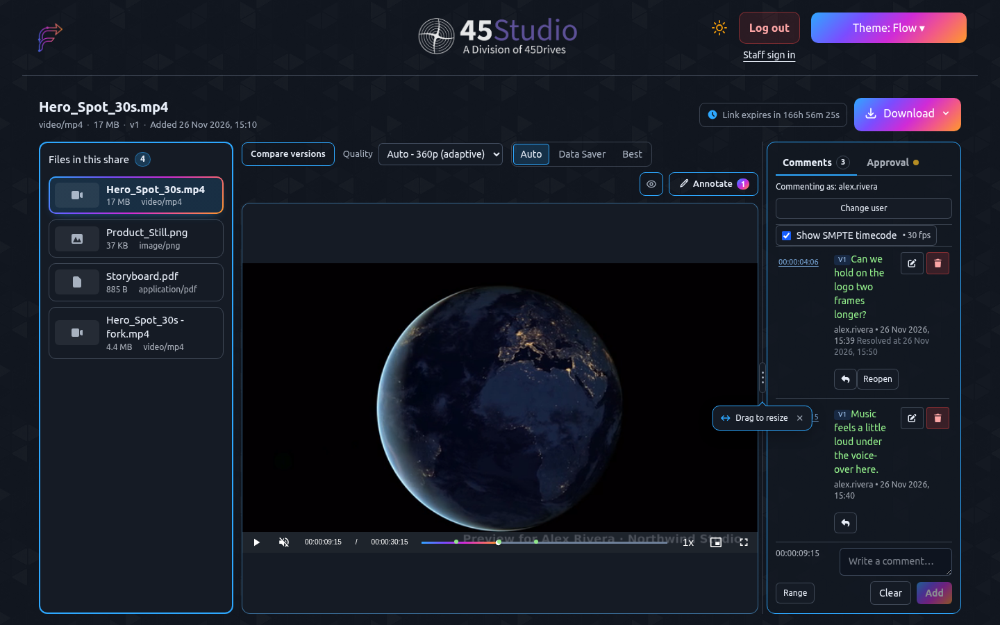

To check progress, open **Link Details → Files**. The **Personal watermarked copies** section lists each person with a status: **Preparing N/M**, **Ready**, **Failed** (hover for the reason) or **No watermark**, plus a summary such as *"3 of 4 ready."* From there you can turn personal copies on or off and click **Edit the watermark text**.

> **Tip:** Fill in each client's **Email** and **Company** in [Client Access](#18-client-access) so those variables have something to show.

### File Requirements for Uploads (Pro)

On a Pro server, links that accept uploads can check each uploaded file against your delivery specs. With **Let client upload to** ticked, a **File requirements** section appears.

1. Turn on **Check uploads against file requirements**.
2. Click **Edit requirements…**.
3. Under **When a file doesn't match**, choose **Reject it and tell the uploader why** or **Accept it, but flag it**.
4. Tick what's allowed in each row. A file must match one of the ticked options in every row; rows with nothing ticked aren't checked.
   - **File type** — QuickTime (.mov), MPEG-4 (.mp4), MXF, Matroska (.mkv), WebM, AVI, MPEG-TS, WAV, AIFF, MP3
   - **Video codec** — Apple ProRes, Avid DNxHD / DNxHR, H.264, H.265 (HEVC), AV1, VP9, MPEG-2, JPEG 2000, GoPro CineForm, FFV1, Uncompressed 10-bit (v210)
   - **Resolution** — common sizes, or type others such as `1998x1080, 4096x1716`
   - **Frame rate (fps)** — 23.976 to 60
   - **Aspect ratio** — 16:9, 1.85:1, 2.39:1, 4:3, 1:1, 9:16
   - **Audio** — No audio, Mono, Stereo, 5.1, or 8, 16, 32 or 64 channels
   - **Length** — shortest and longest (`m:ss`, either can be blank)
5. *(Optional)* Tick **Accept files that aren't video or audio (PDFs, images, documents) without checking them**.
6. Click **Done**. The section shows a summary of your rules.

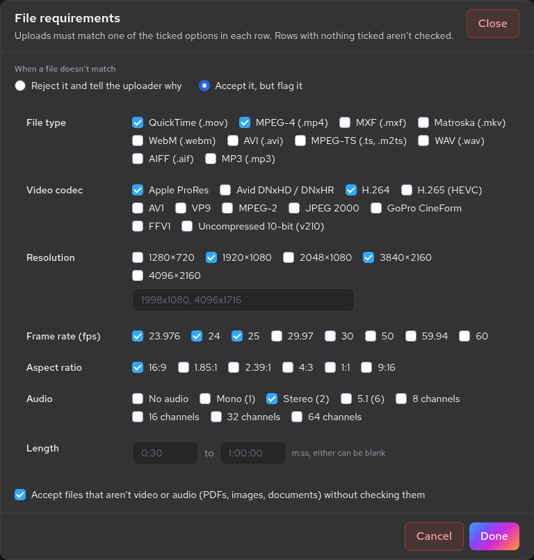

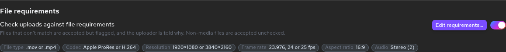

Files are checked after they upload. Your client sees a **"This link checks your files"** box listing the rules on the upload page. A rejected file shows the reason; an accepted-but-flagged file is kept and shows a **Flagged** note explaining what didn't match.

To change the rules later, open **Link Details → Edit**.

### Emailing the Link

At the bottom, turn on **Send link by email** to email the link as soon as it is created. Email must be set up first (see [Email (SMTP)](#email-smtp)).

- Invited clients with an email address are listed and ticked. Untick anyone you don't want to email.
- Add anyone else under **Other email addresses** (separate several with commas).
- With at least one recipient, the button reads **"Generate & Send Flow link"**.

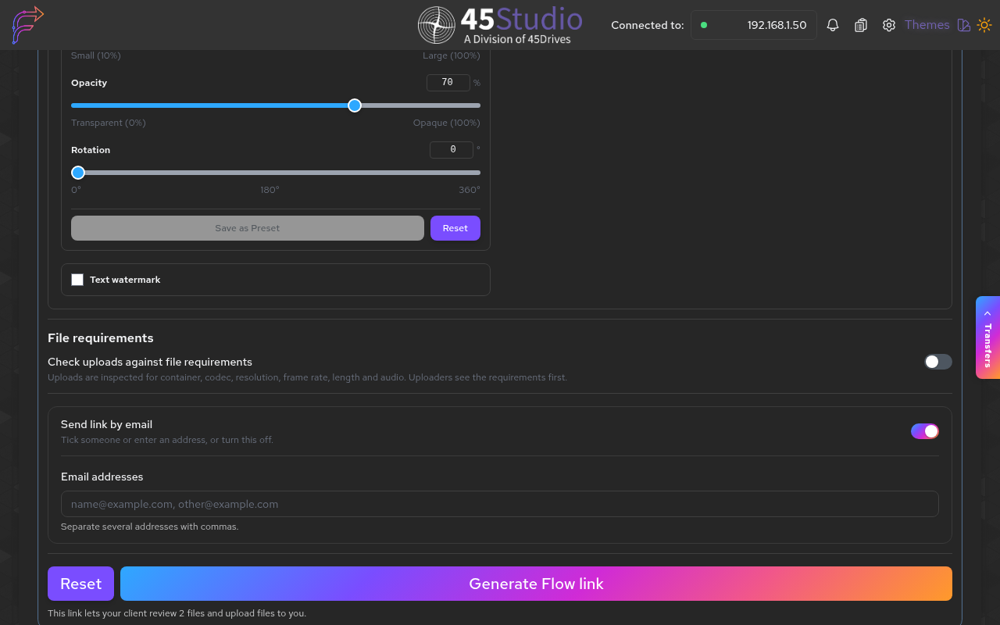

QuickShare has the same option; its button reads **"Upload, Share & Email"**.

### Generating the Link

1. Check the summary line under the button.
2. Click **"Generate Flow link"** (or **"Generate & Send Flow link"**). If the button is unavailable, the line beside it says what's missing (for example *"Add at least one client or team to continue."*).
3. The link appears, for example `https://share.yourstudio.com/link/…`. Click **"Copy"** to copy it, or **"Open"** to see what recipients see.
4. Under **Email this link (optional)**, enter addresses and click **Send** to email it now. You can also do this later from the link's details.

The link now appears in the project's links list. Click **"Reset"** to clear the form and make another, or **"Back to Project"** to return.

---

## 11. Add Files

Upload videos, images, audio, documents and other files from your computer into a project folder on the server, ready to share later.

Open a project and click **"Add Files"**. Everything happens on one screen: add files, check where they go, set media options, and click **"Upload N Files"**. Click **"Back to Project"** at any time to return to the project. In a browser, the server always processes videos after they upload.

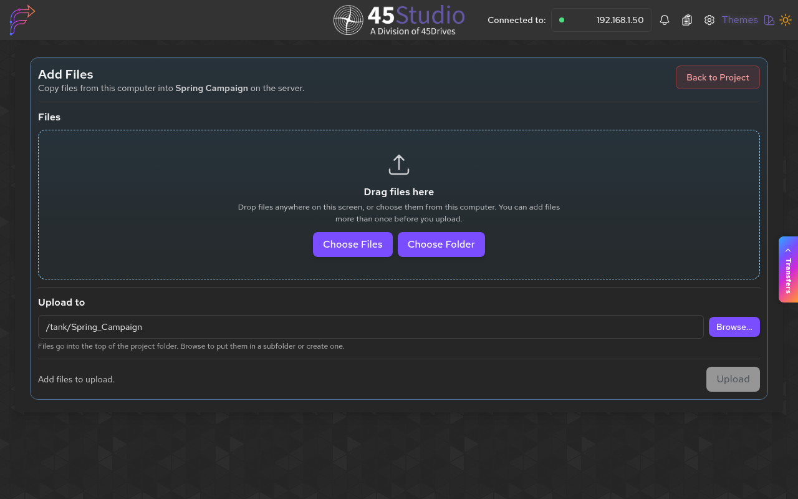

### Add Files to the List

1. Drag files anywhere onto the screen, or click **"Choose Files"** (you can select several) or **"Choose Folder"** to add everything inside a folder.
2. The files appear in a list showing **Name**, **Size**, and a **Remove** button. The total count and size are shown above the list, with **"Clear"** to start over.
3. You can keep adding files until you click **"Upload N Files"**.

> **Note:** To add a folder, use **"Choose Folder"**. Folders dragged onto the screen are skipped, with a reminder to use Choose Folder.


### Check Where the Files Go

**Upload to** starts at the project folder, so most uploads need no change here.

- To use a subfolder, type a path (suggestions appear as you type), or click **"Browse…"** to open the folder browser.
- In the folder browser, **single-click** a folder to choose it, **double-click** to open it, and click **"New Folder"** to create one. Click **"Done"** to close the browser.
- The filesystem root (`/`) can't receive uploads.

### Media Options

When the list includes videos or images, a **Video options** (or **Image options** / **Media options**) section appears below the destination:

- **Proxy Files** — Choose proxy file qualities (720p, 1080p, Full Res MP4) to generate for your videos. These proxy files are used when you share the files later via links. A browser stream is always generated.
- **Watermark Media** — Apply a watermark overlay to uploaded videos and images (Pro: full customization of position, size, opacity and tiling; Community: basic bottom-right watermark).

A line under the options shows whether videos are processed on this computer (client-side transcoding) or on the server.

### Upload & Monitor Progress

The bar at the bottom summarizes what will happen, for example **"4 files · 2.3 GB → /tank/projects/spring/footage"**. If the **"Upload N Files"** button is unavailable, the same bar says what's missing (for example, choosing a watermark image).

Click **"Upload N Files"** to start. An **Uploads Queued** message confirms the files are in the Transfer Dock, and the file list turns into a live status list:

| Column | Description |
|--------|-------------|
| **Name** | File name, with percentage, speed and time remaining while it transfers, or the total time once it finishes |
| **Size** | File size |
| **Status** | **Waiting**, **Processing** (local transcode), **Uploading**, **Scanning** (malware check on the server: *"Scanning for malware (queued or running)…"*), **Done**, **Canceled**, or **Failed** |
| **Cancel** | Stops a file that is waiting, processing or uploading |

The bottom bar shows overall progress across all files (for example *"0 of 2 done · 2 in progress"*). You can leave this screen while uploads run; they continue in the [Transfer Dock](#12-transfer-dock).


> **Note:** Filenames are automatically sanitized during upload for cross-platform compatibility. Special characters such as apostrophes (`'`), colons (`:`), and other non-standard characters are replaced with underscores (`_`). If a file is renamed, a notification will appear showing the new filename. If a file with the same name already exists in the folder, the upload is saved with a number added, such as `Storyboard (1).pdf`; nothing is overwritten.

When **client-side transcoding** is enabled (**Settings → Video processing**, desktop app only), video files go through a two-phase workflow:
1. **Processing** — The video is transcoded on your machine using hardware acceleration (GPU) if available. This generates both the **Stream** (HLS adaptive bitrate for browser playback) and **Proxy Files** (downloadable MP4 files at your chosen qualities).
2. **Upload** — The raw source file is transferred to the server for archival.

This offloads video processing from the server to your workstation, typically completing much faster with hardware-accelerated encoding.

If client-side transcoding is **not enabled**, the workflow is reversed:
1. **Upload** — The raw file uploads to the server first.
2. **Server Transcode** — The server queues and processes video encoding in the background.

You can monitor both modes in the [Transfer Dock](#12-transfer-dock).

**After Upload:**

When every file has finished:

- **"Done"** returns to the project.
- **"Add More Files"** (or dragging in new files) clears the list and starts a new upload with the same folder and options.
- **"Retry Failed"** appears if any files failed; it uploads only those files again. The error for each failed file is shown under its name.

---

## 12. Transfer Dock

The **Transfer Dock** is a persistent overlay that tracks all active and recently completed transfers — uploads, transcodes, and proxy file generation. It stays available on every screen, so you can keep working while transfers run.


### Transfer Dock Overview

The Transfer Dock is a panel that slides in from the right side of the window, below the top bar. Open it with the **Transfers** tab on the right edge. It shows:

- **Status** — **In progress…** while anything is running, otherwise **Idle**
- **Link grouping** — Transfers are grouped by the link they belong to, with the server name and link URL displayed.
- **Clear finished** — Remove completed transfers from the dock.
- **Close** — Collapse the dock (transfers continue in the background).

When the dock is closed, a **Transfers** tab stays on the right edge of the window, with a badge while transfers are running. Click it to open the dock again.


### Transfer Entry Details

Each file in the Transfer Dock shows:

| Field | Description |
|-------|-------------|
| **File name** | The name of the file being transferred. |
| **Destination** | Server-side path (e.g., `tank/Local Uploads/video.mp4`). |
| **Status** | Current state: *Running*, *Complete*, *Queued*, *Canceled*, or *Error*. |
| **Progress** | Percentage bar for the active phase. |
| **Speed** | Transfer or encode speed (e.g., `95.23 MB/s` for uploads, `1.05x` for transcodes). |
| **ETA** | Estimated time remaining. |
| **Action** | Cancel or Dismiss button. |

### Transcode Status

When proxy files or streams are being generated, each transcode entry shows:

- **Stream** — The HLS (HTTP Live Streaming) adaptive bitrate output used for browser-based video playback. This is what link recipients see when they click play.
- **Proxy File** — Downloadable MP4 files at specific qualities (720p, 1080p, or full resolution). These are used for offline review and download. When multiple qualities are selected, they appear as "Proxy File (Multiple Resolutions)" with per-quality progress.
- **Awaiting Transcode…** — The upload task is waiting for client-side transcoding to complete before uploading the raw file.

Each transcode entry also shows:

- **Transcode source** — `Client` or `Server`, indicating where the processing is running.
- **Encoder** — The hardware/software encoder in use:
  - `GPU (QSV)` — Intel Quick Sync Video
  - `GPU (NVENC)` — NVIDIA hardware encoder
  - `GPU (AMF)` — AMD hardware encoder
  - `GPU (VideoToolbox)` — macOS hardware encoder
  - `CPU` — Software encoding (libx264)
- **Speed multiplier** — e.g., `1.05x` means encoding at 1.05× real-time.
- **Progress** — Percentage complete with ETA.

A typical transfer entry for a QuickShare might show multiple sub-items:

```
Proxy File (Full Res)      Client · GPU (QSV)    1.05x   ETA 2:08   31%
Stream                     Client · GPU (QSV)    100%
Upload                     95.23 MB/s            ETA 0:14            100%
```

> **Tip:** If client-side transcoding is enabled (**Settings → Video processing**, desktop app only), video processing happens on your machine before upload. The Transfer Dock shows both the transcode and upload phases separately so you can track each step.

---

## 13. Managing Links

Every link in a project appears in the project's **links table**, below the Create Link and Add Files cards. The heading shows which links you're looking at (for example **Currently All Links**), and badges show the **Total**, **Active**, **Expired** and **Disabled** counts.


### Searching & Filtering Links

Above the table:

- **Search** — Filter by title, directory or file name as you type.
- **Type** — *All types*, *Upload*, *Review* or *Review + Upload*.
- **Status** — *All status*, *Active*, *Expired* or *Disabled*.
- **Approvals** — *All approvals*, *Needs attention* (anything not yet fully approved: change requests, rejections, files waiting on a decision, or no approver chosen) or *Approved*.
- **Show Archived** — Include archived links.
- **Refresh** — Reload the list.

The default view (All Links or Active Only) is set in [Preferences](#preferences).

### Link Table Columns

| Column | Description |
|--------|-------------|
| **Title** | The link's name, with a thumbnail. Click **Edit Title** to rename it in place. Click the title to open Link Details. |
| **Type** | **Review** and **Upload** badges. The one that's lit shows what the link does; both lit means Review + Upload. |
| **Link** | The link address, with **Copy**. |
| **Expires** | Time remaining (e.g., *23 Hours*, *6d 23h*, *Never*). Red when less than 24 hours remain. Click **Edit** to change it. |
| **Status** | **Active** (green), **Expired** (amber) or **Disabled** (grey). |
| **Access** | **Open**, **Password** or **Invited only**. Hover for details. |
| **Review** | Approval progress on invite-only links with files: **Approved**, **N awaiting**, **N/M approved**, **Needs changes**, **N rejected** or **No approver**. A dash means approvals don't apply. Click the column heading to sort by it. |
| **Created** | Date and time the link was created. |
| **Server** | The server the link is on. |
| **Actions** | See below. |

### Link Actions

| Action | Description |
|--------|-------------|
| **Details** | Opens [Link Details](#14-link-details). |
| **Open** | Opens the link in your browser, as recipients see it. |
| **Disable / Enable** | Blocks access straight away without deleting the link, or restores it. |
| **Archive / Unarchive** | Hides the link without deleting it. Archived links can be restored. |
| **Delete** | Permanently deletes the link (see below). |

**Several links at once:** tick the boxes at the left of the rows (or the box in the header to select all shown). A bar shows how many are selected, with **Enable**, **Disable**, **Edit Expiry**, **Move to Project**, **Archive**, **Delete** and **Clear**.

#### Deleting a Link

**Delete** opens **Permanently Delete Link**. It can't be undone and destroys:

- The link itself, which stops working for everyone
- All its activity history and access logs
- All client access permissions

Under **Optional: Clean up associated files**, **Show files** lists the files on the link. Tick **Delete generated files** to also remove its transcodes, proxy videos, HLS streams and watermarked images (the space freed is shown); type **DELETE** to confirm that. **Original files are always kept.** Files shared by other links are kept too.

Click **Delete Permanently** to finish.


---

## 14. Link Details

Click **"Details"** on any link (or click its title) to open Link Details.


The header shows the link's name and type (for example *Review link*), with **Comments** *(Pro)*, **Edit** and **Close** buttons. Below it are the status (**Active**, **Expired** or **Disabled**), the address with **Copy link**, and four quick facts: **Who can open it**, **Expires** (with time left), **Created** and **Project**.

The rest is split into tabs: **Overview**, **Files**, **Review**, **Activity** and **Versions**. The Files and Activity tabs show counts.

### Overview

| Section | What it shows |
|---------|---------------|
| **Who can open it** | The access option. Invite-only links list every invited team (with its members and role) and every client invited directly (with username, email and role). Clients whose login is disabled are marked **Login disabled**. Open and password links show whether **Comments** are allowed. |
| **Invite by email** | Enter one or more addresses (comma-separated) and click **Send invitation** to email the link. Earlier invitations for the link are listed, with the reason if a send failed. |
| **Shared files** | How many files are shared and the folder they come from. |
| **Uploads** | Where uploads are saved, whether they're added to the shared files and watermarked, and the proxy sizes made for them. On a Pro server, **File requirements** summarizes the upload checks. |
| **Playback and watermark** | The **Proxy files** qualities (or Off) and the **Watermark** (or Off). |
| **Notes** | Your internal notes. Use **Edit** to add some. |

**Delete link** at the bottom permanently deletes the link (see [Deleting a Link](#deleting-a-link)).

### Files

Every file people can open from the link, with its **Name**, **Size** and **Type**. Files uploaded through the link also show who uploaded them, from which IP address, and when.

**Processing** shows the state of the proxy files, HLS streams and image watermarks for each file: **Ready**, in progress, or **Failed** with the reason and a **Retry** button. *"Everything is ready for viewers."* means nothing is left to do. Click **Refresh** to update.

On a Pro server, invite-only links also show **Personal watermarked copies**: each invited person and the state of their copy (**Preparing**, **Ready**, **Failed** or **No watermark**), with a summary such as *"2 of 2 ready."* See [Personal Watermarked Copies](#personal-watermarked-copies-pro).


### Review

Approvals for invite-only links. An approver formally **approves**, **requests changes** to, or **rejects** each version of each file from the share page. Approvals work on Community and Pro servers.


- **Approver — Who approves** — The one person who can approve, request changes or reject. Click **Choose** (or **Change**) to pick someone; this opens **Edit → Access**. Only clients invited **directly** to the link can be chosen; invite a team member directly too if you want them to approve.
- **Files** — Each file's current **Version**, **Status** (**Awaiting approval**, **Approved**, **Changes requested**, **Rejected** or **Superseded** when a newer version replaced it) and **Last decision**.
- **History** — Every decision, with who made it, when, and any note. **Export CSV** and **Export JSON** download the history (times are in UTC).
- **Client resolution emails** — Tick invited clients to email them when *their own* feedback is resolved. Off by default; it needs [email](#email-smtp) to be set up. It never gives anyone approval rights.

Approval and resolving comments are separate: resolving feedback never approves or rejects a version.

### Activity

A log of everything that happened on the link.

**Emails** lists every email sent for the link (invitations, download alerts, review decisions) with its delivery status. Click **Retry** on any that failed or weren't sent. If nobody on your team will get alerts for the link, a note explains why and points to **Settings → Email (SMTP)**.

Below that, filter by action or search by person, IP address or details:

| Column | Description |
|--------|-------------|
| **When** | Date and time. |
| **Action** | What happened, e.g. *Created*, *Playback requested*, *Download*, *Upload*, *Expiry updated*. |
| **Who** | A guest or a signed-in client. |
| **From** | IP address and browser. |
| **Details** | A summary. Click **More** for the full record. |


### Versions

Choose a file to see its saved versions.

| Column | Description |
|--------|-------------|
| **Version** | v1, v2… |
| **Created** | When the version was saved. |
| **Snapshot** | The saved copy of the file. |
| **Size** | File size at that version. |
| **Review** | The approval status of that version. |
| **Actions** | **Fork from this version**, **Compare with…**, **Restore**, **Delete**. |

**Restore** replaces the current file with that version. Tick **Back up the current file before restoring** to keep a copy first. **Delete** removes a version (the only version can't be deleted).

Tick **Show extra files (proxy files, HLS, snapshots)** to see and copy the paths of each version's proxy files, HLS folder and snapshot, delete them, or (with client-side transcoding on) remake them with this computer's hardware.


### Forks and Comparing Versions

A **fork** is a separate copy of one exact version of a file. Use it when a file goes in two directions, for example a social cut made from v2 of a master. The fork has its own versions from then on, and it remembers which version it came from. Editing either file never changes the other.

**Make a fork**

1. In **Link Details → Versions**, choose the file.
2. Click **Fork from this version** on the version you want to copy. The button is greyed out while that version is still being saved.
3. Fill in the dialog:
   - **File name** starts as the original name followed by "- fork". Change it if you like.
   - **Folder** starts as the original's folder.
   - **Label** (optional) is a short name for this branch, such as *Social Cut*. It is shown next to the file name when you compare.
   - **Add to this link** is off by default. Leave it off and the fork stays private: people who open the link can't see it. Tick it to share the fork on this link.
4. Click **Fork** and wait for *"Fork created. Saved as …"* (and *"It was added to this link."* if you ticked that). Large files take a while; the dialog shows the copy progress.


**Finding forks.** When you choose a fork in **Versions**, a line says *Forked from **file · vN***. On the source version, **Show *label*** jumps to the fork's versions. If the fork isn't on the link yet, **Add *label* to link** adds it to the link's files; then save the link.

**The source version is kept.** Once a fork exists, the version it came from can't be deleted. In the Versions table that version shows *Kept: … was forked from this version* in place of the **Delete** button, and the extra-file delete buttons for its snapshot are off. Removing a link or a project doesn't delete it either.

**Compare two versions (Pro)**

Side-by-side comparison requires a Pro-licensed server. Forking and viewing individual versions remain available in Community mode. Link recipients can use comparison without their own license when the server has Pro.

1. In **Link Details → Versions**, click **Compare with…** on one version. It becomes side **A**.
2. Choose the other version, side **B**. The list holds the other versions of this file, plus every version of a fork or source file that is on this link, for example *Social Cut · v1*. **Compare with…** is greyed out when there is nothing else on the link to compare with.
3. Click **Open comparison**. The share page opens in a new browser tab, already set to compare the two versions (you may need to use **Staff sign in** there).


The comparison is on the share page itself, so people you share the link with can compare too, using the **Compare versions** button. They can only compare files that are on the link. Two versions can be compared only when they are the same kind of file (both video, both images, both PDFs or both text) and belong to the same family: one file plus the forks made from it.

**Using the comparison**

- **Video.** Both videos sit side by side. Each side has its own timeline. Click **Sync A & B** to play and seek them together; the button then reads **Synced**, and the gap you set between them is kept (for example *"B is 2s ahead of A"*). **Line up at A** moves B to the same time as A. Click **Synced** again to play and seek each side separately. If one video is shorter, its side says *No video at this point* after it ends. Under **Audio**, choose which side you hear.
- **Drawing.** **Annotate** works in compare mode too (Pro).
- **Pictures, PDFs and text.** The two versions sit side by side. PDFs show one page of each at a time, with **Previous page** and **Next page**.
- **Pick other versions.** Each side has a version menu if you want to change what is being compared.
- **Comments.** Under **Comment on**, choose **A** or **B** before you write. The comment is saved against that exact version, and at the current time for video. Approvals are not given in a comparison; go back to the normal view (**Exit compare**) to approve.
- **Phones.** The two videos stack, A above B, with one timeline. For pictures, PDFs and text there is an **A | B** toggle that shows one side at a time. The comments open from a **Comments** button.

Showing two videos at once uses about twice the data of one. Choose **Data Saver** under the video's playback mode before you click **Compare versions** if the viewer is on a limited connection.

### Comments Review & Export

*Pro feature.* Click **"Comments"** in the Link Details header to review every comment on the link.


**Finding comments** (left panel):

- **Search text or people**, and switch between **All**, **Open** and **Resolved**.
- **Filter** by **File**, **Person**, **Category** (including *No category*) and **Version**.
- **Sort** by Timecode, Date posted, Person, Status or Version; the arrow button reverses the order.
- **Summary** shows totals, comments, open, resolved and comments with drawings.

**Working with comments:**

- Comments are grouped by file. Replies sit under the comment they answer.
- Click **Resolve** or **Reopen**. Resolved comments show **Resolved at *date and time***.
- Pick a **category** from the menu on each comment. Click **Manage…** next to the Category filter to add, rename and colour categories (suggestions include *Bug / Issue*, *Feedback*, *Question*, *Follow-up*, *Review* and *Approved*), then **Save Categories**.
- Tick several comments (or the box at the top to select everything shown) to **Resolve**, **Reopen** or **Set category…** in one step.
- **View drawing** opens the frame with the reviewer's drawing on top, plus the comment's author, timecode, version and frame number.
- **Delete** asks you to confirm and says whether the drawing and replies will go too.
- **Refresh** reloads; **Open link** opens the share page.


**Version tracking:** each comment is tagged with the file version that was being reviewed (V1, V2…), so you can filter to one version and see which notes were dealt with in later versions.

**Exporting comments:** click **Export…**, choose all files or one file, pick a format and click **Export**. The file is named after the link.

| Format | Best for |
|--------|----------|
| **PDF report** | A styled report grouped by file and version, for sharing or printing. |
| **CSV** | A spreadsheet with one row per comment. |
| **Markdown** | A readable list for notes, emails or docs. |
| **EDL (edit decision list)** | Timeline markers for Premiere, Resolve or Avid. |
| **WebVTT subtitles** | Timecoded comments as caption cues. |
| **JSON** | Every field, for scripts and other tools. |


Click **"Edit"** at the top of Link Details to change the link's settings (see next section).

---

## 15. Editing a Link

In Link Details, click **"Edit"**. The **Edit *link name*** window has up to five tabs: **Details**, **Access**, **Files** (when Review is on), **Uploads** (when Upload is on) and **Playback**. *"Changes apply to the live link when you save."*


| Tab | What you can change |
|-----|---------------------|
| **Details** | **Title**, **Project** (move the link to another project, or **None**) and internal **Notes**. Under **What this link does**, turn **Review** (share files for clients to view) and **Upload** (let clients send you files) on or off; at least one must be on. Turning one on jumps to its settings. |
| **Access** | **Who can open it**, the invited clients and teams, and **Who approves** (see below). |
| **Files** | How many files are shared. **Manage files…** adds or removes files; **Show the file list** lists their paths. |
| **Uploads** | The folder uploads are saved to; whether uploads are shared back, watermarked or given proxy files (and which sizes); and *(Pro)* the **File requirements**. |
| **Playback** | **Proxy files** on/off and **Qualities** (720p, 1080p, Full Res (MP4)), the **Watermark** (click **Configure…** for the image, position, size and opacity — full control in Pro), and **Reprocess proxy files** to rebuild proxy files and streams with the new settings (the server does the processing). |

**Access tab in detail:**

- **Only invited clients & teams** — Click **"Invite clients…"** to add clients or teams or change their roles. Each row shows the role and a **Remove** button. Changes are marked **New**, **Role changed** or **Will be removed** (with **Undo**) and only apply when you save.
- **Who approves** — Choose the approver from the clients invited **directly** to the link. See [Review](#review).
- **Anyone with the link + password** — **New password**: leave blank to keep the current password.
- **Anyone with the link** / password links — **Allow comments**, and **Comment categories…** to set the labels reviewers can use.


If something stops the link from saving (for example, no files selected or a missing password), the reason shows at the bottom left. Click **"Save & close"** to apply your changes, or **"Cancel"**. Closing the window with unsaved changes asks you to confirm first.

> **Important:** Changes to access, passwords and files take effect straight away for anyone opening the link. The link address doesn't change.

> **Expiry:** change a link's expiry from the **Expires → Edit** button in the links table.

---

## 16. Accessing a Shared Link

What a recipient sees depends on the link's access mode. Recipients never need to install anything; links open in any modern browser, on a computer or a phone. If you've set up [custom branding](#8-custom-branding-white-label--pro-feature), every page shows your logo, colours and messages.

### Opening the Link

**Anyone with the link** — The files open straight away.

### Password-Protected Links

**Anyone with the link + password** — *"This link is protected. Enter link password to continue."* The recipient types the password and clicks **Unlock**.


### Invite-Only Links

**Only invited clients & teams** — *"This link is protected. Enter your username and password to continue."*

1. Enter the **Username** and **Password** you gave the client.
2. Click **Unlock**.
3. **The first time**, the client must replace their temporary password: enter a **New Password**, **Confirm** it, and click **Set New Password**.


> **Note:** Clients must be invited to the link, directly or through a team. See [Client Access](#18-client-access).

**Log out** in the page header signs the client out of that link.

### Staff Sign-In on a Share Page

Every protected page also has a **Staff sign in** link. Staff (server accounts) can sign in there to view a link without being invited, and to **resolve** or **reopen** feedback. Staff access doesn't give comment, upload, download or approval rights as a client. **Staff sign out** ends that browser session (which also signs you out of the web app in that browser). Sign out of staff access before signing in as a client.

### Upload Pages

On an upload link, the client sees **Upload files**. They click **Choose files** or **Choose folder** (or drag and drop), then **Start Upload**. **Parallel Uploads** sends several files at once (faster, but uses more of their connection). **Upload History** lists what they've sent. Uploads continue until they finish or are cancelled.

If the link has [file requirements](#file-requirements-for-uploads-pro), a **"This link checks your files"** box lists the rules before they upload.


---

## 17. Video Player, Comments & Annotations

When a link has files to review, the share page shows the **45Flow player**.


### The Share Page

- **Header** — Your logo, the light/dark toggle, **Theme** menu (unless your branding locks the theme), **Log out** and **Staff sign in**.
- **File title** — Name, type, size, version (v1, v2…) and when it was added, plus **Link expires in…** and a **Download** menu (when the recipient's role or the link allows downloads).
- **Files in this share** (left) — Click a file to open it. Version selection is available when a file has more than one version.
- **Viewer** (centre) — Video, image, PDF, audio or document preview, with **Compare versions** *(Pro server)* and **Annotate** (where drawing is available).
- **Right panel** — **Comments** and, on links with an approver, **Approval**. Drag the divider to resize it.

On a phone, the panels stack and the comments open from a **Comments** button.

### Playback Controls

- **Play / Pause**, seek bar, volume, **Playback Rate**, **Picture-in-Picture** and **Fullscreen**.
- **Keyboard shortcuts:** **Space** play/pause · **←/→** back/forward 5 seconds · **,** and **.** (or **Shift+←/→**) step one frame.

### Quality Selection

Viewers choose a playback mode plus an optional fixed quality:

- **Auto** — Adapts to the viewer's connection (the menu shows the current size, e.g. *Auto - 360p (adaptive)*).
- **Best** — The highest quality the viewer is allowed to see.
- **Data Saver** — A smaller stream that uses less data; the manual quality menu is disabled while it's on.
- **Manual quality** (e.g. 1080p (MP4), Full Res (MP4)) — Overrides the mode with a fixed version.

> **Note:** Available qualities depend on the proxy files made for that file and the viewer's permissions.

### Timecoded Comments

If comments are allowed, the **Comments** tab shows every comment with its timecode and version.


- **Who you are** — *"Commenting as: …"*. Invited clients comment under their account. On open and password links, guests click **Set name** to open **Comment identity**: a **Display name**, a **Random color**, and the option **Email me when my feedback is resolved** (see below).
- **Adding a comment** — Pause where you want, type in **Write a comment…** and click **Add**. The comment is pinned to the current time and the version you're watching. Click **Range** to set a start time and comment over a span of time instead of a single frame; **Clear** cancels the range. Choose a **category** if the link has them.
- **Reading comments** — Click a timecode to jump there. Markers on the seek bar show where comments are.
- **Replies, edits and deletes** — Click the reply button under a comment to answer it. You can edit or delete your own comments.
- **SMPTE timecode** — **Show SMPTE timecode** (on by default) shows HH:MM:SS:FF with the detected frame rate; turn it off for plain times.
- **Previous Version Notes** — When earlier versions have comments, they appear in a collapsible section below.
- **Resolved feedback** *(Pro)* — Staff can **Resolve** or **Reopen** comments here; the comment shows **Resolved at *time***. A comment's author can reopen their own resolved comment.


**Email updates for guests:** in **Comment identity**, a guest can enter an email address and tick **Email me when my feedback is resolved**. They must open the confirmation email and press **Confirm email** (within 24 hours). Updates cover only the comments they made in that browser tab on that link, and every email has an unsubscribe link.

> **Note:** Commenting depends on the link's access mode, whether comments are allowed, and (on invite-only links) the person's role.

### Approving a Version

On invite-only links with an approver, the **Approval** tab shows the current version's status and, for the approver, three buttons:

- **Approve this version**
- **Request changes** — Needs at least one unresolved comment on this version. A box, **What needs to change?**, lets the approver add more feedback, which is saved as a comment. Click **Send request**.
- **Reject**


**History** lists every decision. Other viewers can see the status but not decide. Decisions appear in **Link Details → Review**, in the links table's **Review** column, and in staff alert emails if those are set up.

### Annotations & Drawing Tools

Draw on a video frame, image or PDF page to point at exactly what you mean. Drawing on **videos and images** is a **Pro** feature; drawing on **PDF pages** works on Community servers too.

1. Pause at the frame you want.
2. Click **Annotate**. The drawing toolbar opens.
3. Pick a tool — **Freehand Draw**, **Rectangle**, **Circle**, **Arrow**, **Text** or **Eraser** — a **colour** and a line **width**. **Undo** and **Clear** fix mistakes.
4. Draw on the frame.
5. Click **Save**. In **Save Annotation**, type a **Comment** describing what needs attention and click **Save Annotation**.


Comments with a drawing show a pencil icon. Click the comment to see the drawing on the frame. In the app, **Link Details → Comments → View drawing** shows it full size.

### PDFs, Images and Documents

- **PDFs** open in a read-only viewer, one page at a time, with **Fullscreen**. Annotations are drawn on an overlay tied to the page and version; the PDF itself is never changed.
- **Images** show full size, with watermarks if the link uses them.
- **Spreadsheets** (Excel, OpenDocument, CSV, TSV) show a read-only grid preview, and **Word (DOCX)** files a text preview. Previews cover files up to 10 MB and may show only part of larger files. Older **DOC** files must be downloaded.


### Multi-File Shares

Links with several files list them under **Files in this share**. Click any file to open it.

---

## 18. Client Access

Clients are people outside your company who sign in to open **invite-only** links. Each client has their own login, and their role decides what they can do. Open a project and click **"Client Access"**.

The **Client Access** window has three tabs, each with a count: **Clients**, **Teams** and **Roles**. Clients, teams and roles are shared across the whole server, not per project.


### Viewing Existing Clients

Each client shows their initials (in their comment colour), **name**, **@username**, **email**, **company**, **tags** and **default role**, with **Edit** and **Delete** buttons. Use the search box to filter by name, username, email, company or tags.

### Adding a Client

Click **"Add client"**.


| Section | Field | Description |
|---------|-------|-------------|
| **Sign-in** | **Name** *(required)* | Shown in comments and activity logs. |
| | **Username** *(required)* | What the client types to sign in. Must be unique. |
| | **Temporary password** / **Confirm password** *(required)* | Their first password. **Generate a password** makes a strong one; **Show** reveals it. The client must change it the first time they sign in. Send it to them securely. |
| **Details** | **Email** | Used for invitations and email updates, and for `{email}` in personal watermarks. |
| | **Company** | Used for `{company}` in personal watermarks. |
| | **Tags** | Comma-separated, handy for searching (e.g. `agency, vip`). |
| | **Comment colour** | Colour of this client's comments. |
| **Access** | **Default role** | Picked for them when you invite them to a new link. |
| | **Teams** | Add them to existing teams, or click **New team**. |

Click **"Add client"** to save. **Clear form** starts over. When you add a client from a link's invite picker, the dialog is **Add & invite a client** and the button **"Add & invite client"** also invites them to that link.

### Managing Teams

A team is a group of clients. Invite a team to a link and everyone in it gets access in one step.

**Creating a team:**

1. Open the **Teams** tab and click **"New team"**.
2. Enter a **Team name**, an optional **Description**, and a **Colour** for its label.
3. Tick the **Members**.
4. Click **"Create team"**.

Each team shows its member count and description, with **Members**, **Edit** and **Delete**.

**Inviting a team:** on an invite-only link, click **"Invite clients & teams…"**, tick the team, choose its role, and click **"Add selected to link"**.


> **Tip:** Add a new person to a team once, and they get access to every link already shared with that team.

> **Note:** To make someone the **approver** on a link, invite them directly as well; team members aren't offered as approvers.

### Editing & Deleting Clients

- Click **Edit** on a client to change their details, comment colour, default role or teams. **Reset password…** sets a new temporary password when you save.
- Click **Delete** to remove a client. You'll be asked to confirm. **This cannot be undone.**

---

## 19. Role Management

A role decides what someone can do on an invite-only link. You pick a role for each client or team when you invite them. Open **Client Access → Roles**.


### Built-in Roles

45Flow comes with three built-in roles:

| Role | View | Comment | Download | Upload |
|------|:----:|:-------:|:--------:|:------:|
| **editor** | ✅ | ✅ | ✅ | ✅ |
| **feedback** | ✅ | ✅ | — | — |
| **viewer** | ✅ | — | — | — |

You can change a built-in role's permissions, but not its name, and built-in roles can't be deleted.

### Permission Definitions

| Permission | What it allows |
|------------|----------------|
| **View** | Open the link, browse files and play media. |
| **Comment** | Leave timecoded comments and replies. |
| **Download** | Download files to their device. |
| **Upload** | Upload files on links that accept uploads. |

### Creating Custom Roles

1. Click **"New role"**.
2. Enter a **Role name** (e.g. "Client", "Uploader").
3. Tick the permissions to grant.
4. Save.

### Editing & Deleting Roles

- Click **Edit** on a role to change its permissions (and its name, for custom roles).
- Click **Delete** to remove a custom role. Built-in roles can't be deleted.

> **Important:** Role changes apply immediately to everyone with that role, on every link.

---

## 20. Multi-Server Management

45Flow supports connecting to and managing **multiple servers** simultaneously.


### Adding Servers

1. From the connection screen, connect to any server using auto-discovery or manual IP.
2. Once connected, use the **Connection Manager** (accessible from the server switcher dropdown in the header) to add additional servers.
3. Each server maintains its own JWT token, SSH credentials, and license status.

If that server address is already connected, 45Flow shows the signed-in user and offers **Open existing connection**. To sign in as another user, open that connection and log out first. Different addresses for the same server are not automatically recognized as the same server.

### Switching Active Server

The **active server** is displayed in the header bar. Click the dropdown to switch between connected servers. The active server is where all your actions take effect — creating links, uploading files, managing users, etc.


### Server Filter (All Servers View)

When multiple servers are connected, the **"Show links from"** filter appears on the Dashboard:

- **All Servers** — Aggregates links from every connected server. Each row shows which server the link belongs to.
- **Specific server** — Shows links only from the selected server.

This is useful for managing links across multiple servers from a single view.


---

## 21. Automatic Updates

45Flow includes built-in automatic update detection and installation. When a new version is available, a banner appears at the top of the application window.

**Update eligibility** is tied to your license status:
- **Active Pro license** — Automatic updates are enabled. You receive new versions as they're released.
- **Pro — Legacy (expired license)** — Updates are disabled. The Pro features you had at the time of expiry continue to work, but you won't receive new app versions or any Pro features released after expiration until the license is renewed.
- **Community (unlicensed)** — In-app updates are disabled. Download the newest installer from the [Releases page](https://github.com/45Drives/45flow/releases) and install it over your current version; your settings and servers are kept.

**Server updates** are separate. When a newer houston-broadcaster version is available, administrators see a **Server Update Available** notification with an **Update** button. This is offered on Community and active Pro servers, and paused on Pro — Legacy servers until the license is renewed.


### Update Notifications

When a new version is detected:

1. An **Update Available** panel appears in the bottom-right corner, showing the new version number.
2. Click **"Download Update"** to download it in the background. A progress bar shows how far it has got.
3. Click **Dismiss** to hide the panel for now.

Updates are checked automatically when the app starts and periodically while it runs. To check yourself, click **Check Now**; if you're already up to date you'll see *"You already have the latest version."*

### Downloading & Installing Updates

Once the download completes, the panel changes to **Update Ready** with a **"Restart & Install"** button:

- **macOS and Windows:** Click **"Restart & Install"** to quit the app, apply the update, and relaunch automatically.
- **AppImage (Linux):** Click **"Restart & Install"** — the AppImage self-updates in place and relaunches.

The update process is quick (typically a few seconds) and preserves all your settings and server connections.

### Linux Package Updates

On Linux systems using `.deb` or `.rpm` packages, automatic installation requires administrator privileges. Instead of auto-installing, 45Flow shows **manual installation instructions**:

1. The update is downloaded to your Downloads folder.
2. A yellow instruction box shows the exact command to run:
   - **Debian/Ubuntu:** `sudo apt install /path/to/45Flow-x.x.x-linux-amd64.deb`
   - **RHEL/Rocky/Fedora:** `sudo dnf install /path/to/45Flow-x.x.x-linux-x86_64.rpm`
3. Open a terminal, paste the command, and enter your password.
4. Relaunch 45Flow after the package is installed.

> **Tip:** Using `apt install` or `dnf install` (instead of `dpkg -i` or `rpm -Uvh`) ensures that dependencies are resolved automatically.

---

## 22. Activity Log

The Activity Log lets you see what the app and server have been doing, spot errors, and troubleshoot. Click the **Activity Log** (clipboard) icon in the top bar.

The Log Viewer has two tabs: **Client Logs** and **Server Logs**.

> **In a browser**, the first tab is **Browser Logs** and it has a **Download** button. See [Browser Logs](#browser-logs).


### Client Logs

The Client Logs tab shows parsed entries from the local application log file stored on your computer.

At the top, you'll see:

- **Log file** — The name of the currently loaded log file (e.g., `45flow-premium-client-2026-05-27.json`).
- **Directory** — The file path where logs are stored on your system.
- **Entries loaded** — Total number of parsed log entries.

**Severity counts** are shown as colored badges:
- 🔴 **Errors** — Failures, unhandled exceptions, critical issues
- 🟡 **Warnings** — Non-critical issues, network retries
- 🔵 **Info** — General operational events (uploads started, links created)
- ⚪ **Debug** — Low-level diagnostic data

### Server Logs (Audit Log)

The **Server Logs** tab shows the server's audit log: every significant action, including link changes, sign-ins and denied requests, file transfers, transcodes, branding updates, license activations, email and outbound calls. You need a staff (server account) sign-in.


At the top:

- **Log file** — `ops.log`, in **Directory** `/var/lib/45flow/logs`.
- **Database** — `/var/lib/45flow/studioShare.db`, where structured audit entries are kept.
- **Entries loaded** — How many audit entries there are.

**Audit integrity** *(administrators)* — The audit log is tamper-evident: each entry is chained to the one before it, so changes or deletions can be detected.

| Item | Meaning |
|------|---------|
| **Audit writes** | **OK** when entries are being saved. Write failures are reported here. |
| **Hash chain** | **Intact** (with how many rows were checked and when), a problem, or **Not checked yet**. Click **Verify chain** to check it now. |
| **Last review** / **Since last review** | When an administrator last reviewed the log and by whom, and how many errors and warnings have appeared since. |
| **Retention** | How long entries are kept (365 days by default). |

- **Export CSV** / **Export JSONL** download the audit log for your records or a security review.
- **Mark reviewed…** opens a **Review note** box (what you checked, follow-ups). Click **Record review** to log that you reviewed the entries up to now.

**Quick filters:** **All events**, **Alerts & warnings**, **Security changes** (weakened links, access/role/group changes, scanning turned off), **Denied & failed logins**, **Downloads & streams** and **Audit integrity**. Use **From** and **To** with **Apply** to limit the dates; **Clear** resets them.

Each entry shows:

| Column | Description |
|--------|-------------|
| **Time** | When it happened. |
| **Level** | INFO, WARN or ERROR. |
| **Action** | The event name, e.g. `link.files_updated`, `auth.session.created`, `http.denied`, `egress.call`. |
| **Actor** | Who did it. |
| **Resource** | What it affected, e.g. `link/17`. |
| **Details** | Click **Show detail** for the full record. |

Use Previous/Next at the bottom to page through results.

### Multi-Server Log Viewer

When connected to multiple servers, a **server selector dropdown** appears in the Server Logs tab. This lets you choose which server's audit log to view without disconnecting or switching your active server.


### Searching & Filtering Logs

| Control | Description |
|---------|-------------|
| **Search** | Filter by event name, summary text, details, actor, or resource. |
| **Level filter** | Show only a specific level: *All levels*, *Error*, *Warn*, *Info*, or *Debug* (client only). |
| **Errors/warnings only** | (Client tab) Quick toggle to show only error and warning entries. |
| **Group related events** | (Client tab) Groups similar events together to reduce visual duplication. |

> **Tip:** If you're experiencing connection or upload issues, check the Client Logs for `ERROR` entries. For server-side issues (transcodes failing, links not updating), check the Server Logs tab.

---

## 23. Using 45Flow in a Browser

You can use 45Flow from a web browser on any computer that is on the same network (or VPN) as your server, with nothing to install. The web app is the same 45Flow you know from the desktop app: sign in, create links, upload files and share them.

> **The web app is a Pro feature.** On a server without a Pro license, opening the web address shows a short page explaining this. Everything keeps working in the desktop app.

### Opening the Web App

Open this address in your browser, using your server's name or IP address:

```
https://<your-server>/app/
```

- Your server uses a **self-signed certificate** unless you have set up a domain with Let's Encrypt, so your browser will show a warning the first time ("Your connection is not private"). Check that the address is your own server, then choose to continue. See [HTTPS Certificate](#https-certificate) to remove the warning.
- The web app is only available from **your local network or VPN**. From the internet, the address is blocked. If you are away from the office, connect to your VPN first.

### Signing In and Out

The sign-in card says which server you're signing in to (*"Signing in to <server>. You stay signed in until you sign out or step away for a while."*).

1. Enter your server **Username** and **Password**, then click **"Sign In"**. There is no server to choose: the web app always connects to the server it was opened from.
   - If two-step sign-in is on for your account, enter the **Authenticator code** too. **Set up two-step sign-in** under the password box starts enrollment (see [Signing In with Two-Step Sign-In](#signing-in-with-two-step-sign-in)).
2. To leave, click **"Log Out"** on the Dashboard. This ends your session on the server straight away.

Your password is never stored in the browser, and there is no "remember password" option.


### Staying Signed In

- **Reloading the page keeps you signed in.** You do not need to enter your password again.
- **You are signed out after 15 minutes without activity**, and after 12 hours in any case. Moving the mouse, typing or scrolling counts as activity, so you stay signed in while you work.
- **About two minutes before you would be signed out**, a message appears with a countdown and a **"Stay signed in"** button. Click it to continue, or ignore it to be signed out.
- Uploads keep running while you are signed in. If you leave a long upload running and walk away, it continues, but you may be signed out when it finishes.
- Several tabs share one session. Using any of them keeps all of them signed in.
- Your server administrator can change these times.

### What Works in the Browser

| Feature | In the browser |
|---|---|
| Creating, editing and managing links, projects, clients and roles | Works the same as the desktop app |
| **Add Files** | Choose files or a folder from your computer with the normal file dialog |
| **Drag-and-drop QuickShare** | Drag files anywhere on the Dashboard, as in the desktop app |
| Watermark images | Choose an image from your computer |
| Transfer Dock | Works. Uploads continue while you use other pages, but **closing or leaving the tab cancels them** (your browser asks you to confirm) |
| Admin Networks | Works for administrators |
| Server updates | Administrators are offered updates, as in the desktop app |
| Copy link buttons | Work. If your browser does not allow copying, the app uses a fallback |
| **Phones and tablets** | The layout adapts to small screens: buttons wrap and the server badge is hidden to save room |

**Notifications.** When a tab is in the background you will not see on-screen messages. To be told when an upload finishes or fails, open **Settings → Preferences** and turn on **"Notify when uploads finish"**. Your browser will ask for permission once.


### What Needs the Desktop App

These are not available in the browser, and the app explains this where it matters:

- **Client-side video processing.** In the desktop app you can create proxy files on your own computer before uploading. In the browser the **server** prepares them after the upload instead, which can take longer for large videos. The sign-in screen mentions this.
- **First-time server setup** (installing houston-broadcaster over SSH) and **desktop app updates**.
- **Connecting to more than one server.** The web app talks only to the server it was opened from.
- **Resuming an interrupted upload.** If a page is closed or reloaded during an upload, start it again.

### Browser Logs

**Activity Log** is available in the browser. The first tab is **Browser Logs** instead of Client Logs. It shows errors and events recorded by this browser tab, such as a failed upload or a request the server refused. It is kept for the current tab only and is cleared when you close it. Passwords and tokens are never recorded.

Click **"Download"** to save the log as a file you can send to support. **Server Logs** works the same as in the desktop app.

### For Administrators: Hosting the Web App

The web app is served by the same nginx that serves your share links, from `/app/`, and only to the networks listed in `/etc/nginx/45flow-admin-allow.conf` (your LAN and VPN ranges by default). To allow another trusted network, add an `allow <network>;` line **before** `deny all;`, then run `sudo nginx -t && sudo systemctl reload nginx`. Never allow public ranges.

| Setting (in `/etc/default/houston-broadcaster` or `/etc/sysconfig/houston-broadcaster`) | Default | Meaning |
|---|---|---|
| `WEB_APP_LICENSE_GATE` | on | Serve the web app only to licensed (Pro) servers. Set to `off` to serve it to every server. |
| `SESSION_IDLE_MINUTES` | 15 | Sign out after this long without activity. |
| `SESSION_ABSOLUTE_HOURS` | 12 | Sign out after this long, however active. |
| `SESSION_ROTATE_MINUTES` | 60 | How often session credentials are replaced. |

Restart the service after changing a setting: `sudo systemctl restart houston-broadcaster`.

- **Installing and updating.** The web app is a separate package, **45flow-web**, whose version matches the desktop app. It installs to `/opt/45drives/45flow-web`. To see which version is running, open `https://<your-server>/app/version.json`.
- **Seeing who is signed in.** Administrators can list and end sessions through the server API (`/api/admin/sessions`); see the session contract in the houston-broadcaster documentation.
- **After an update.** Restarting or updating houston-broadcaster does **not** sign browsers out.

### Troubleshooting the Web App

| What you see | What it means |
|---|---|
| Browser warning about the connection | The self-signed certificate. Check the address, then continue. |
| "The 45Flow web app is a Pro feature" | The server has no Pro license, or a trial has ended. Activate a license in the desktop app, or ask your administrator. |
| A blocked or "403 Forbidden" page | You are not on the local network or VPN, or your network is not in the allowed list. |
| "404 Not Found" at `/app/` | The web app package isn't installed yet. A licensed server installs it automatically (it retries every 15 minutes and needs internet access), or install the **45flow-web** package yourself. Also check the server's nginx has been updated. |
| Sign-in fails with an error | Check the username and password. A server that has not been updated to the version with web sign-in will not accept browser sign-ins. |
| "You were signed out after a period of inactivity" | Normal. Sign in again. |

---

## 24. Frequently Asked Questions

**Q: What's the difference between Community and Pro editions?**  
A: There is only ONE 45Flow app. It works as Community Edition (free) by default, and automatically upgrades to Pro when connected to a licensed server. You don't download separate apps — Pro features simply unlock when the server has a valid license. Community includes all core sharing, uploads, review, comments, approvals, basic watermarks and security features. Pro adds the web app, custom branding, advanced, text and personal watermarks, upload file requirements, drawing on videos and images, resolving feedback, comment review and export, side-by-side comparison, multi-server management, No-IP, automatic app updates and priority support. See the [Feature Comparison](#feature-comparison).

**Q: How do I upgrade from Community to Pro?**  
A: Activate a license on your server. Go to **Settings → Go Pro**, enter your license key, and click **"Activate License"**. Once activated, all users connecting to that server immediately gain Pro features. You can also start a free 30-day trial from the same section.

**Q: Do I need a separate license for each user?**  
A: No. Licenses are tied to the server, not individual users. Once a server is licensed, all users connecting to it automatically get Pro features. You only need one license per server.

**Q: What happens when my trial expires?**  
A: When a trial license expires, the server reverts to Community mode. Pro features (custom branding, advanced watermarks, client-side comment review/export workflows, annotations) are disabled. All existing links remain accessible, but you can't use Pro features until a full license is activated.

**Q: What happens when my full Pro license expires?**  
A: The app enters **Pro — Legacy** mode. All the Pro features you had at the time of expiry remain fully functional — you keep what you paid for. However, automatic app updates stop, and any new Pro features or improvements released after your license expired will not be available to you. Renew your license at any time in **Settings → Go Pro** or **Settings → Server health** to unlock everything new and resume receiving updates.

**Q: What are Projects and do I need to use them?**  
A: A project is a folder on your server for one job or production. After you sign in you land on your Projects; open one to see its links, create new links and add files. Each project keeps its own proxy files and streams in a hidden `.45flow` folder inside the project folder.

**Q: How do I create a link that supports both sharing and uploading?**  
A: Pick files under **Files to share** and also check **"Let client upload to"** with a destination folder. This creates a **Review + Upload** link where recipients can view/download your shared files AND upload their own files. The summary line under **"Generate Flow link"** confirms the link type. Perfect for collaborative review workflows.

**Q: Can I watermark images, or just videos?**  
A: Both! Watermarking for video and image files is available in both Community and Pro editions. In Community mode, watermarks are applied at a fixed bottom-right position with default settings. Pro unlocks full customization — position (9 anchor points), scale, opacity, rotation, and the ability to save/reuse watermark presets.

**Q: My server doesn't appear in the auto-discovery dropdown. What do I do?**  
A: The `houston-broadcaster` service must be running on the server, and you must be on the same subnet. Otherwise, type the server's IP address into the **"Or enter the server address"** box on the sign-in screen.

**Q: External share links aren't working. What should I check?**  
A: Ensure port 443 (or your custom HTTPS port) is forwarded on your router. Use the **"Check Port"** button when creating a link to verify. Also check **Settings → Internet sharing**, and confirm your internet address is correctly configured in **Settings**.

**Q: What file types are supported for upload?**  
A: 45Flow supports a wide range of media file types including:
- **Video:** MP4, MOV, MKV, AVI, WebM, BRAW, R3D, and more
- **Image:** JPG, PNG, TIFF, EXR, DPX, PSD, and more
- **Audio:** MP3, WAV, FLAC, AAC, AIFF, and more
- **Cinema/VFX:** DPX, CIN, EXR, HDR, DNG, RAW camera formats
- **Archives:** ZIP, TAR, GZ, 7Z, RAR
- **Documents:** PDF, SRT, VTT (subtitles), XML, CSV

**Q: What do proxy files do?**  
A: Proxy files are lower-resolution versions (720p, 1080p) of your videos. When enabled, shared links stream the proxy file instead of the original, resulting in faster playback, reduced bandwidth usage, and protection of your original high-resolution files.

**Q: Can I change a link's settings after creating it?**  
A: Yes. Open the link's **Details** from the Dashboard and click **"Edit"**. You can change access mode, password, expiration, proxy file/watermark settings, and the files attached to the link. Changes take effect immediately.

**Q: What happens when a link expires?**  
A: Expired links become inaccessible to anyone who tries to open them. The link remains in your Dashboard with an "Expired" status, so you can view its history or adjust its expiration to reactivate it.

**Q: Can I disable a link without deleting it?**  
A: Yes. Click **"Disable"** in the link's action column on the Dashboard. This immediately blocks access. You can re-enable it later with the **"Enable"** button.

**Q: How do I permanently delete a link?**  
A: Click **"Delete"** in the link's action column. A confirmation modal shows a preview of associated files and lets you choose whether to also delete generated files (proxy files and streams). Original uploaded files are retained. Type "DELETE" to confirm when deleting generated files. This action cannot be undone.

**Q: What happens to links when I delete a project?**  
A: When you delete a project, its links are **not deleted** unless you choose to delete them. Kept links appear in the **Links Without a Project** section below your project list. You can move them into another project later from the link edit screen.

**Q: How are uploaded files scanned for security?**  
A: When a malware scanner is installed and **Require malware scanning for uploads** is on, every uploaded file is checked with ClamAV before it reaches the destination folder. Infected files are deleted. Files over 2 GB are too large to scan fully; they're kept and reported as *not fully scanned*. See [Upload Security](#upload-security) and [Scanning & Privacy](#scanning--privacy).

**Q: Where are my logs stored?**  
A: **Client logs** are stored in your local application data directory (shown in the Log Viewer's Client tab). **Server logs** (audit entries) are stored on the server in `/var/lib/45flow/studioShare.db` and `/var/lib/45flow/logs/ops.log`. In a browser, **Browser Logs** are kept for the current tab only. You can view both from the Log Viewer — use the Client/Server tabs to switch.

**Q: I can't see Server Logs — it says "Admin access required". What do I do?**  
A: Server logs and server health need a staff sign-in: a server account that is a member of the staff group. Ask an administrator to add you under **Settings → Staff users**.

**Q: How do I connect to multiple servers?**  
A: 45Flow supports multiple simultaneous server connections. After connecting to your first server, use the Connection Manager (from the server switcher dropdown in the header) to add additional servers. Each server maintains its own authentication and license state.

**Q: How does a client approve a version?**  
A: Make the link **Only invited clients & teams**, invite the client **directly**, and choose them under **Who approves** in **Link Details → Edit → Access**. On the share page, the **Approval** tab then shows **Approve this version**, **Request changes** and **Reject**. Decisions show in **Link Details → Review** and the links table's **Review** column. See [Approving a Version](#approving-a-version).

**Q: Why can't I choose a team member as the approver?**  
A: Only clients invited directly to the link are offered. Invite that person directly as well as through the team, then choose them.

**Q: A client forgot their password. What do I do?**  
A: Open **Client Access**, click **Edit** on the client, click **Reset password…**, and save. Send them the new temporary password securely; they must change it the first time they sign in.

**Q: Can clients download files?**  
A: It depends on their role. **editor** can download; the built-in **feedback** and **viewer** roles can't. Change a role's permissions, or make your own, in **Client Access → Roles**. On open and password links, anyone with the link can download.

**Q: How do I get emailed when a client comments, approves or downloads?**  
A: Set up **Settings → Email (SMTP)**, then add your address under **Staff alerts** and tick the events you want. Feedback also appears in the notification bell without email.

**Q: How do I turn on two-step sign-in for staff?**  
A: Set up your own authenticator first in **Settings → Two-step sign-in → Set up my two-step sign-in**, then turn on the **Staff sign-in policy**. Other staff get 14 days to enroll. See [Two-step Sign-in](#two-step-sign-in).

**Q: Video processing fails with "Permission denied". Why?**  
A: The server software runs as its own service account and must be able to write in the project folder. This happens when a folder was created outside 45Flow (for example over SSH as `root`). Create folders with **New Folder** in 45Flow, or give the service account write access, then click **Retry** in **Link Details → Files**.

**Q: Can I view annotations created by other users?**  
A: Yes. Drawings are visible to anyone who can see the comments on the link. They appear on the video frame (or PDF page) at the time where they were created.

---

*For additional support, contact your 45Drives representative or visit [45drives.com](https://www.45drives.com).*
