<p align="center">
  
</p>

# 45Flow User Guide

Welcome to **45Flow** — the secure file sharing and collaboration platform by 45Drives. This guide walks you through installing the application, connecting to your server, and using every feature from start to finish.

## About 45Flow Editions

45Flow is available in two modes:

- **Community Edition** — Free unlicensed version. Includes all core file sharing, review, upload, and watermarking features (video and image).
- **Pro Edition** — Unlocked when your server is licensed. Adds custom branding (white label), advanced watermark customization (position, scale, opacity, rotation, presets), advanced comment workflows (review/export tools, categories), annotations, and priority support.

**The app works the same way for everyone** — it starts in Community mode by default, and automatically upgrades to Pro when connected to a licensed server. No separate downloads or builds. When unlicensed, Pro features are simply hidden or disabled in the UI.

**Licensing is server-side** — your 45Flow license is tied to your houston-broadcaster server, not to individual user accounts. Once a server is licensed, all users connecting to it gain access to Pro features automatically.

### Feature Comparison

| Feature | Community | Pro |
|---------|:---------:|:---:|
| **File Sharing & Links** | | |
| Create share links (single file or collection) | ✅ | ✅ |
| Create upload links | ✅ | ✅ |
| Combined links (share + upload) | ✅ | ✅ |
| Link expiration, password protection, invite-only access | ✅ | ✅ |
| Project-based link organization | ✅ | ✅ |
| Multi-server management | ❌ | ✅ |
| **Uploads & Transfers** | | |
| Local file upload to server | ✅ | ✅ |
| Remote upload links | ✅ | ✅ |
| Client-side transcoding (GPU/CPU) | ✅ | ✅ |
| Transfer Dock with progress tracking | ✅ | ✅ |
| **Review & Playback** | | |
| Video player with HLS streaming | ✅ | ✅ |
| Proxy files (720p, 1080p) | ✅ | ✅ |
| Multi-file share navigation | ✅ | ✅ |
| **Watermarking** | | |
| Video watermarking (enable/disable, select image) | ✅ | ✅ |
| Image watermarking (enable/disable, select image) | ✅ | ✅ |
| Advanced watermark customization (position, scale, opacity, rotation) | ❌ | ✅ |
| Watermark presets (save & reuse configurations) | ❌ | ✅ |
| **Collaboration** | | |
| Timecoded comments on videos | ✅  | ✅ |
| Comment categories (create, assign, filter) | ✅ | ✅ |
| Annotations & drawing tools | ❌ | ✅ |
| Comment export (JSON, CSV, Markdown, WebVTT, PDF, EDL) | ❌ | ✅ |
| **Branding & Customization** | | |
| Custom branding / white label | ❌ | ✅ |
| Custom themes & colors | ❌ | ✅ |
| Custom logos | ❌ | ✅ |
| Custom link preview metadata | ❌ | ✅ |
| **Administration** | | |
| Client, team & role management | ✅ | ✅ |
| Server health monitoring | ✅ | ✅ |
| Audit logs (client & server) | ✅ | ✅ |
| Maintenance & cleanup tools | ✅ | ✅ |
| Automatic app updates | ✅ | ✅ |
| SSL certificate management (Let's Encrypt) | ✅ | ✅ |

---

## Table of Contents

1. [System Requirements](#1-system-requirements)
2. [Installation](#2-installation)
   - [macOS](#macos)
   - [Windows](#windows)
   - [Linux](#linux)
3. [Getting Started — Connecting to Your Server](#3-getting-started--connecting-to-your-server)
   - [Logging In](#logging-in)
   - [Automatic Server Discovery](#automatic-server-discovery)
   - [Entering the Server Address](#entering-the-server-address)
   - [Custom Port Configuration](#custom-port-configuration)
   - [License Status & Activation](#license-status--activation)
4. [Port Forwarding for External Sharing](#4-port-forwarding-for-external-sharing)
5. [Projects — Organizing Your Workspace](#5-projects--organizing-your-workspace)
   - [What Are Projects](#what-are-projects)
   - [Links Without a Project](#links-without-a-project)
   - [The Project Workflow](#the-project-workflow)
   - [Creating a Project](#creating-a-project)
   - [Managing Projects](#managing-projects)
6. [Dashboard Overview](#6-dashboard-overview)
7. [Settings](#7-settings)
   - [URLs & Access](#urls--access)
   - [SSL Certificate Management](#ssl-certificate-management)
   - [Public Sharing](#public-sharing)
   - [Link Options](#link-options)
   - [Preferences](#preferences)
   - [Performance](#performance)
   - [Server Health](#server-health)
   - [Maintenance & Cleanup](#maintenance--cleanup)
   - [Go Pro — License Activation](#go-pro--license-activation)
   - [Guides](#guides)
8. [Custom Branding (White Label) — Pro Feature](#8-custom-branding-white-label--pro-feature)
   - [Enabling Branding](#enabling-branding)
   - [Company Identity](#company-identity)
   - [Theme & Colors](#theme--colors)
   - [Company Logo](#company-logo)
   - [Support & Contact Information](#support--contact-information)
   - [Link Preview Metadata](#link-preview-metadata)
   - [Live Preview](#live-preview)
   - [Clearing Branding](#clearing-branding)
9. [Drag and Drop QuickShare](#9-drag-and-drop-quickshare)
10. [Creating Links — Share, Upload, or Combined](#10-creating-links--share-upload-or-combined)
    - [Step 1: Select a Project or Destination](#step-1-select-a-project-or-destination)
    - [Step 2: Configure Link Settings](#step-2-configure-link-settings)
    - [Link Types — Share, Upload, Combined](#link-types--share-upload-combined)
    - [Link Access Modes](#link-access-modes)
    - [Video and Media Options](#video-and-media-options)
    - [Watermark Settings — Video and Image Support](#watermark-settings--video-and-image-support)
    - [Generating the Link](#generating-the-link)
11. [Add Files](#11-add-files)
    - [Step 1: Pick Files](#step-1-pick-files)
    - [Step 2: Choose Folder](#step-2-choose-folder)
    - [Step 3: Upload & Monitor Progress](#step-3-upload--monitor-progress)
12. [Transfer Dock](#12-transfer-dock)
    - [Transfer Dock Overview](#transfer-dock-overview)
    - [Transfer Entry Details](#transfer-entry-details)
    - [Transcode Status](#transcode-status)
13. [Managing Links](#13-managing-links)
    - [Searching & Filtering Links](#searching--filtering-links)
    - [Link Table Columns](#link-table-columns)
    - [Link Actions](#link-actions)
14. [Link Details](#14-link-details)
    - [Link Configuration Summary](#link-configuration-summary)
    - [Shared Files](#shared-files)
    - [Access Activity Log](#access-activity-log)
    - [File Versions](#file-versions)
    - [Comments Review & Export](#comments-review--export)
15. [Editing a Link](#15-editing-a-link)
16. [Accessing a Shared Link](#16-accessing-a-shared-link)
    - [Opening the Link](#opening-the-link)
    - [Password-Protected Links](#password-protected-links)
    - [Invite-Only Links](#invite-only-links)
17. [Video Player, Comments & Annotations](#17-video-player-comments--annotations)
    - [Playback Controls](#playback-controls)
    - [Quality Selection](#quality-selection)
    - [Timecoded Comments](#timecoded-comments)
    - [Annotations & Drawing Tools](#annotations--drawing-tools)
    - [Multi-File Shares](#multi-file-shares)
18. [Client Access](#18-client-access)
    - [Viewing Existing Clients](#viewing-existing-clients)
    - [Adding a Client](#adding-a-client)
    - [Managing Teams](#managing-teams)
    - [Editing & Deleting Clients](#editing--deleting-clients)
19. [Role Management](#19-role-management)
    - [System Roles](#system-roles)
    - [Permission Definitions](#permission-definitions)
    - [Creating Custom Roles](#creating-custom-roles)
    - [Editing & Deleting Roles](#editing--deleting-roles)
20. [Multi-Server Management](#20-multi-server-management)
    - [Adding Servers](#adding-servers)
    - [Switching Active Server](#switching-active-server)
    - [Server Filter (All Servers View)](#server-filter-all-servers-view)
21. [Automatic Updates](#21-automatic-updates)
    - [Update Notifications](#update-notifications)
    - [Downloading & Installing Updates](#downloading--installing-updates)
    - [Linux Package Updates](#linux-package-updates)
22. [Activity Log](#22-activity-log)
    - [Client Logs](#client-logs)
    - [Server Logs (Audit Log)](#server-logs-audit-log)
    - [Multi-Server Log Viewer](#multi-server-log-viewer)
    - [Searching & Filtering Logs](#searching--filtering-logs)
23. [Using 45Flow in a Browser](#23-using-45flow-in-a-browser)
    - [Opening the Web App](#opening-the-web-app)
    - [Signing In and Out](#signing-in-and-out)
    - [Staying Signed In](#staying-signed-in)
    - [What Works in the Browser](#what-works-in-the-browser)
    - [What Needs the Desktop App](#what-needs-the-desktop-app)
    - [Browser Logs](#browser-logs)
    - [For Administrators: Hosting the Web App](#for-administrators-hosting-the-web-app)
    - [Troubleshooting the Web App](#troubleshooting-the-web-app)
24. [Frequently Asked Questions](#24-frequently-asked-questions)

---

## 1. System Requirements

### Client App — 45Flow Community / Pro

| Component | Minimum | Recommended |
|-----------|---------|-------------|
| **OS** | Linux Ubuntu 20.04+, Windows 10 64-bit, macOS 11+ (Intel or Apple Silicon) | Latest LTS / latest supported release for each OS |
| **CPU** | Dual-core x86_64 or Apple Silicon | 4+ cores |
| **RAM** | 4 GB | 8 GB; 16 GB if doing client-side transcoding of large files |
| **Disk** | 500 MB for app install | 500 MB for app install, plus 1.5× source video size as temporary space during client-side transcodes |
| **GPU** | Not required; CPU transcoding works | NVIDIA GTX 1060+ with NVENC, Intel 6th-gen+ with QSV, or Apple Silicon with VideoToolbox for hardware-accelerated client-side transcoding |
| **Network** | LAN access to server | Gigabit LAN for large file uploads |

> **Note:** The client app is built with Electron and is Chromium-based, so any machine that can run a modern browser should be able to run the app. Client-side transcoding is optional — if disabled, the server handles transcoding instead.

### Server — houston-broadcaster

| Component | Minimum | Recommended |
|-----------|---------|-------------|
| **OS** | Ubuntu 20.04+ (Focal/Jammy) or Rocky Linux 8/9 (RHEL-compatible) | Ubuntu 22.04 LTS or Rocky Linux 9 |
| **CPU** | 2 cores x86_64 | 4–8+ cores; transcoding is CPU-intensive, more cores allow more concurrent transcode jobs |
| **RAM** | 2 GB | 8–16 GB; FFmpeg transcoding uses approximately 1–2 GB per concurrent 1080p job |
| **Disk** | Enough storage for source media plus transcoded proxy files; approximately 2–3× source size per link when proxy files are generated | Fast SSD/NVMe for the database and transcode scratch space; bulk media storage on ZFS/spinning disk is fine |
| **GPU** | Not required | Intel QSV (6th-gen+ iGPU), NVIDIA with driver, or VAAPI for significantly faster server-side transcodes |
| **Network** | 1 Gbps LAN | 10 Gbps if serving many concurrent viewers/uploads |
| **Node.js** | 20+ | 20 LTS |

### Required Server System Packages

These packages are automatically installed by the houston-broadcaster software:

| Package | Purpose |
|---------|---------|
| **ffmpeg** | Video/audio transcoding and media processing |
| **nginx** | Web server / reverse proxy |
| **sqlite3** | Local database support |
| **openssl** | TLS, certificates, and crypto utilities |
| **avahi-daemon** | Local network discovery / mDNS |
| **pamtester** | PAM authentication testing |
| **python3** | Supporting scripts and tooling |
| **dbus** | System service communication |
| **iproute2** | Network interface and routing utilities |
| **clamav** | Antivirus / malware scanning support |
| **ca-certificates** | Trusted certificate bundle |
| **curl** | HTTP requests and install/runtime utilities |

---

## 2. Installation

Download the latest version of 45Flow from the **[Releases page](https://github.com/45Drives/45flow/releases)**. Under the **Assets** section of the latest release, download the file matching your operating system.

### macOS

| Chip | File to Download |
|------|-----------------|
| Apple Silicon (M1, M2, M3, M4…) OR Intel | `45Flow-*-mac-universal.dmg` |

1. Double-click the downloaded `.dmg` file.
2. In the window that appears, drag the **45Flow** icon into the **Applications** folder.
3. Open **45Flow** from your Applications folder or Launchpad.

> **Tip:** If macOS warns the app is from an unidentified developer, go to **System Preferences → Security & Privacy** and click **Open Anyway**.

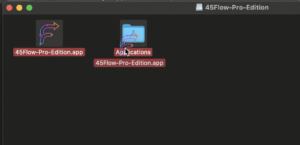

### Windows

| File to Download |
|-----------------|
| `45Flow-*-win-x64.exe` |

1. Double-click the downloaded `.exe` installer.
2. Follow the on-screen installation wizard steps.
3. Once complete, launch **45Flow** from the Start Menu or Desktop shortcut.

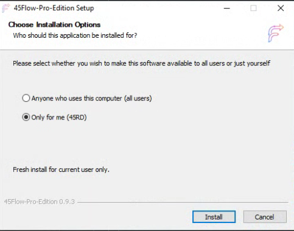

### Linux

Three package formats are available:

| Distribution | File | Install Command |
|-------------|------|-----------------|
| Ubuntu / Debian | `45Flow-*-linux-amd64.deb` | `sudo apt install ./45Flow-*-linux-amd64.deb` |
| Rocky / RHEL / Fedora | `45Flow-*-linux-x86_64.rpm` | `sudo dnf install ./45Flow-*-linux-x86_64.rpm` |
| Any Linux (portable) | `45Flow-*-linux-x86_64.AppImage` | No installation required |

**DEB / RPM Installation:**

1. Download the appropriate package file for your distribution.
2. Open a terminal and run the install command above, replacing `*` with the version number.
3. Launch **45Flow** from your application menu.

**AppImage (Portable):**

The AppImage is a self-contained portable executable that runs on any modern x86_64 Linux distribution without installation.

1. Download the `.AppImage` file.
2. Make it executable: `chmod +x 45Flow-*-linux-x86_64.AppImage`
3. Double-click the file or run it from the terminal: `./45Flow-*-linux-x86_64.AppImage`

The AppImage requires no root privileges and does not modify your system. It supports automatic updates — when a new version is available, the app will download and replace itself in place.

> **Tip:** Move the AppImage to a convenient location like `~/Applications/` or `/opt/` for easy access. You can also right-click → "Create Desktop Entry" in many file managers.

---

## 3. Getting Started — Connecting to Your Server

When you first open 45Flow, you'll see the **Login Screen**: a single card titled **"Sign in to 45Flow"**. This is where you connect the desktop client to your 45Drives server.

The card has two sections:

- **Login** — your **Username**, **Password**, and (desktop app only) **"Remember my password on this computer"**.
- **Server** (desktop app only) — the server to connect to: the **"Choose a server"** dropdown, the **"Or enter the server address"** box, and the collapsible **"Advanced: custom ports"** settings.

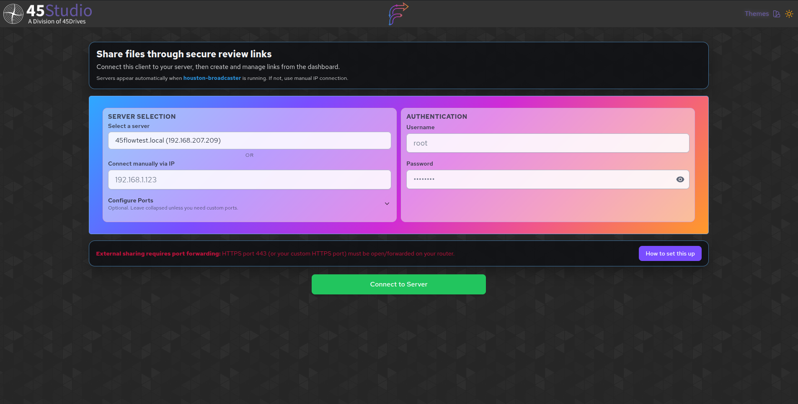

### Logging In

1. Enter your server **Username** (e.g., `root`).
2. Enter your **Password**.
3. *(Optional, desktop app only)* Check **"Remember my password on this computer"** so you don't have to type it next time.
4. In the **Server** section, choose your server from the dropdown or enter its address (see below).
5. Click **"Sign In"**.

The app will display status messages as it connects:
- *"Preparing SSH…"*
- *"Bootstrapping…"*
- *"Checking server health…"*
- *"Verifying the server certificate…"*

On success, you'll be taken to the **Projects** screen.


At the bottom of the card:

- **First-time setup** needs an account with **sudo** or **root** access, so 45Flow can install what it needs on the server.
- **"Set up port forwarding"** opens step-by-step help for sharing with clients outside your network. See [Port Forwarding](#4-port-forwarding-for-external-sharing).

### Automatic Server Discovery

If your server is running the **houston-broadcaster** service on the same network, it will appear automatically in the **"Choose a server"** dropdown. Each entry shows the server's hostname and IP address. While 45Flow is still searching, the dropdown shows *"Looking for servers on your network…"*.

Simply select your server from the dropdown to populate the connection.

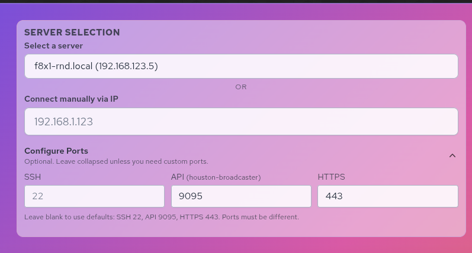

> **Note:** If no servers appear, the houston-broadcaster service may not be running, or you may be on a different subnet. Enter the server address instead, as described below.

### Entering the Server Address

If your server doesn't appear automatically:

1. Find the **"Or enter the server address"** box in the **Server** section.
2. Enter your server's IP address (e.g., `192.168.1.123`).

### Custom Port Configuration

In most cases, the default ports work without changes. If your server uses non-standard ports, click **"Advanced: custom ports"** to expand the port settings:

| Port | Default | Purpose |
|------|---------|---------|
| **SSH** | 22 | Secure shell communication, server setup, and verifying the server's HTTPS certificate |
| **Setup API** | 9095 | Finding and setting up the server |
| **HTTPS** | 443 | The app's encrypted connection to the server; share links, upload links, external access |

The app signs in and does all of its work over the HTTPS port, so that port must be reachable from your computer. It trusts the server's certificate, including the default self-signed one, by reading it over SSH; if the certificate cannot be verified, or the HTTPS port cannot be reached, the app does not connect rather than fall back to an unencrypted connection. Servers saved by an earlier version move to HTTPS automatically.

> **Important:** For external sharing the HTTPS port (443 by default) must be open/forwarded on your router. See [Port Forwarding](#4-port-forwarding-for-external-sharing) for details.

### License Status & Activation

After connecting to your server, 45Flow automatically checks the server's license status in the background. **Login is never blocked** — you can start using the app immediately, even if the server is unlicensed.

#### Community vs Pro Mode

- **Unlicensed server** — The app runs in Community mode. Pro features (custom branding, advanced watermarks, client-side comment review/export workflows, annotations) are hidden or disabled. The window title shows "45Flow (Community Edition)".

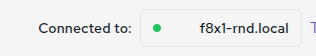

- **Licensed server** — The app automatically upgrades to Pro mode. All Pro features become available. The window title shows "45Flow (Pro Edition)".
- **Trial license** — If your server has an active trial license, the app shows "Pro Trial — X days left" in the header. When the trial expires, the app reverts to Community mode.

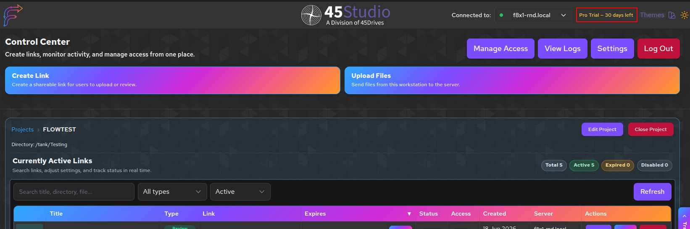

- **Pro — Legacy (expired license)** — If your server was previously licensed but the license has since expired, the app enters a "Pro — Legacy" state. In this mode:
    - All Pro features **you had at the time of expiry remain accessible** (branding, watermarks, client-side comment review/export workflows, annotations — whatever was available in the version you last updated to)
  - The window title shows "45Flow (Pro — Legacy)"
  - **Automatic updates are disabled** — you will not receive new app versions, bug fixes, or future Pro features until the license is renewed
  - Any **new Pro features released after your license expired will not be available** until you re-activate
  - You can re-activate a license at any time in Settings → Go Pro to restore full Pro status, unlock any new features, and resume receiving updates


> **Note:** Legacy mode ensures you are never abruptly locked out of features you already paid for. Think of it as: you keep everything your license covered, but the clock stops — no new features or updates until you renew. An active license means continuous access to every new feature and improvement as it's released.

#### Activating a License

If your server is unlicensed, you can activate a license at any time:

1. Open **Settings** from the Dashboard.
2. Navigate to **Go Pro** in the left sidebar.
3. Enter your **License Key** provided by 45Drives.
4. Click **"Activate License"** to validate and activate.

Once activated, the app immediately upgrades to Pro mode and all Pro features unlock.

> **Note:** Licenses are tied to the server, not individual users. Once a server is licensed, all users connecting to it automatically gain Pro features.

#### Starting a Trial

If you don't have a license key yet, you can start a **30-day free trial** directly from the Go Pro settings section. Trials give you full access to all Pro features for evaluation.

After successful login, you'll always be directed to the **Projects** screen.

---

## 4. Port Forwarding for External Sharing

**If you plan to share links over the internet (externally), complete this step before creating any external links.** Port forwarding is not required for sharing within your local network (LAN/VPN), but it is essential for allowing anyone outside your network to access share links, upload links, or review pages.

To share files externally (over the internet), HTTPS port **443** (or your custom HTTPS port) must be forwarded from your router to your server.

**What is port forwarding?**  
Port forwarding tells your router to direct incoming traffic on a specific port to your server's local IP address, allowing people outside your network to access your share links.

**General Steps:**

1. Log into your router's admin panel (usually at `192.168.1.1` or `192.168.0.1`).
2. Find the **Port Forwarding** or **NAT** settings section.
3. Create a new rule:
   - **External port:** 443 (or your custom HTTPS port)
   - **Internal IP:** Your server's local IP address
   - **Internal port:** 443 (or your custom HTTPS port)
   - **Protocol:** TCP
4. Save the rule and test using the **"Check Port"** button in the 45Flow link creation screen.

> **Note:** Port forwarding configuration varies by router manufacturer and model. Some ISPs or shared building networks may restrict port forwarding. If you're unsure whether your network supports it, contact your ISP or network administrator.

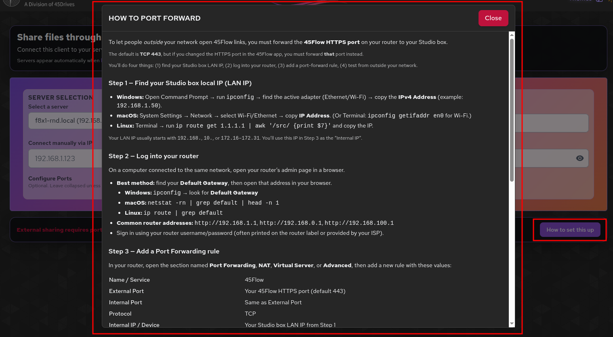

> **Tip:** After setting up port forwarding, configure your external URL in [Settings](#7-settings) → URLs & Access to ensure links are generated correctly.

> **Important:** If you only plan to share files within your LAN or VPN, you can skip this step entirely. Links shared locally do not require port forwarding.

---

## 5. Projects — Organizing Your Workspace

After logging in, you always land on the **Projects** screen. This is your primary workspace organizer. Each project is a folder on your server for one job or production — open a project to share files with clients or collect their uploads, or create a new one to get started.

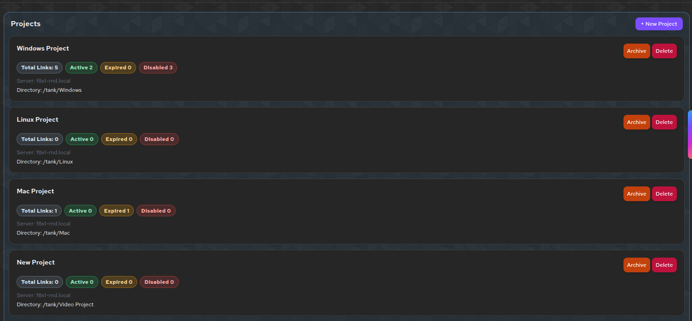

### What Are Projects

A project is a named workspace that:

- **Groups related links** — Keep all links for a client, campaign, or workflow together in one place.
- **Has a project folder** — Each project points to a specific folder on your server. When creating links or adding files within a project, the file browser starts from that folder.
- **Tracks link counts** — See at a glance how many active, expired, or disabled links each project has.
- **Scopes your view** — When you open a project, only that project's links are displayed.
- **Can be archived or deleted** — Archive completed projects to hide them without deletion, or permanently delete projects you no longer need.

### Links Without a Project

If you have older links that were created before projects (or links whose project was deleted), a collapsible **"Links Without a Project"** section appears below the project list. It only appears when such links exist. This includes:

- Older links created before projects
- Links whose project was deleted
- Links created via QuickShare without a project

Click the disclosure arrow to expand or collapse this section. These links are managed the same way as project links — you can view details, edit, disable, or delete them.

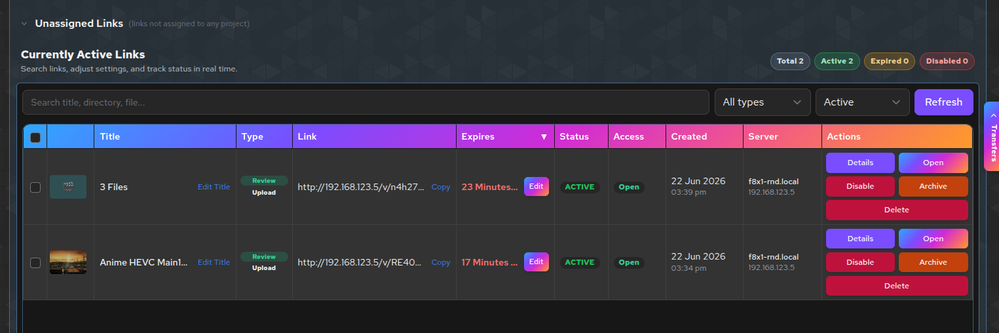

### The Project Workflow

The typical flow is:

1. **Log in** to 45Flow.
2. **Open a project** (or create a new one) from the Projects screen.
3. **The project view loads** showing only that project's links.
4. **Create links, add files, and manage client access** — all within the context of the open project.
5. Click **"Projects"** in the breadcrumb (or **"Back to Projects"**) to return to the project list.

To switch to a different project, return to the project list and open another one.

### Creating a Project

From the Projects screen, click **"+ New Project"** to create a new project:

1. Enter a **Project name** — A descriptive name (e.g., "Acme Corp Review", "Spring Campaign Edit").
2. Pick the **Project folder** — The folder on the server that holds this project's media. The folder picker detects your **ZFS pools** (storage locations) so you can start from one of them. To use a fresh folder, click **"New Folder"** in the folder browser, then select it.
3. *(Optional)* Add **Notes** about the project — client, deliverables, anything your team should know.
4. Click **"Create Project"**.

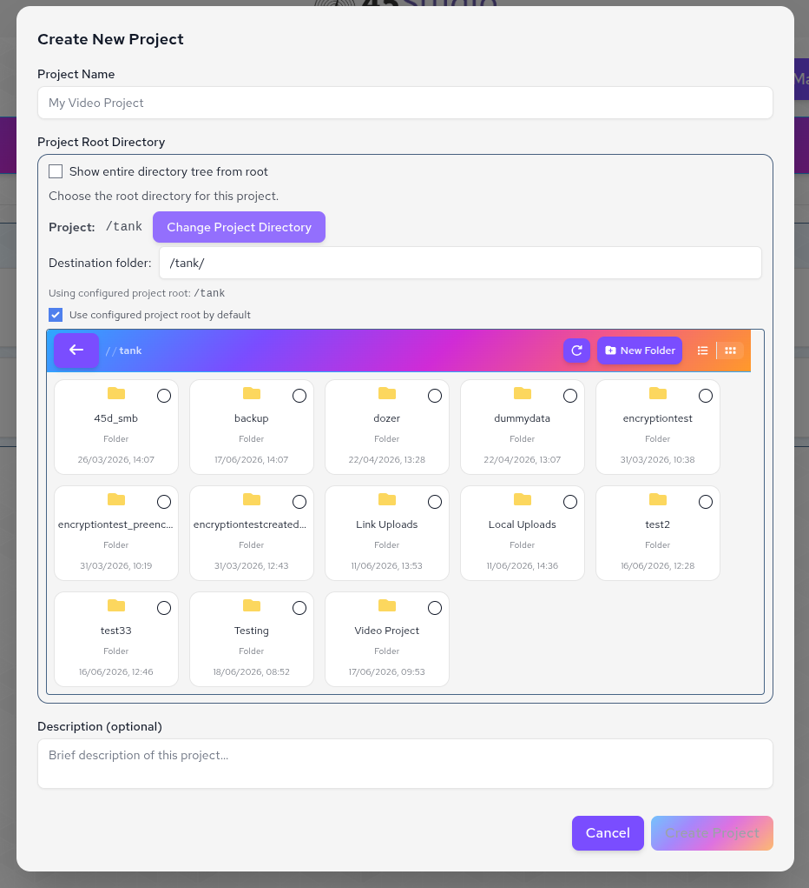

**Folder check:**

While you pick a folder, 45Flow checks it and shows what it finds:

- **On a storage pool** — A green check shows the ZFS storage pool the folder is on and how much space is free.
- **Not on a storage pool** — A warning shows the disk the folder is on and how much space is free. Media can fill a small disk fast; if the folder is on the server's system disk, the server can stop working.
- **Low space** — A red warning appears when less than 50 GB is free or the disk is 90% or more used. Pick a folder with more room for proxy files and client uploads.
- **New folder** — If the folder doesn't exist yet, 45Flow notes that it will create it.

> **Note:** 45Flow keeps each project's proxy files and streams in a hidden `.45flow` folder inside the project folder. Links that are not in a project use the `.45flow` folder in the default server folder (see [Settings → Preferences](#preferences)).

Once created, the new project opens immediately so you can start creating links or adding files.

### Managing Projects

**Viewing Projects:**

The Projects screen shows all active projects as cards in a responsive grid layout with:
- Project name
- **Folder:** the project folder path
- Link count badges: **Total Links**, **Active** (green), **Expired** (amber), **Disabled** (red)
- Server name (when connected to multiple servers)
- Notes (if provided)

Check **"Show archived projects"** above the cards to include archived projects in the list.

Projects are paginated when you have many — use the Previous/Next controls at the bottom to navigate pages.

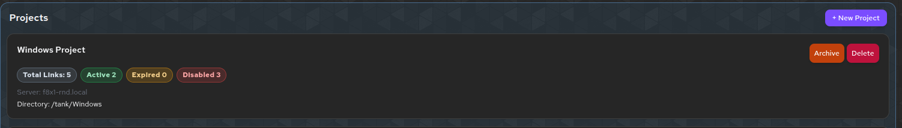

**Project Card Actions:**

Each project card has action buttons in the top-right corner (click without opening the project):

| Button | Description |
|--------|-------------|
| **Edit** | Opens the Edit Project dialog (see below). |
| **Disable / Enable** | Disables the project and all its links, or re-enables them. No files or links are deleted. |
| **Archive** | Deactivates all links and hides the project from the default view. Available on active projects. |
| **Unarchive** | Restores an archived project and re-enables its links. Available on archived projects. |
| **Delete** | Permanently removes the project (see below). |

**Editing a Project:**

Click **"Edit"** on a project card, or open the project and click **"Edit Project"** above its links list. The Edit Project dialog lets you update the **Project Name**, **Project Folder** (with the same folder check as when creating a project), and **Notes (optional)**. It also provides Archive/Unarchive and Delete Project buttons.

**Archiving a Project:**

Click **"Archive"** on a project card, or open the project and use the Edit Project dialog's Archive button. A confirmation dialog explains what archiving does:

- All active links in the project are **disabled** (become inaccessible)
- The project is hidden from the default project list
- **No files or links are deleted**
- You can unarchive at any time to restore everything

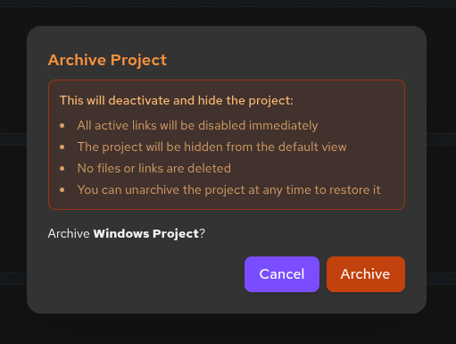

**Restoring an Archived Project:**

Check **"Show archived projects"** to see archived projects. They appear dimmed (reduced opacity) with an "Archived" badge. Click **"Unarchive"** on the card or in the Edit Project dialog to restore the project and re-enable its links.

**Deleting a Project (Hard Delete):**

Click **"Delete"** on a project card or **"Delete Project"** in the Edit Project dialog. A confirmation dialog warns:

- The project record is permanently removed
- Links associated with the project are **unlinked** from it (they are not deleted) and move to **Links Without a Project**, unless you choose to delete them
- This action **cannot be undone**

You can optionally delete the project's links and their generated or original files. When you choose to delete files, you must type "DELETE" to confirm.

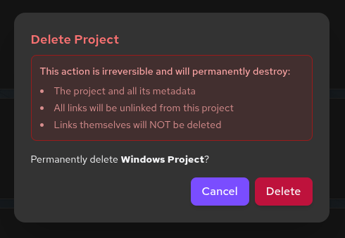

---

## 6. Dashboard Overview

The **Dashboard** is your central hub for managing all file sharing operations. It has two views:

- **Projects screen** — The project list, with **"+ New Project"**, **"Show archived projects"**, and (when any exist) the **Links Without a Project** section.
- **Project view** — Opens when you click a project. The header shows a **"Projects ›"** breadcrumb, the project name, and **"Project folder:"** with the folder path. Below it are the action cards and the project's links.

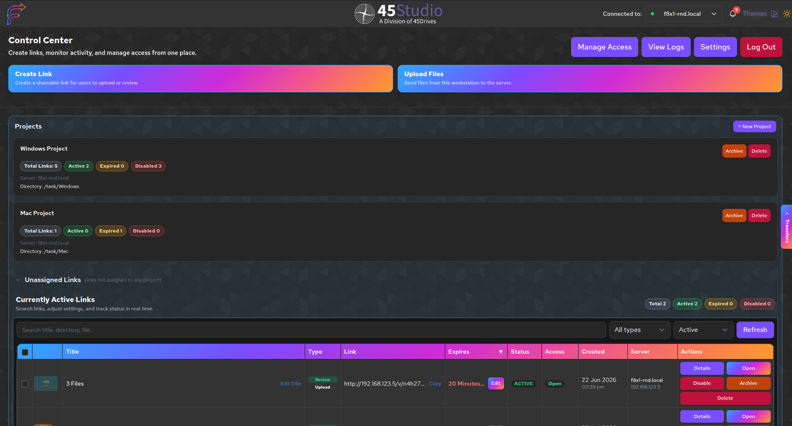

### Top Navigation

At the top of the Dashboard, you'll find quick-access buttons:

| Button | Description |
|--------|-------------|
| **Client Access** | Add client accounts, organize them into teams, and manage roles. Shown only inside a project. See [Client Access](#18-client-access). |
| **Activity Log** | Open the log viewer to inspect application activity and diagnose issues |
| **Settings** | Configure application-wide defaults for links, URLs, and server behavior |
| **Log Out** | Disconnect from the server and return to the Login Screen |
| **Notifications** (bell icon) | View notification history (see below) |

### Notifications

The **notification bell** in the top navigation provides a central history of all application notifications. A red badge shows the count of unread notifications (displays "9+" when more than 9).

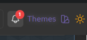

Click the bell to open the notification panel. Each notification shows:

- **Color-coded severity dot** — Red (error), amber (warning), blue (info), green (success)
- **Title** — Brief description of what happened
- **Body** — Detailed message (click any notification to expand its full text)
- **Timestamp** — Relative time (e.g., "2m ago", "1h ago")

Notifications are displayed in reverse chronological order (newest first). The panel stores up to 50 notifications. Click **"Clear all"** to dismiss the entire history.


> **Tip:** Click on any notification in the list to expand or collapse its full message text. This is useful for longer messages that are truncated by default.

### Main Action Buttons

Inside a project, two large action cards let you perform the core tasks:

| Button | Description |
|--------|-------------|
| **Create Link** | Send a client a link to review files, send you files, or both. Configure all link settings in one screen. See [Creating Links](#10-creating-links--share-upload-or-combined). |
| **Add Files** | Copy files from this computer into the project folder. See [Add Files](#11-add-files). |

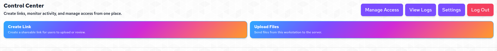

### Active Links Table

Below the action cards, the project view displays the **Links** table for the open project, with search/filter tools and at-a-glance status information. Above the table, **"Edit Project"** opens the Edit Project dialog and **"Back to Projects"** returns to the project list. See [Managing Links](#13-managing-links) for full details.

### Logging Out

Click **"Log Out"** at the top of the Dashboard to disconnect from the server and return to the Login Screen.

---

## 7. Settings

Configure application-wide defaults and server settings. Access Settings from the Dashboard by clicking **"Settings"**.

The Settings panel is organized into sections via the left-hand navigation sidebar:

- **Link Sharing** — URLs & Access, Public Sharing, Certificate, Link Options
- **Branding** — White Label (see [Custom Branding](#8-custom-branding-white-label--pro-feature))
- **Application** — Preferences, Performance, Server Health, Maintenance, Admin Networks (server administrators)
- **Help** — Guides

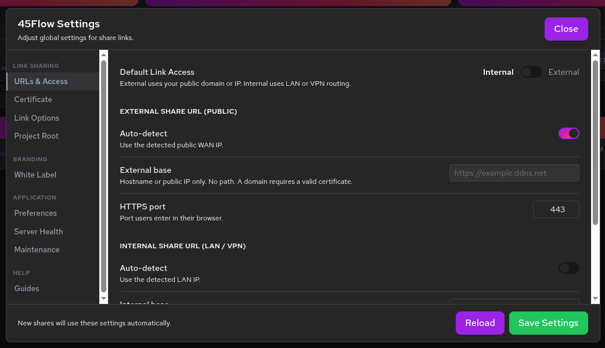

### URLs & Access

Toggle between **Internal** and **External** as the default network access mode for new links:

- **Internal** — New links default to LAN/VPN routing.
- **External** — New links default to public/internet routing (requires port forwarding).

**External Share URL (Public):**

| Setting | Description |
|---------|-------------|
| **Auto-detect (WAN IP)** | Enable to automatically detect and use your public IP address. Disable to enter a custom domain. |
| **External base** | Your public hostname or IP (e.g., `https://example.ddns.net`). No path — hostname only. |
| **External HTTPS port** | Port users will use in their browser. Default is `443`. |

> **Note:** Using a custom domain requires a valid SSL certificate for that domain. See [SSL Certificate Management](#ssl-certificate-management) below.

**Example:**  
Without a domain: `https://203.0.113.10/s/<token>`  
With a domain: `https://yourcompany.com/s/<token>`

**Internal Share URL (LAN / VPN):**

| Setting | Description |
|---------|-------------|
| **Auto-detect (LAN IP)** | Enable to automatically detect and use your local server IP. |
| **Internal base** | Private IP or internal hostname (e.g., `http://192.168.1.123`). |

A **Preview** section shows the currently active external and internal URLs so you can verify your configuration.

### SSL Certificate Management

The **Certificate** tab lets you upgrade from the default self-signed certificate to a trusted **Let's Encrypt** certificate for your custom domain. A trusted certificate eliminates browser security warnings when clients open share links.


**Certificate Status:**

The top section shows your current certificate state:

| Field | Description |
|-------|-------------|
| **Type** | Self-Signed (default) or Trusted (Let's Encrypt) |
| **Domain** | The domain the certificate is issued for |
| **Expires** | Expiration date with days remaining |
| **Auto-renewal** | Whether automatic renewal is active (Let's Encrypt certificates auto-renew before expiry) |

**Setting Up a Trusted Certificate:**

1. **Configure your domain** — Enter your custom domain name (e.g., `yourcompany.com`). This auto-syncs from the External Base if already set.
2. **Add a contact email** — Let's Encrypt sends renewal notices to this address.
3. **Create a DNS A record** — At your domain registrar (GoDaddy, Namecheap, Cloudflare, etc.), create an **A record** pointing your domain to your server's public IP address.
4. **Verify DNS** — Click **"Verify DNS"** to confirm the record is active.
5. **Install certificate** — Once DNS is verified, click **"Install Trusted Certificate"** to automatically obtain and install the Let's Encrypt certificate.

**Reverting to Self-Signed:**

If you need to remove the trusted certificate (e.g., domain change), click **"Revert to Self-Signed"**. This instantly switches back to the self-signed certificate.

> **Important:** Port 80 and 443 must both be accessible from the internet for Let's Encrypt validation to succeed. Ensure your firewall and port forwarding rules allow both ports.

### Public Sharing

The **Public Sharing** section provides a consolidated status overview of your server's readiness for external (internet) sharing. It shows at a glance whether all the components needed for public link access are correctly configured.

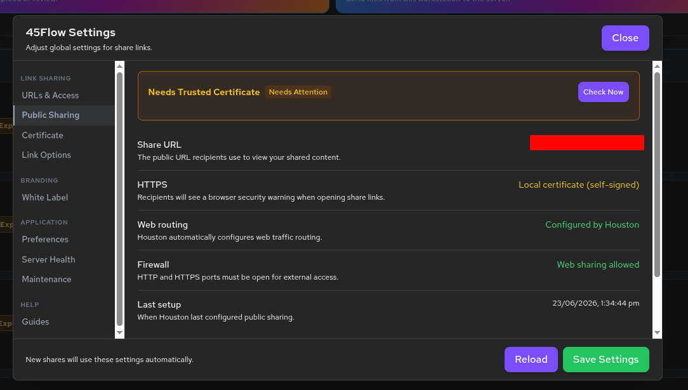

**Status Summary:**

A color-coded status card shows the overall state:
- **Green (Ready)** — All components are properly configured for public sharing.
- **Yellow (Warning)** — Some components need attention (e.g., missing trusted certificate, firewall ports closed).
- **Red (Error)** — Critical issue (e.g., web routing not working).

**Status Rows:**

| Row | Description |
|-----|-------------|
| **Share URL** | The public URL recipients use to access your shared content. |
| **HTTPS** | Certificate type (Trusted/Self-Signed) and validity status. |
| **Web routing** | Whether nginx is running and properly configured. |
| **Firewall** | Whether HTTP (80) and HTTPS (443) ports are open for external access. |
| **Last setup** | When Houston last configured public sharing (timestamp). |

**Actions:**

- **Check Public Sharing** — Re-checks all status components.
- **Repair Public Sharing** — Attempts to automatically fix common issues (restarts nginx, regenerates configs).
- **Install Trusted Certificate** — Navigates to the Certificate section for Let's Encrypt setup.

### Link Options

These defaults are applied automatically when creating new links, but can be changed per link:

| Option | Description |
|--------|-------------|
| **Invite-only links** | New links default to invite-only mode: only invited clients and teams can get in. |
| **Allow comments on open links** | Enable comments by default on open (unauthenticated) links. |
| **Generate proxy files by default** | Automatically enable proxy file generation for new links. |
| **Default watermark settings** | Configure default watermark image and settings for new links. See [Watermark Settings — Video and Image Support](#watermark-settings--video-and-image-support) for details on Community vs Pro watermark features. |

### Preferences

**Display:**

| Option | Description |
|--------|-------------|
| **Time format** | Toggle between 24-hour and 12-hour time display throughout the app. |
| **Default link list view** | Choose which links are shown by default (All Links or Active Only). |

**Path Defaults:**

| Setting | Description |
|---------|-------------|
| **Use default server folder** | When on, folder pickers start in the default server folder below. Projects keep their own folders. |
| **Default server folder** | Absolute path on the server. It holds the hidden `.45flow` folder (proxy files and streams) for links that are not in a project. Each project keeps its own `.45flow` folder inside its project folder. |

### Performance

The **Performance** section controls client-side video transcoding — processing videos on your machine before uploading rather than on the server.

| Option | Description |
|--------|-------------|
| **Enable client-side transcoding** | When enabled, videos are processed on your computer before upload — using your local CPU or GPU. This creates proxy files faster and reduces load on the server. When disabled, the server handles all video processing after files are uploaded. |
| **Hardware Acceleration** | Uses your GPU (NVIDIA NVENC, Intel Quick Sync, AMD AMF, Apple VideoToolbox) for faster transcoding. Falls back to CPU-only when no compatible GPU is detected. |
| **Encode Quality** | Choose between Fast (quicker encode, larger file), Balanced (good tradeoff), or Quality (slower encode, best visual fidelity). |
| **Detected Encoders** | Shows which hardware encoders passed verification on your system. |

> **Note:** Client-side transcoding is **disabled by default**. Enable it in Settings → Performance if you want video processing to happen locally. When disabled, videos are transcoded on the server after upload.

#### Hardware Requirements for Client-side Transcoding

- **Minimum:** Any modern multi-core CPU (4+ cores recommended)
- **Recommended:** Dedicated GPU with hardware encoding support (NVIDIA GTX 1060+ / Intel 6th-gen+ / Apple Silicon)
- **Storage:** Temporary disk space equal to ~1.5× the size of the source video during transcode
- **FFmpeg** is bundled with 45Flow — no separate installation is needed

> **Tip:** If client-side transcoding fails (e.g., insufficient GPU memory or unsupported codec), you can disable it in Settings → Performance. The server will handle transcoding instead — it just takes longer.

### Server Health

The **Server Health** section provides real-time resource statistics from your connected server.

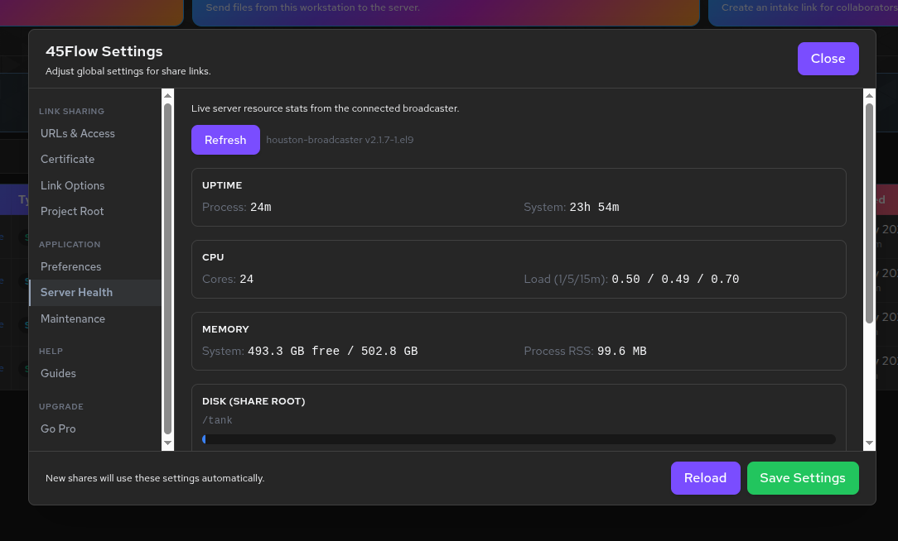

Server Health auto-loads when you navigate to the section and shows the following:

| Section | What It Shows |
|---------|---------------|
| **Version** | The installed houston-broadcaster version |
| **Uptime** | Process uptime (how long the server has been running) and system uptime (total OS uptime) |
| **CPU** | Number of CPU cores and load averages (1-minute, 5-minute, 15-minute) |
| **Memory** | System total/free RAM and process RSS (resident set size) |
| **Disk (Share Root)** | Visual progress bar showing disk usage on the share root volume, with used/free/total bytes |
| **Transcode Queue** | Number of transcode jobs currently queued, running, completed, or failed |
| **Links & Connections** | Count of active/total links and current WebSocket connections |

The disk usage bar changes color based on usage:
- 🔵 Blue — under 75% used
- 🟡 Amber — 75%–90% used
- 🔴 Red — over 90% used

Click **"Refresh"** to fetch the latest stats from the server.

> **Note:** Server Health requires admin (PAM) access. If you're logged in with a non-admin user or an environment token, you'll see an access denied message.

### Maintenance & Cleanup

For administrators to manage server health:

- **Delete orphan transcode directories** — Remove transcode output folders that no longer have associated links.
- **Prune DB rows for missing source files** — Clean up database entries where the original files no longer exist on disk.
- Configure **orphan min age** (hours) and **max missing file checks** to control scan scope.
- Click **"Run Scan"** to preview what would be cleaned, then **"Apply Cleanup"** to execute.
- Use **"Export JSON"** to save scan results.

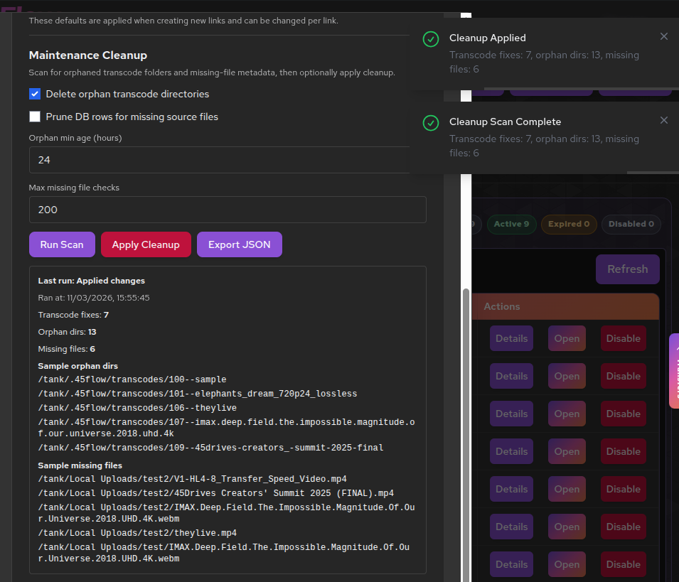

### Admin Networks

**Most users do not need to change this setting.** Use it when your server
administrator needs to limit which office or VPN networks can reach the server's
administrative HTTPS interface.

- **It controls:** access to administrative HTTPS routes, including administrative
  WebSocket connections. Allowed users still need to log in.
- **It does not control:** public share links, recipient passwords or permissions,
  SSH access, or direct connections to the backend port (9095 by default).
  Keep the backend port private using your firewall/router.
- **Who can change it:** users signed in with server credentials, on free or Pro
  servers. Giving a collaborator a role called "admin" does not grant this access.

The defaults cover common LAN and VPN address ranges, not just your own network.
Being on an allowed network does not make every device trustworthy.
You do not need a public domain, Let's Encrypt or port forwarding to use this
panel on a LAN-only server.

#### Changing the allowed networks

Keep a working server console or SSH connection available before making changes.
An incorrect list can block your administrative HTTPS connection.

1. Open **Settings → Admin Networks**. Note the connection address shown by the
   server. If you connect through a proxy, this may be the proxy's address.
2. Enter one trusted network per line. For example, `192.168.1.0/24` allows
   `192.168.1.0` through `192.168.1.255`; `192.168.1.25/32` allows one IPv4
   address. These are examples, not values to copy without checking your network.
   Open **What are these networks?** for more help.
3. If you only want the current connection address allowed, click
   **Allow this device only**. It uses the address shown by the server, not your
   whole LAN. A changing address or proxy can make this unsuitable.
4. Click **Check proposed networks**. For a normal change, make sure the result
   says your current connection is included. Do not use the exclusion override
   unless you deliberately want to block this connection and have another
   permitted connection available to confirm.
5. Acknowledge the warning, then click **Apply admin networks**.
6. Click **Reconnect and confirm** before the displayed deadline. This checks
   that you can still connect using the new rules and makes the change permanent.
   Without confirmation, the server automatically restores the previous rules.

**Apply admin networks** takes effect separately from **Save settings**.
An empty list blocks all administrative HTTPS access; `/0` ranges, which would
allow every address in an IP family, are rejected.

#### If you lose access or see a connection warning

- **After applying a change:** wait for the displayed rollback deadline, reconnect,
  then click **Reload admin networks**. Do not repeatedly apply changes.
  Leave the broadcaster service running so it can restore the old rules.
  If it was interrupted, recovery runs when it restarts; a reported recovery
  failure needs console/SSH assistance.
- **SSH trust prompt:** the desktop uses SSH to verify the server's HTTPS
  certificate, including self-signed certificates on private servers. If asked
  **Trust this SSH server?**, verify the fingerprint with your administrator or
  server console before accepting. A changed/revoked SSH identity, expired
  certificate or failed verification blocks the operation rather than bypassing
  the check.
- **Panel cannot connect:** confirm the server's HTTPS port is reachable
  (443 by default). For custom ports, check the connection ports on the login
  screen. Like the rest of the app, this panel uses HTTPS and never falls back
  to the backend port.
- **Connection safety unavailable:** ask your administrator to update the server
  and regenerate/reload its nginx configuration before retrying.

The address check and automatic rollback reduce accidental lockout; they cannot
guarantee access after your IP address, VPN, proxy or firewall changes.

### Guides

The Guides section provides:

- **Open User Guide** — Opens this documentation in your browser.
- **Disable guided tours** — Turn off all onboarding walkthroughs and first-time guides.
- **Re-enable guided tours** — Reset onboarding walkthroughs so they show again on each page.

### Saving Settings

- Click **"Save settings"** to apply all changes. New links will use the updated defaults.
- Click **"Reload"** to discard changes and reload current settings from the server.

> **Important:** Settings changes affect only **newly created links**. Existing links are not modified retroactively.

### Go Pro — License Activation

The **Go Pro** section appears in Settings when your server is unlicensed or running on a trial license. Use this section to activate a full license or start a free trial.

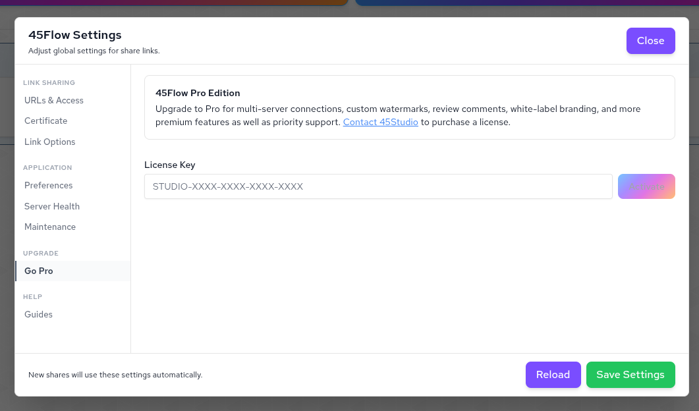

**License Activation:**

1. Enter your **License Key** in the input field.
2. Click **"Activate License"**.
3. The app validates your key with the licensing server.
4. On success, your server is permanently licensed and the app immediately upgrades to Pro mode.

**Start a Free Trial:**

If you don't have a license key yet:

1. Click **"Start Free Trial"**.
2. Enter your email address.
3. A 30-day trial license is generated and activated automatically.
4. You'll receive a confirmation email with trial details.

**Trial Status:**

When running on a trial license, this section shows:
- Trial expiration date
- Days remaining
- Option to upgrade to a full license before the trial expires

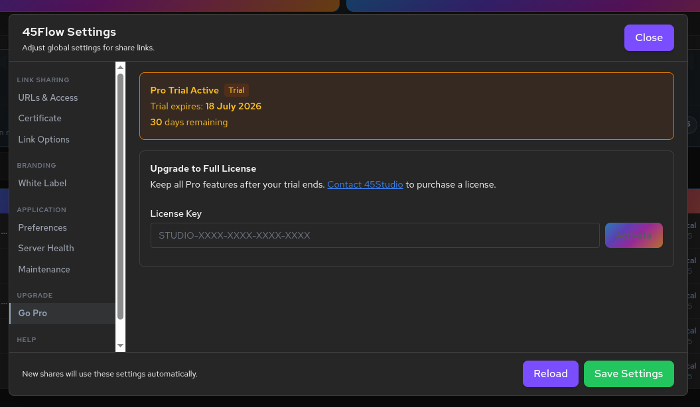

When a trial expires, the app reverts to Community mode and Pro features are disabled until a full license is activated.

> **Note:** The Go Pro section is hidden once your server has a full Pro license (not trial). To view license details, go to Settings → Application → Server Health.

---

## 8. Custom Branding (White Label) — Pro Feature

**Custom branding requires a Pro license.** This feature lets you customize how share links, upload pages, and review pages appear to your clients and collaborators. When enabled, recipients see your company's branding instead of the default 45Flow identity.

Access branding configuration from **Settings → White Label**.

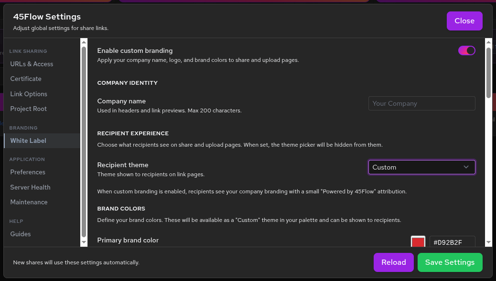

### Enabling Branding

Toggle the **"Enable white-label branding"** switch at the top of the Branding section. When disabled, all share pages display the default 45Flow branding.

### Company Identity

| Field | Description |
|-------|-------------|
| **Company name** | Your company or studio name (max 200 characters). Displayed on share pages below the logo. |

### Theme & Colors

Control the visual theme applied to all share/upload pages that recipients see:

**Enforced Theme:**

Choose from 22+ built-in themes or select **"Custom"** to define your own brand colors:

- **Built-in themes** — Pre-designed color palettes (dark, light, and specialty themes) applied automatically to all share pages.
- **Custom** — Define your own primary and secondary brand colors.

When **Custom** is selected, two color pickers appear:

| Field | Description |
|-------|-------------|
| **Primary color** | Main brand color used for buttons, links, and accent elements (e.g., `#D92B2F`). |
| **Secondary color** | Supporting color used for gradients, hover states, and secondary elements (e.g., `#b02428`). |

A **gradient preview** shows how your colors will render together. The editor also provides a **WCAG contrast warning** if your color combination may have accessibility issues with text readability.

> **Note:** When an enforced theme is set, recipients cannot change the theme on share pages — the theme picker is hidden from their view. This ensures consistent brand presentation.

### Company Logo

Upload your company logo to replace the default 45Flow logo on all share and upload pages.

| Option | Description |
|--------|-------------|
| **Default logo** | A single logo used for both light and dark backgrounds. Upload a PNG, JPEG, SVG, or WebP file (max 2 MB). |
| **Split logos (light/dark)** | Toggle to upload separate logos optimized for light and dark backgrounds. Useful when your logo doesn't work on both. |

After uploading, a preview shows the logo with its dimensions and file size. Click the **trash icon** to remove an uploaded logo.

> **Tip:** For best results, use a transparent PNG or SVG with adequate padding. Logos are displayed at a reasonable size — overly large images will be scaled down.

### Support & Contact Information

Add your company's support details to share pages, so recipients know who to contact:

| Field | Description |
|-------|-------------|
| **Support email** | Displayed as a clickable mailto link on share pages (max 200 characters). |
| **Support URL** | A link to your help desk, FAQ page, or support portal (max 500 characters). |

These appear on password-protected pages, expired link pages, and in the footer of upload pages.

### Link Preview Metadata

Customize how your share links appear when pasted into social media, Slack, Teams, email clients, or any platform that renders **Open Graph** (OG) previews:

| Field | Description |
|-------|-------------|
| **Link preview title** | The title shown in social cards and link unfurls (max 200 characters). |
| **Link preview description** | The description text shown below the title in link previews (max 500 characters). |

> **Example:** When someone pastes a share link into Slack, instead of showing "45Flow — Secure file sharing", it could show "Acme Studios — Review your project files securely".

### Live Preview

The branding panel includes a **live preview** section showing miniature mockups of how your branding will appear:

- **Protected Link page** — What recipients see when a link requires a password.
- **Review Page** — The video player / file viewer page.
- **Upload Page** — The drag-and-drop upload page.

These previews update in real-time as you change settings, giving you immediate visual feedback before saving.

### Clearing Branding

Click **"Clear branding"** at the bottom of the section to reset all branding fields to their defaults. This removes all custom logos, colors, company name, and support info — restoring the default 45Flow appearance on all share pages.

### How Branding Appears to Recipients

When branding is enabled, recipients viewing your share links will see:

- **Your logo** instead of the 45Flow logo (respects light/dark mode if split logos are configured)
- **Your company name** displayed below the logo
- **Your brand colors** applied to buttons, links, gradients, and backgrounds
- **Your support contact** on password pages and expired link pages
- **"Powered by 45Flow"** attribution shown as a subtle footer (required)
- **Your enforced theme** — recipients cannot change the color theme

> **Important:** Branding is tied to your server's license. If the license expires or is revoked, share pages will revert to default 45Flow branding.

---

## 9. Drag and Drop QuickShare

The **QuickShare** feature provides the fastest way to create a share link. Drag files from your desktop or file manager directly into 45Flow, configure a few options, and generate a shareable link in seconds.

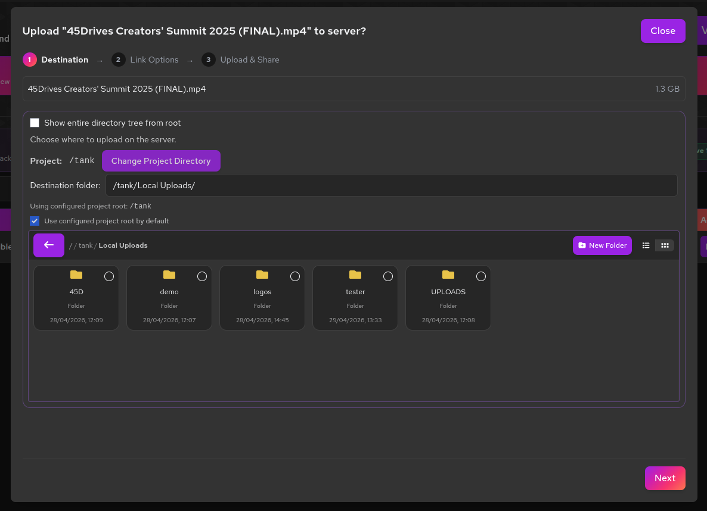

### How to Use QuickShare

1. **Drag Files:** From anywhere on your computer, drag one or more files directly into the QuickShare drop zone.
2. **Choose Destination:** Select the folder on the server where your files will be stored.
3. **Configure Options:** For video files, choose proxy file qualities and watermark settings. Set link expiry, title, and access controls.
4. **Generate Link:** Click **"Share"** to upload, transcode, and generate a shareable link.

Documents and spreadsheets: Share Excel, OpenDocument, CSV, TSV, and Word files. Spreadsheets have a read-only grid preview; DOCX has a text preview. Legacy DOC files require downloading.

Previews support files up to 10 MB and may show only part of larger documents or worksheets. Download the original for complete content and formatting, when permitted.

QuickShare checks all selected files before uploading. If any are unsupported or exceed upload limits, nothing uploads and the rejected files are listed.

**Video Processing:** When client-side transcoding is enabled (Settings → Performance), video files are transcoded on your machine before upload — this generates both a **Stream** (HLS for browser playback) and **Proxy Files** (downloadable MP4s). With server-side mode, files upload first and the server handles processing.

### QuickShare Options

QuickShare lets you configure:

- **Destination folder** — Where files are stored on the server
- **Link expiration** — How long the link remains active (default: 7 days)
- **Access mode** — Open (anyone with link), password-protected, or invited clients/teams
- **Proxy file qualities** — 720p, 1080p, and/or full resolution (for video)
- **Watermark** — Overlay a watermark on video and image files (Pro: full positioning; Community: basic)
- **Network mode** — External (port-forwarded) or Local (LAN/VPN)

These defaults can be customized in [Settings](#7-settings) under **Link Options**.

### After Creating a QuickShare Link

Once generated, the share link is:
- **Automatically copied to your clipboard** — ready to paste into email, chat, or wherever you need
- **Displayed on screen** — for immediate viewing and verification
- **Added to your Active Links table** on the Dashboard for management

From the Dashboard, you can find your QuickShare link and:
- Edit settings (change expiration, access mode, etc.)
- Copy the link again
- View access logs
- Delete the link

> **Tip:** QuickShare is perfect for ad-hoc file sharing when you don't need custom settings. For more control over link configuration, use [Create Link](#10-creating-links--share-upload-or-combined) inside a project instead.

---

## 10. Creating Links — Share, Upload, or Combined

45Flow uses a **unified link system** — every link can be configured to support file sharing (review/download), upload, or both simultaneously. You no longer need to create separate "share links" and "upload links" — a single link can do both.

Open a project and click **"Create Link"** to begin.

### Step 1: Select a Project or Destination

Links are created inside a project. The **Create Link** screen opens for the project you were in, and the file browser starts in that project's folder.

To create the link in a different project, use the **Project** selector in the top-right corner of the screen header. Changing the project moves the file browser to that project's folder.

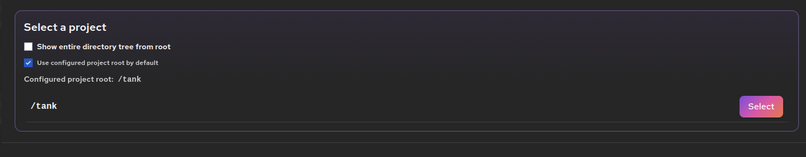

Click **"Back to Project"** at the bottom of the screen (or **"Back"** in the header) at any time to cancel and return to the project.

### Step 2: Configure Link Settings

The Create Link screen is a single page, from top to bottom:

1. **Link name** *(optional)* — An internal name to help you identify the link later (e.g., "Rough Cut v2 for review").
2. **Files to share** — A full-width file browser for picking what your client should review or download.
3. **Details** — Whether the client can upload, and to which folder.
4. **Link options** — Expiry, network, what happens after a client uploads, and who can access the link.
5. **Video / Image / Media Options** — Proxy files and watermark settings (shown when you have picked video or image files).
6. **Generate Flow link**.

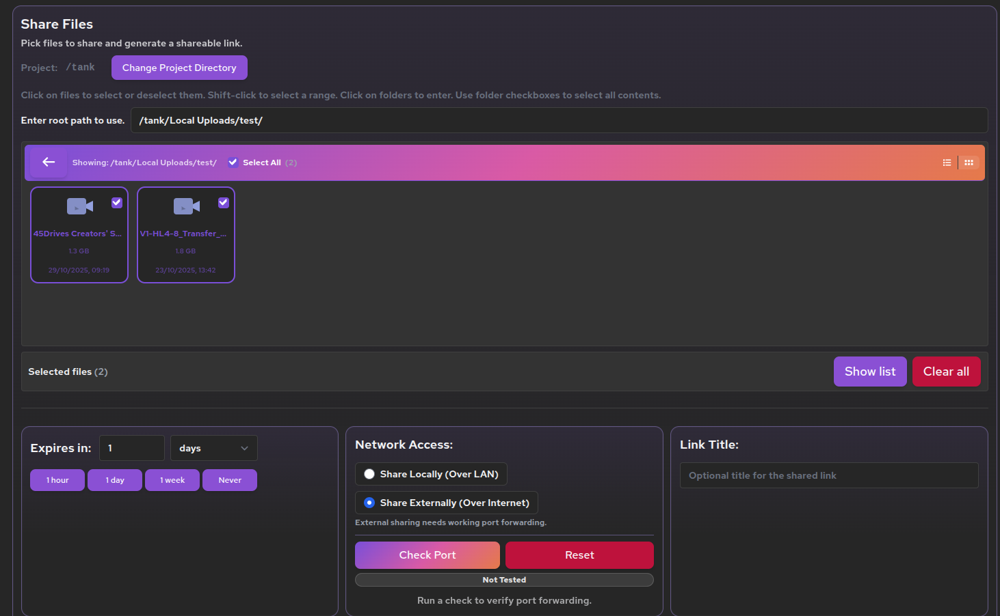

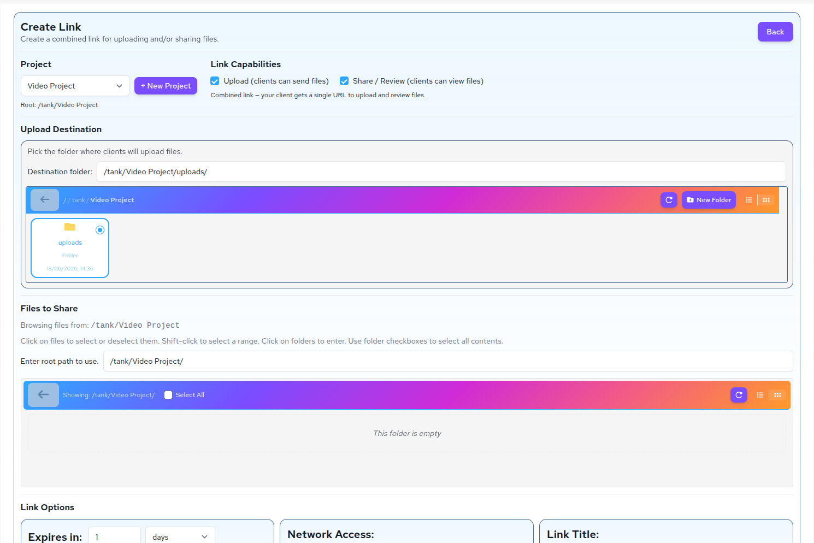

### Link Types — Share, Upload, Combined

45Flow links support three modes:

| Mode | Description |
|------|-------------|
| **Share only** | Recipients can view, download, and comment on files. Pick files under **Files to share** and leave **"Let client upload to"** unchecked. |
| **Upload only** | Recipients can send files to a specified destination folder. Leave **Files to share** empty and check **"Let client upload to"**. |
| **Combined (Share + Upload)** | Recipients can both review your shared files AND upload their own files. Pick files and check **"Let client upload to"**. Perfect for collaborative workflows. |

The link type follows from what you pick: there is no separate mode switch. A summary line under the **Generate Flow link** button tells you what kind of link you are about to create.

#### Selecting Files (Share Mode)

The **Files to share** browser sits front and center, across the full width of the screen:

- Use the **file browser** to navigate folders and select individual files. Check a folder to include everything in it.
- Selected files appear in the **"Selected"** panel with a count. Files from the same folder are grouped together.
- Click **"Show"** to review your selection, and use the **✕** button to remove individual files or a whole folder group.
- Click **"Clear"** to start over.
- Leave **Files to share** empty to make an **upload-only** link.

#### Letting Clients Upload

The **Details** section has a single row for client uploads:

1. Check **"Let client upload to"**.
2. Type the folder path on the server in the box next to it. The box suggests matching folders as you type.
3. Or click **"Browse…"** to open the folder browser and pick the folder. Click **"Done"** to close the browser.

Client uploads land in this folder. If the folder doesn't exist yet, 45Flow creates it. The filesystem root (`/`) can't receive uploads.

#### Configuring Basic Settings

**Expiration:**
- Set how long the link stays active using the **"Expires in"** field.
- Use the number and time unit (hours, days, weeks) or choose a quick preset: **1 hour**, **1 day**, **1 week**, or **Never**.
- Once expired, the link becomes inaccessible automatically.

**Network:**
- **Share Externally (Over Internet)** — Link accessible from anywhere. Requires port forwarding to be configured. This is listed first and is the default, unless your administrator set the default to Internal in [Settings → URLs & Access](#urls--access).
- **Share Locally (Over LAN)** — Link accessible only within your local network or VPN.
- When **Share Externally** is selected, use the **"Check Port"** button to verify your external port forwarding is working.

**After a client uploads** (available when **"Let client upload to"** is checked):
- **Share uploads back** — Add each upload to the files shared on this link. On an upload-only link, the client can view and download each file right after they upload it, on the same link.
- **Watermark uploads** — Apply this link's watermark settings to new uploads.
- **Make proxy files for uploads** — The server makes proxy files for each video the client uploads. Choose the **Proxy sizes**: **720p**, **1080p**, and/or **Full Res (MP4)**.

**Project:**
- The link is created in the project shown in the **Project** selector in the header.

### Link Access Modes

Choose who can access the link:

| Mode | Description |
|------|-------------|
| **Anyone with the link** | No login required. Anyone with the URL can access the files. You can optionally enable the **"Allow comments"** toggle so visitors can leave a name and comment. |
| **Anyone with the link + password** | Requires a shared password. Enter a password in the field that appears. The same password is used by all recipients. |
| **Only invited clients & teams** | Requires each client to log in with their own login. Click **"Invite clients & teams…"** to choose which clients and teams can access the link. Roles set what they can do. |

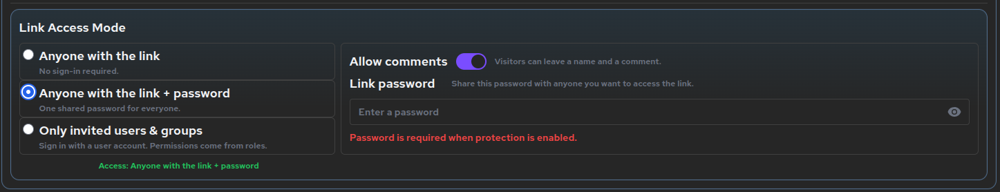

When comments are enabled, you can optionally define **Comment Categories** (for example: *Client Feedback*, *Audio*, *Color*, *VFX*, *Needs Revision*). Categories help standardize review notes and make filtering and exports easier later.

### Video and Media Options

When you pick video or image files to share, a **Video Options**, **Image Options**, or **Media Options** section appears below the link options:

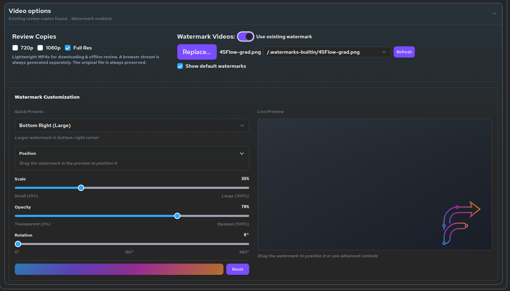

**Proxy Files:**
- Choose which proxy file qualities to generate: **720p**, **1080p**, **Full Res (MP4)**, or any combination.
- Shared links serve the proxy files instead of the originals, providing faster playback and reduced bandwidth.
- A note shows whether the video will be transcoded on this computer (client-side transcoding) or by the server.

### Watermark Settings — Video and Image Support

45Flow supports watermarking for both **video files** and **image files**. When enabled, watermarks are applied to proxy files (for videos) or directly to the shared image (for images).

**Enable Watermark:**
- Turn on **"Watermark Videos"** (or **"Watermark Images"** / **"Watermark Media"**, depending on what you picked) to enable watermarking.
- Click **"Browse…"** to upload a watermark image, or choose from built-in presets.

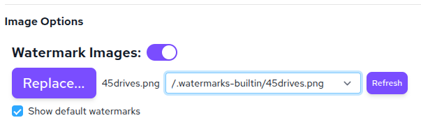

**Community vs Pro Watermarking:**

| Feature | Community | Pro |
|---------|-----------|-----|
| Video watermarking (enable/disable, select image) | ✅ Yes | ✅ Yes |
| Image watermarking (enable/disable, select image) | ✅ Yes | ✅ Yes |
| Position control (9 anchor points) | ❌ Bottom-right only | ✅ Full control |
| Scale, opacity, rotation | ❌ Fixed defaults | ✅ Customizable |
| Watermark presets (save & reuse) | ❌ No | ✅ Yes |

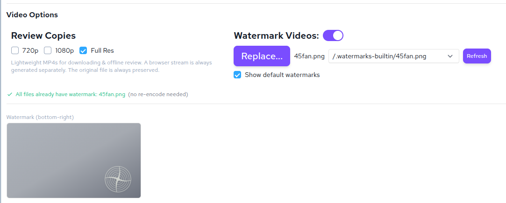

**Watermark Position & Style (Pro):**

| Setting | Description |
|---------|-------------|
| **Position** | Nine anchor points: Top-Left, Top-Center, Top-Right, Center-Left, Center, Center-Right, Bottom-Left, Bottom-Center, Bottom-Right. |
| **Scale** | Size of the watermark relative to the frame (percentage). |
| **Opacity** | Transparency level (0% = invisible, 100% = fully opaque). |
| **Rotation** | Angle in degrees (e.g., 45° for diagonal placement). |

**Watermark Presets (Pro):**

- The preset dropdown shows all available watermark images with saved settings.
- Select a preset to instantly apply a predefined watermark configuration.
- Upload your own watermark image by clicking **"Upload custom watermark"**.
- Presets can be saved and reused across multiple links.

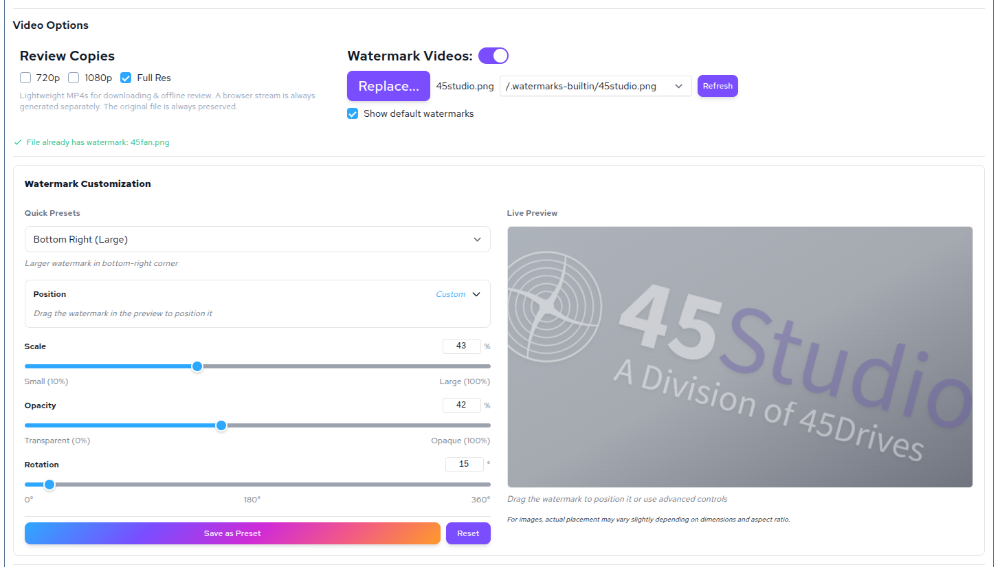

> **Note:** In Community mode, watermarks (video and image) are applied at a fixed bottom-right position with default scale/opacity. Upgrade to Pro for full customization (position, scale, opacity, rotation) and reusable presets.

### Generating the Link

1. Verify all your settings are correct. The summary line under the **"Generate Flow link"** button says what kind of link you are about to create:
   - *"This link lets your client review and download N files."* — a share (review) link.
   - *"No files selected, so this is an upload-only link: your client can send you files."* — an upload-only link.
   - *"This link lets your client review N files and upload files to you."* — a combined link.
2. Click **"Generate Flow link"**.
3. The generated URL will appear — use the **"Copy"** button to copy it to your clipboard, or **"Open"** to view it in your browser.
4. The link is now visible in the project's links list for ongoing management.

Click **"Reset"** to clear the form and start over, or **"Back to Project"** to return to the project.

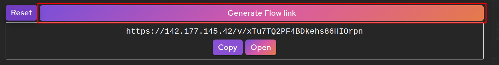

---

## 11. Add Files

Use this feature to copy files from this computer into a project folder on the server. This is ideal for getting new media onto the server for sharing later.

Open a project and click **"Add Files"** to begin. A three-step wizard titled **"Add Files → \<project name\>"** guides you through the process: **Pick Files**, **Choose Folder**, and **Upload**. Click **"Back to Project"** at any time to return to the project.

### Step 1: Pick Files

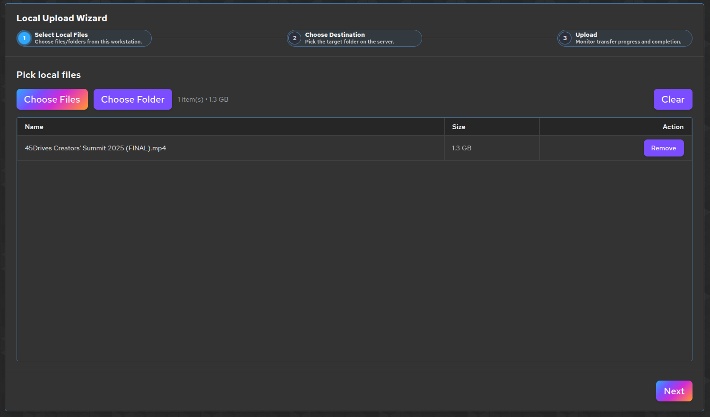

1. Click **"Choose Files"** to select individual files, or **"Choose Folder"** to add an entire folder's contents. You can also drag files onto the table.
2. Selected files appear in a table showing **Name**, **Size**, and a **Remove** button.
3. A summary shows the total number of items and combined size.
4. Use **"Clear"** to remove all selected files and start over.
5. Click **"Next"** to proceed.

> **Note:** You can select multiple files at once in the file chooser dialog.

### Step 2: Choose Folder

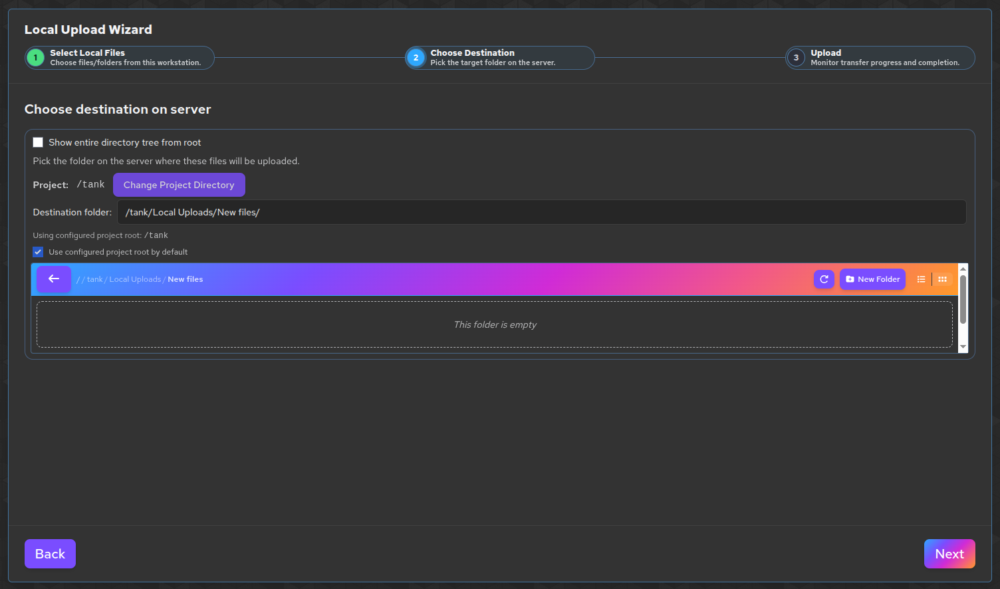

1. The folder browser opens in the project folder. Pick where the files go in the project.
2. Navigate the folder browser:
   - **Single-click** a folder to select it as the destination.
   - **Double-click** a folder to enter it and browse deeper.
   - Click **"New Folder"** to create a new directory at the current location.
3. The selected destination path is shown at the top.
4. Click **"Next"** to proceed, or **"Back"** to return to file selection.

### Step 3: Upload & Monitor Progress

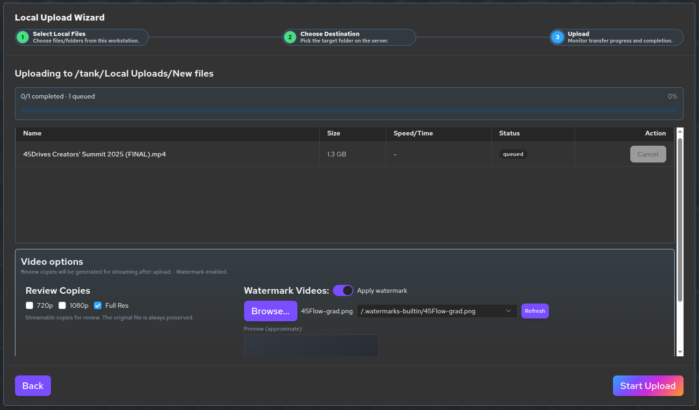

The heading shows **"Adding to \<folder\>"** so you can confirm where the files are going.

**Before Uploading:**

If you're uploading video or image files, you can configure **Video options** (or **Image options** / **Media options**) before starting:

- **Proxy Files** — Choose proxy file qualities (720p, 1080p) to generate for your videos during upload. These proxy files are used when you share the files later via links.
- **Watermark Media** — Apply a watermark overlay to uploaded videos and images (Pro: images supported with full customization; Community: videos only with basic positioning).

Click **"Start Upload"** to begin transferring files.

> **Note:** Filenames are automatically sanitized during upload for cross-platform compatibility. Special characters such as apostrophes (`'`), colons (`:`), and other non-standard characters are replaced with underscores (`_`). If a file is renamed, a notification will appear showing the new filename.

**During Upload:**

The upload table shows each file with real-time status:

| Column | Description |
|--------|-------------|
| **Name** | File name with upload percentage |
| **Size** | File size |
| **Speed / Time** | Transfer speed during upload, or total time after completion |
| **Status** | Current state — **Queued**, **Transcoding** (local), **Uploading**, **Done**, **Canceled**, or **Error** |
| **Action** | Cancel button (available during active transcode or upload) |

A progress bar at the top shows overall completion across all files.

When **client-side transcoding** is enabled (Settings → Performance), video files go through a two-phase workflow:
1. **Transcode** — The video is processed on your machine using hardware acceleration (GPU) if available. This generates both the **Stream** (HLS adaptive bitrate for browser playback) and **Proxy Files** (downloadable MP4 files at your chosen qualities). Shown as "Transcode XX%" in the table.
2. **Upload** — The raw source file is transferred to the server for archival. Shown as "Upload XX%".

This offloads video processing from the server to your workstation, typically completing much faster with hardware-accelerated encoding.

If client-side transcoding is **not enabled**, the workflow is reversed:
1. **Upload** — The raw file uploads to the server first.
2. **Server Transcode** — The server queues and processes video encoding in the background.

You can monitor both modes in the [Transfer Dock](#12-transfer-dock).

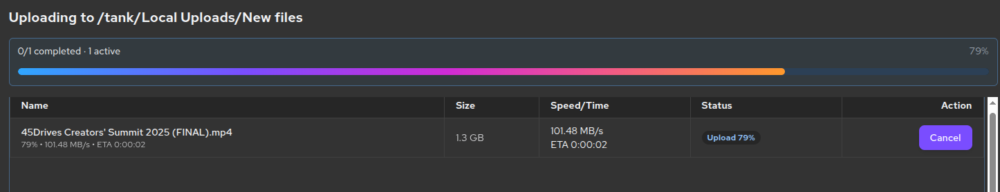

**After Upload:**

When all files are complete, click **"Finish"** to return to the project.

> **Tip:** If any uploads fail, the error message will appear below the file entry. You can address the issue and re-upload those files.

---

## 12. Transfer Dock

The **Transfer Dock** is a persistent overlay that tracks all active and recently completed transfers — uploads, transcodes, and proxy file generation. It remains visible across all screens so you can continue working while monitoring progress.

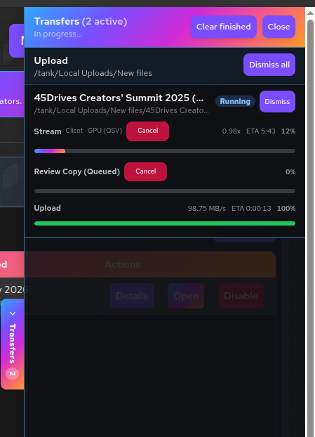

### Transfer Dock Overview

The Transfer Dock appears at the bottom of the screen whenever a transfer is in progress. It shows:

- **Active transfer count** — e.g., "Transfers (2 active)"
- **Link grouping** — Transfers are grouped by the link they belong to, with the server name and link URL displayed.
- **Clear finished** — Remove completed transfers from the dock.
- **Close** — Collapse the dock (transfers continue in the background).

When collapsed, a minimal indicator remains visible showing active transfer count. Click it to expand the dock again.

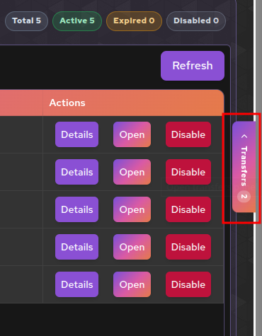

### Transfer Entry Details

Each file in the Transfer Dock shows:

| Field | Description |
|-------|-------------|
| **File name** | The name of the file being transferred. |
| **Destination** | Server-side path (e.g., `tank/Local Uploads/video.mp4`). |
| **Status** | Current state: *Running*, *Complete*, *Queued*, *Canceled*, or *Error*. |
| **Progress** | Percentage bar for the active phase. |
| **Speed** | Transfer or encode speed (e.g., `95.23 MB/s` for uploads, `1.05x` for transcodes). |
| **ETA** | Estimated time remaining. |
| **Action** | Cancel or Dismiss button. |

### Transcode Status

When proxy files or streams are being generated, each transcode entry shows:

- **Stream** — The HLS (HTTP Live Streaming) adaptive bitrate output used for browser-based video playback. This is what link recipients see when they click play.
- **Proxy File** — Downloadable MP4 files at specific qualities (720p, 1080p, or full resolution). These are used for offline review and download. When multiple qualities are selected, they appear as "Proxy File (Multiple Resolutions)" with per-quality progress.
- **Awaiting Transcode…** — The upload task is waiting for client-side transcoding to complete before uploading the raw file.

Each transcode entry also shows:

- **Transcode source** — `Client` or `Server`, indicating where the processing is running.
- **Encoder** — The hardware/software encoder in use:
  - `GPU (QSV)` — Intel Quick Sync Video
  - `GPU (NVENC)` — NVIDIA hardware encoder
  - `GPU (AMF)` — AMD hardware encoder
  - `GPU (VideoToolbox)` — macOS hardware encoder
  - `CPU` — Software encoding (libx264)
- **Speed multiplier** — e.g., `1.05x` means encoding at 1.05× real-time.
- **Progress** — Percentage complete with ETA.

A typical transfer entry for a QuickShare might show multiple sub-items:

```
Proxy File (Full Res)      Client · GPU (QSV)    1.05x   ETA 2:08   31%
Stream                     Client · GPU (QSV)    100%
Upload                     95.23 MB/s            ETA 0:14            100%
```

> **Tip:** If client-side transcoding is enabled (Settings → Performance), video processing happens on your machine before upload. The Transfer Dock shows both the transcode and upload phases separately so you can track each step.

---

## 13. Managing Links

All links you create — whether Share, Upload, or Combined — appear on the Dashboard in the **links table**. This is your central view for monitoring and managing all active, expired, and disabled links.

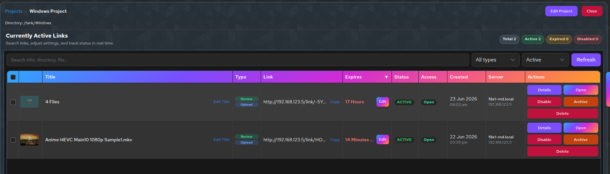

### Searching & Filtering Links

At the top of the table:

- **Search bar** — Filter links by title, directory, or file name. Results update as you type.
- **Type filter** — Show only specific link types: *All types*, *Upload*, *Share*, or *Combined*.
- **Status filter** — Show only links with a specific status: *All status*, *Active*, *Expired*, or *Disabled*.
- **Refresh** — Manually reload the link list from the server.

Summary badges show the count of **Total**, **Active**, **Expired**, and **Disabled** links.

### Link Table Columns

| Column | Description |
|--------|-------------|
| **Title** | Internal name of the link. Click the edit icon to rename it inline. Click the title to open Link Details. |
| **Type** | Badge showing **Upload**, **Share**, or **Combined** (share + upload enabled). |
| **Link** | The public URL. Click to open in browser, or use the **Copy** button. |

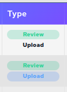
| **Expires** | Time remaining (e.g., *23 Hours*, *6d 22h*, *Never*). Shown in red when less than 24 hours remain. Click **Edit** to change the expiration. |
| **Status** | Current state: **ACTIVE** (green), **EXPIRED** (amber), or **DISABLED** (gray). |
| **Access** | Access mode: **Open** (green), **Password** (amber), or **Invited only** (rose). Hover for details. |
| **Created** | Date and time the link was created. |
| **Actions** | Action buttons (see below). |

### Link Actions

Each link row provides these actions:

| Action | Description |
|--------|-------------|
| **Details** | Opens the full Link Details view with configuration, activity log, and file list. |
| **Open** | Opens the link in your browser to preview what recipients will see. |
| **Disable / Enable** | Immediately deactivates or reactivates the link. Disabling blocks access without deleting the link. |
| **Archive / Unarchive** | Soft-hides the link without deleting. Archived links can be restored. |
| **Delete** | Permanently deletes the link (see below). |

#### Deleting a Link

Clicking **"Delete"** opens a confirmation modal with a detailed preview of what will be removed:

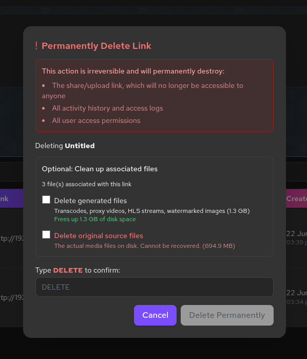

The delete preview shows:
- **Total files** associated with the link
- **Shared files** — files also used by other links (these are kept)
- **Option: Delete generated files** — Remove proxy files, transcodes, and streams. Shows how much disk space will be freed.
- **Option: Delete original source files** — Remove the original uploaded files. **This is destructive** — only enable if you're sure the originals are no longer needed.

You must type "DELETE" to confirm permanent deletion. This action cannot be undone.

---

## 14. Link Details

Click **"Details"** on any link (or click its title) to view comprehensive information.

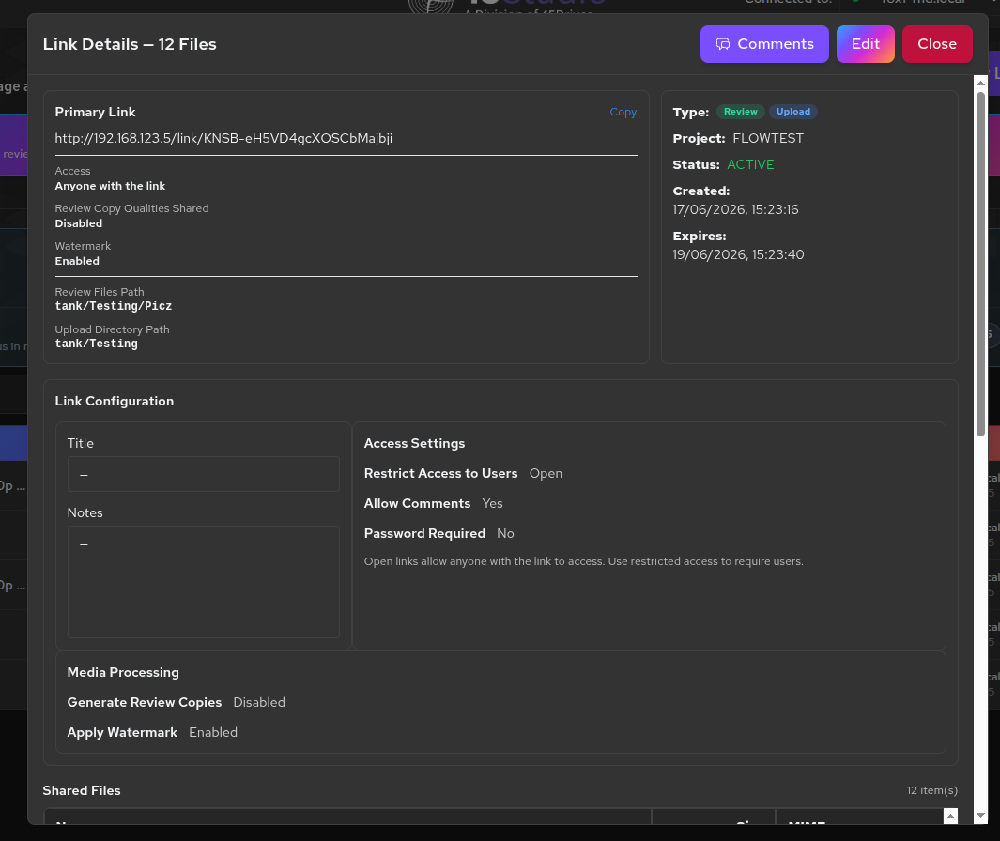

### Link Configuration Summary

The details view displays:

| Field | Description |
|-------|-------------|
| **Primary Link** | The full URL with a **Copy** button. |
| **Access** | Current access mode: **Anyone with the link**, **Anyone with the link + password**, or, for invite-only links, how many clients and teams are invited (**Only invited clients** when none are yet). |
| **Proxy File Qualities Shared** | The proxy file qualities generated for this link, or "Disabled". |
| **Watermark** | Whether watermarking is enabled or disabled (shows "Video + Image" for Pro, "Video only" for Community). |
| **Type** | Share, Upload, or Combined. |
| **Status** | Active, Expired, or Disabled. |
| **Created** | Creation date and time. |
| **Expires** | Expiration date/time or "Never". |
| **Title** | Internal name. |
| **Project** | Associated project (if assigned). |
| **Notes** | Optional internal notes. |

### Shared Files

A table of all files associated with this link, showing:
- **Name** — File name
- **Size** — File size
- **MIME** — File type (e.g., video/mp4, image/jpeg)

### Access Activity Log

View a log of all actions taken on this link:

| Column | Description |
|--------|-------------|
| **When** | Date and time of the activity. |
| **Action** | What happened — e.g., *Playback requested*, *Download*, *Upload*, *Expiry updated*. |
| **Actor** | Whether the access was from a *Guest* or an *Authenticated user*. |
| **Source** | IP address and browser information. |
| **Summary** | Details of the action performed. |

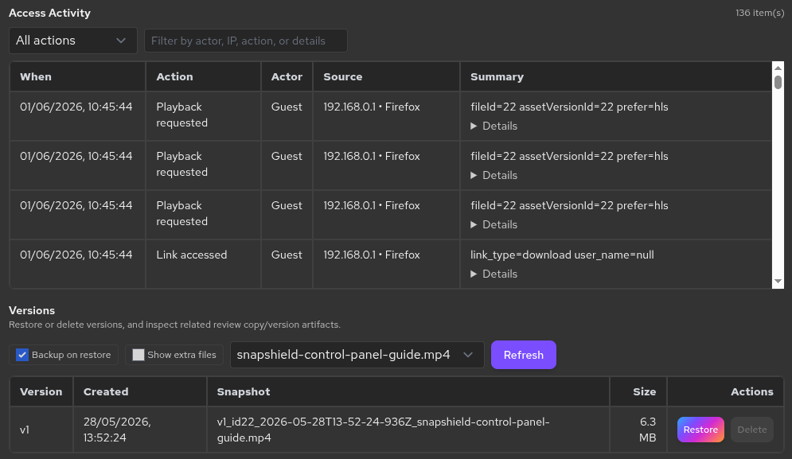

### File Versions

If file versioning/snapshots are available, this section shows:

| Column | Description |
|--------|-------------|
| **Version** | Version identifier (e.g., v1, v2). |
| **Created** | When the version was created. |
| **Snapshot** | Snapshot reference. |
| **Size** | File size at that version. |
| **Restore** | Restore this version, replacing the current file. |
| **Delete** | Remove this version (if permitted). |

### Comments Review & Export

From the Link Details view, click the **"Comments"** button to review and manage all comments on a link.

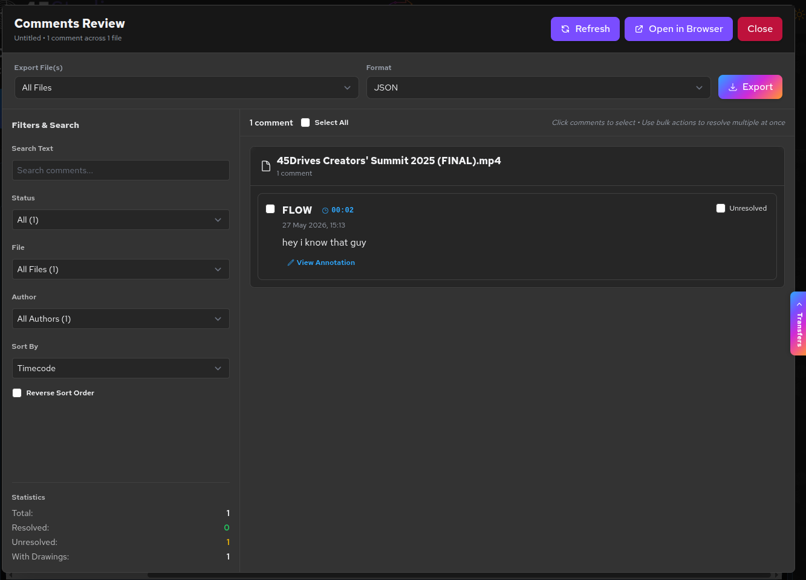

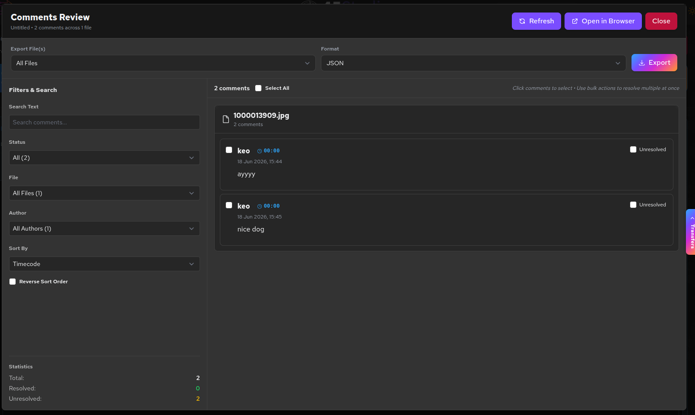

**Reviewing Comments:**

- View all comments across all files in a link in one place.
- **Filter** by file, by resolved/unresolved status, by user, by **version**, or by **category**.
- **Resolve/Unresolve** individual comments or bulk-resolve all.
- Create and manage **Comment Categories** directly from the review panel, then assign categories per comment or in bulk.
- **Sort** by timecode, date, author, status, or version.
- Each comment shows its timecode, author, category (if set), annotation indicator, tags, and the version it was made on.
- If a comment has an annotation, click **"View Annotation"** to see the drawing overlaid on the video frame at that timecode.

**Version Tracking:**

Comments are automatically tagged with the file version that was being reviewed when they were posted. This lets you:

- See which notes belong to V1, V2, V3, etc.
- Filter the review panel to show only comments from a specific version.
- Track which feedback has been addressed across revisions.

**Exporting Comments:**

Export comments in multiple formats for use in external tools:

| Format | Description |
|--------|-------------|
| **JSON** | Structured data with all fields — timestamps, authors, categories, annotations, tags, resolved status, version info. |
| **CSV** | Spreadsheet-compatible tabular export with category columns when categories are set. |
| **Markdown** | Human-readable formatted list, suitable for reports or emails, including category labels when present. |
| **WebVTT** | Subtitle/caption format — timecoded comments as VTT cues for use in NLEs or other players (comment text includes category context when used). |
| **PDF** | Styled report with comments grouped by file and version, resolved status checkmarks, tags, and category labels. |
| **EDL** | Edit Decision List (CMX 3600) with markers — import directly into Premiere, Resolve, or Avid to see notes as timeline markers. |

Click **"Edit"** at the top of the Link Details view to modify the link's settings (see next section).

---

## 15. Editing a Link

From the Link Details view, click **"Edit"** to modify an existing link's configuration.

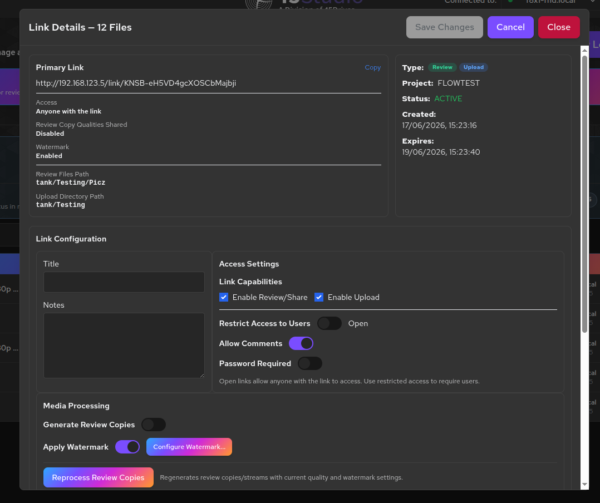

You can modify:

- **Title** and **Notes** — Update the internal name and documentation.
- **Project Assignment** — Assign or change the project this link belongs to.
- **Link Type** — Toggle **"Enable Review/Share"** and **"Enable Upload"** to change between Share, Upload, or Combined mode.
- **Only invited clients & teams** — Toggle between open and invite-only access.
- **Allow Comments** — Enable or disable commenting on shared files.
- **Comment Categories** — When comments are enabled, use **"Comment Categories"** to define reusable labels and colors for review notes.
- **Password Required** — Enable or disable password protection, and set the password.
- **Generate Proxy Files** — Enable/disable proxy file generation and select qualities (720p, 1080p, Original).
- **Apply Watermark** — Enable/disable watermark overlay with full customization controls (position, scale, opacity, rotation, presets — Pro for full control).
- **Auto-watermark uploaded files** — When enabled on upload or combined links, files uploaded through this link automatically have the link's watermark settings applied.
- **Files for This Link** — Add or remove files associated with the link using **"Manage Files"**.

Click **"Save Changes"** to apply. All changes take effect **immediately**.

Click **"Cancel"** or **"Close"** to discard changes and return to Link Details.

> **Important:** Changes to access settings, passwords, and file lists take effect immediately for anyone accessing the link.

---

## 16. Accessing a Shared Link

When someone opens a share link you've created, their experience depends on the **access mode** you configured. This section explains what recipients see when accessing links with different restriction levels.

### Opening the Link

For **open access** (Anyone with the link) share links, recipients can immediately browse files, play videos, or download content without any login or password.

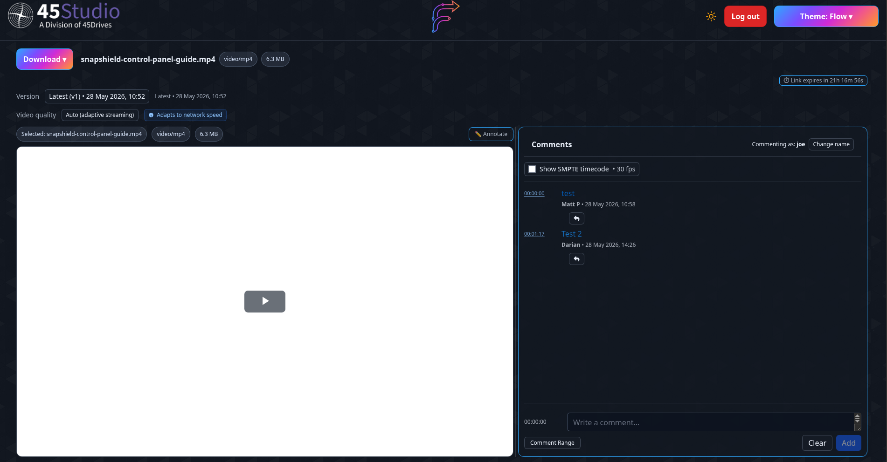

### Password-Protected Links

When you protect a link with a password (**Anyone with the link + password**), recipients must enter the correct password before accessing the content.

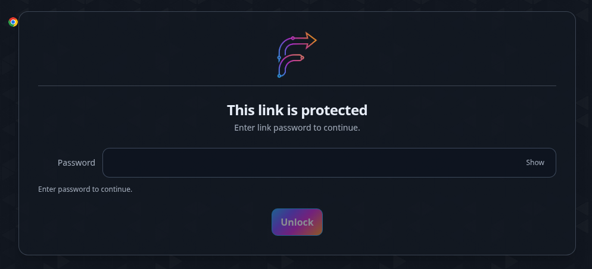

After entering the correct password, they'll have full access to the shared files according to the permissions you set (view, download, comment, etc.).

### Invite-Only Links

For links set to **Only invited clients & teams**, recipients must log in with their own credentials:

1. Click **"Sign In"** on the access screen.
2. Enter their username and password.
3. If authenticated and authorized, they'll be granted access to the content.

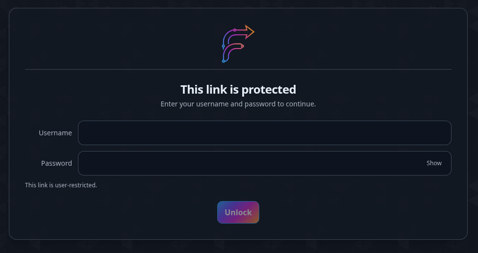

> **Note:** Clients must have been invited to the link, directly or through a team, to open an invite-only link. See [Client Access](#18-client-access) for details on adding and managing client accounts.

---

## 17. Video Player, Comments & Annotations

When someone opens a share link containing video files, they see the **45Flow Video Player** — a browser-based player with collaboration features.


### Playback Controls

The player supports standard media controls:
- **Play / Pause**
- **Seek bar** with timeline scrubbing
- **Volume control**
- **Fullscreen** toggle
- **Playback rate** adjustment (speed up or slow down)

### Quality Selection

If proxy files were generated, viewers can choose their preferred quality:
- **Auto** — Automatically adapts to available bandwidth
- **720p** — Lower resolution, faster loading
- **1080p** — Full HD
- **Original** — Full quality source file (if included)

The player uses **HLS (HTTP Live Streaming)** for adaptive bitrate delivery.

### Timecoded Comments

If comments are enabled on the link, a **Comments Panel** appears alongside the player:


- **Viewing comments:** Comments are displayed with the author's name, timecode, and color-coded indicator. Click a timecode to jump to that point in the video.
- **Adding comments:** Click the comment input area, type your message, optionally choose a **Comment Category**, and submit. The comment is automatically tagged to the current playback position and the file version being viewed.
- **Replies:** Click on any comment to reply, creating threaded conversations.
- **Timecode markers:** Visual markers appear on the seek bar indicating where comments exist.
- **SMPTE timecodes:** Comments display professional SMPTE timecodes (HH:MM:SS:FF, drop-frame where applicable) when the video's frame rate is detected. **"Show SMPTE timecode"** above the comments is on by default; turn it off to show plain HH:MM:SS times.
- **Previous Version Notes:** If a file has multiple versions and earlier versions have comments, a collapsible **"Previous Version Notes"** section appears below the comments list. This shows all notes from prior versions with their resolved/unresolved status, letting reviewers see what was addressed without switching versions.

Use categories to quickly triage feedback types during review (for example, filter to only *Audio* notes before a sound pass, then export a category-focused report for that team).

> **Note:** Commenting availability depends on the link's access mode and whether comments were enabled when creating the link.

### Annotations & Drawing Tools

**Pro Feature.** 45Flow includes built-in annotation tools for drawing directly on video frames. Annotations are created alongside comments in the review player.


**Creating Annotations:**

1. Pause the video at the frame you want to annotate.
2. Click the **annotation/draw tool** in the comment area.
3. Use the available tools:
   - **Freehand** — Draw freeform paths
   - **Rectangle** — Draw rectangular highlights
   - **Circle/Ellipse** — Draw circular highlights
   - **Arrow/Line** — Draw directional arrows or straight lines
4. Choose a color for your annotation.
5. Submit the comment — the annotation is saved alongside the timecoded comment.

**Viewing Annotations:**

- **In the review player** — Navigate to a comment with an annotation and the drawing renders on top of the video at the correct timecode.
- **In Link Details → Comments** — Click **"View Annotation"** on any comment that has one. The **Annotation Viewer** modal shows a full-size view of the annotated frame with all drawing data rendered.


### Multi-File Shares

For collection links (multiple files), a sidebar file browser appears on the left. Click any file to load it in the player. Version selection is available if multiple versions exist.

---

## 18. Client Access

Clients are the people you invite to **"Only invited clients & teams"** links. Each client signs in with their own login, and their role decides what they can do. Open a project, then click **"Client Access"** at the top of the screen.


### Viewing Existing Clients

The **Clients** list shows everyone you've added, with:
- **Name** and **Username**
- **Email** (if provided)
- **Company** and **Tags** (if provided)
- **Assigned role**
- **Color dot** showing their comment color

Use the **search bar** to filter clients by name, username, email, company, or tags.

### Adding a Client

Click **"Add client"** to open the form.


| Field | Required | Description |
|-------|----------|-------------|
| **Name** | Yes | Display name shown in comments and activity logs. |
| **Username** | Yes | What the client signs in with. Must be unique. |
| **Temporary Password** | Yes | First password (4–64 characters). Click **"Generate password"** to make one. Send it to your client securely. |
| **Confirm Password** | Yes | Must match the temporary password. |
| **Email** | No | Email address for identification. |
| **Company** | No | The client's company. |
| **Tags** | No | Comma-separated tags (e.g., `agency, vip, internal`). |
| **Default Role** | — | The role the client gets when invited to a link. |
| **Comment Color** | — | Color used for this client's comments. Use the color picker or type a hex value (e.g., `#94ebc8`). |

Click **"Add Client"** to save. When you opened Client Access from a link, the button reads **"Add & Invite Client"** and also invites them to that link.

### Managing Teams

Teams group clients you share with together (e.g., **Agency**, **Producers**, **Reviewers**) so you can invite them all at once.

**Creating a team:**

1. Click **"Teams"** at the top of Client Access.
2. Enter a **team name** and optional **description**.
3. Check the clients who belong to the team.
4. Click **"Create"**.

**Inviting a team to a link:**

When a link is set to **"Only invited clients & teams"**, click **"Invite clients & teams…"** and pick the team. Everyone on the team gets access to the link.


> **Tip:** Use teams when you share with the same people again and again. Add a new person to the team once, and they get access to every link shared with that team.

### Editing & Deleting Clients

- Click the **pencil icon** on any client to edit their name, email, company, tags, comment color, default role, or to reset their password.
- Click the **red X** to delete a client. You'll be asked to confirm. **This cannot be undone.**

---

## 19. Role Management

Roles define what clients can do on invite-only links. Open them from **Client Access → Roles**.


### System Roles

45Flow includes three built-in roles that cannot be deleted:

| Role | View | Comment | Download | Upload |
|------|------|---------|----------|--------|
| **Editor** | ✅ | ✅ | ✅ | ✅ |
| **Feedback** | ✅ | ✅ | ✅ | ❌ |
| **Viewer** | ✅ | ❌ | ❌ | ❌ |

### Permission Definitions

| Permission | What It Allows |
|------------|----------------|
| **View** | See files, open media, browse directory contents |
| **Comment** | Leave timecoded comments and participate in threads |
| **Download** | Download files to their device |
| **Upload** | Upload files (on upload-enabled links) |

### Creating Custom Roles

1. Enter a **Role name** (e.g., "Client", "Uploader").
2. Check the permissions you want to grant.
3. Click **"Create"**.

### Editing & Deleting Roles

- Click **Edit** on any custom role to modify its name or permissions, then click **Save**.
- Click **Delete** to remove a custom role (only if it's not currently assigned to users).
- System roles (Editor, Feedback, Viewer) cannot be deleted or modified.

> **Important:** Role changes apply immediately to all users assigned that role. Removing a permission instantly restricts affected users.

---

## 20. Multi-Server Management

45Flow supports connecting to and managing **multiple servers** simultaneously.


### Adding Servers

1. From the connection screen, connect to any server using auto-discovery or manual IP.
2. Once connected, use the **Connection Manager** (accessible from the server switcher dropdown in the header) to add additional servers.
3. Each server maintains its own JWT token, SSH credentials, and license status.

### Switching Active Server

The **active server** is displayed in the header bar. Click the dropdown to switch between connected servers. The active server is where all your actions take effect — creating links, uploading files, managing users, etc.


### Server Filter (All Servers View)

When multiple servers are connected, the **"Show links from"** filter appears on the Dashboard:

- **All Servers** — Aggregates links from every connected server. Each row shows which server the link belongs to.
- **Specific server** — Shows links only from the selected server.

This is useful for managing links across multiple servers from a single view.


---

## 21. Automatic Updates

45Flow includes built-in automatic update detection and installation. When a new version is available, a banner appears at the top of the application window.

**Update eligibility** is tied to your license status:
- **Active Pro license** — Automatic updates are enabled. You receive new versions as they're released.
- **Pro — Legacy (expired license)** — Updates are disabled. The Pro features you had at the time of expiry continue to work, but you won't receive new app versions or any Pro features released after expiration until the license is renewed.
- **Community (unlicensed)** — Updates are disabled.


### Update Notifications

When a new version is detected:

1. An **update banner** appears showing the new version number.
2. Click **"Download"** to begin downloading the update in the background.
3. A progress indicator shows the download status.

If you're already on the latest version, you'll see a **"You're up to date"** message when the app checks for updates.

> **Note:** Updates are checked automatically on launch and periodically while the app is running. No manual check is needed.

### Downloading & Installing Updates

Once the download completes, the banner changes to show an **"Install & Restart"** button:

- **macOS and Windows:** Click **"Install & Restart"** to quit the app, apply the update, and relaunch automatically.
- **AppImage (Linux):** Click **"Install & Restart"** — the AppImage self-updates in place and relaunches.

The update process is quick (typically a few seconds) and preserves all your settings and server connections.

### Linux Package Updates

On Linux systems using `.deb` or `.rpm` packages, automatic installation requires administrator privileges. Instead of auto-installing, 45Flow shows **manual installation instructions**:

1. The update is downloaded to your Downloads folder.
2. A yellow instruction box shows the exact command to run:
   - **Debian/Ubuntu:** `sudo apt install /path/to/45Flow-x.x.x-linux-amd64.deb`
   - **RHEL/Rocky/Fedora:** `sudo dnf install /path/to/45Flow-x.x.x-linux-x86_64.rpm`
3. Open a terminal, paste the command, and enter your password.
4. Relaunch 45Flow after the package is installed.

> **Tip:** Using `apt install` or `dnf install` (instead of `dpkg -i` or `rpm -Uvh`) ensures that dependencies are resolved automatically.

---

## 22. Activity Log

The Activity Log lets you see what the app and server have been doing, spot errors, and troubleshoot. Click **"Activity Log"** at the top of the Projects screen or inside any project.

The Log Viewer has two tabs: **Client Logs** and **Server Logs**.

> **In a browser**, the first tab is **Browser Logs** and it has a **Download** button. See [Browser Logs](#browser-logs).


### Client Logs

The Client Logs tab shows parsed entries from the local application log file stored on your computer.

At the top, you'll see:

- **Log file** — The name of the currently loaded log file (e.g., `45flow-premium-client-2026-05-27.json`).
- **Directory** — The file path where logs are stored on your system.
- **Entries loaded** — Total number of parsed log entries.

**Severity counts** are shown as colored badges:
- 🔴 **Errors** — Failures, unhandled exceptions, critical issues
- 🟡 **Warnings** — Non-critical issues, network retries
- 🔵 **Info** — General operational events (uploads started, links created)
- ⚪ **Debug** — Low-level diagnostic data

### Server Logs (Audit Log)

The Server Logs tab retrieves structured audit log entries from the connected server. These entries record every significant action taken on the server — link creation, file changes, transcode operations, user actions, branding updates, license activations, and more.


At the top, you'll see:

- **Log file** — The ops.log file name on the server (e.g., `ops.log`).
- **Directory** — The server-side log directory path (e.g., `/var/log/houston-broadcaster`).
- **Database** — The SQLite database path where structured audit entries are stored.
- **Entries loaded** — Total number of audit log entries in the database.

Each server log entry shows:

| Column | Description |
|--------|-------------|
| **Time** | Timestamp of the server event. |
| **Level** | Severity: INFO, WARN, or ERROR. |
| **Action** | The audit event name (e.g., `link.files_updated`, `annotation.created`, `transcode.cancelled`). |
| **Actor** | Username of who performed the action. |
| **Resource** | The resource type and ID affected (e.g., `link/17`, `annotation/42`). |
| **Details** | Expandable JSON payload with additional context. |

Server logs support **pagination** — use the Previous/Next buttons at the bottom to navigate through pages of results.

### Multi-Server Log Viewer

When connected to multiple servers, a **server selector dropdown** appears in the Server Logs tab. This lets you choose which server's audit log to view without disconnecting or switching your active server.


### Searching & Filtering Logs

| Control | Description |
|---------|-------------|
| **Search** | Filter by event name, summary text, details, actor, or resource. |
| **Level filter** | Show only a specific level: *All levels*, *Error*, *Warn*, *Info*, or *Debug* (client only). |
| **Errors/warnings only** | (Client tab) Quick toggle to show only error and warning entries. |
| **Group related events** | (Client tab) Groups similar events together to reduce visual duplication. |

> **Note:** Server Logs require admin (PAM) access. If you're logged in with a non-admin account, you'll see a message indicating that admin access is required.

> **Tip:** If you're experiencing connection or upload issues, check the Client Logs for `ERROR` entries. For server-side issues (transcodes failing, links not updating), check the Server Logs tab.

---

## 23. Using 45Flow in a Browser

You can use 45Flow from a web browser on any computer that is on the same network (or VPN) as your server, with nothing to install. The web app is the same 45Flow you know from the desktop app: sign in, create links, upload files and share them.

> **The web app is a Pro feature.** On a server without a Pro license, opening the web address shows a short page explaining this. Everything keeps working in the desktop app.

### Opening the Web App

Open this address in your browser, using your server's name or IP address:

```
https://<your-server>/app/
```

- Your server uses a **self-signed certificate** unless you have set up a domain with Let's Encrypt, so your browser will show a warning the first time ("Your connection is not private"). Check that the address is your own server, then choose to continue. See [SSL Certificate Management](#ssl-certificate-management) to remove the warning.
- The web app is only available from **your local network or VPN**. From the internet, the address is blocked. If you are away from the office, connect to your VPN first.

### Signing In and Out

1. Enter your server **Username** and **Password**, then click **"Connect to Server"**. There is no server to choose: the web app always connects to the server it was opened from.
2. To leave, click **"Log Out"** on the Dashboard. This ends your session on the server straight away.

Your password is never stored in the browser, and there is no "remember password" option.

### Staying Signed In

- **Reloading the page keeps you signed in.** You do not need to enter your password again.
- **You are signed out after 15 minutes without activity**, and after 12 hours in any case. Moving the mouse, typing or scrolling counts as activity, so you stay signed in while you work.
- **About two minutes before you would be signed out**, a message appears with a countdown and a **"Stay signed in"** button. Click it to continue, or ignore it to be signed out.
- Uploads keep running while you are signed in. If you leave a long upload running and walk away, it continues, but you may be signed out when it finishes.
- Several tabs share one session. Using any of them keeps all of them signed in.
- Your server administrator can change these times.

### What Works in the Browser

| Feature | In the browser |
|---|---|
| Creating, editing and managing links, projects, clients and roles | Works the same as the desktop app |
| **Add Files** | Choose files or a folder from your computer with the normal file dialog |
| **Drag-and-drop QuickShare** | Drag files anywhere on the Dashboard, as in the desktop app |
| Watermark images | Choose an image from your computer |
| Transfer Dock | Works. Uploads continue while you use other pages, but **closing or leaving the tab cancels them** (your browser asks you to confirm) |
| Admin Networks | Works for administrators |
| Server updates | Administrators are offered updates, as in the desktop app |
| Copy link buttons | Work. If your browser does not allow copying, the app uses a fallback |

**Notifications.** When a tab is in the background you will not see on-screen messages. To be told when an upload finishes or fails, open **Settings → Preferences** and turn on **"Notify when uploads finish"**. Your browser will ask for permission once.

### What Needs the Desktop App

These are not available in the browser, and the app explains this where it matters:

- **Client-side video processing.** In the desktop app you can create proxy files on your own computer before uploading. In the browser the **server** prepares them after the upload instead, which can take longer for large videos. *Settings → Performance* explains this.
- **First-time server setup** (installing houston-broadcaster over SSH) and **desktop app updates**.
- **Connecting to more than one server.** The web app talks only to the server it was opened from.
- **Resuming an interrupted upload.** If a page is closed or reloaded during an upload, start it again.

### Browser Logs

**Activity Log** is available in the browser. The first tab is **Browser Logs** instead of Client Logs. It shows errors and events recorded by this browser tab, such as a failed upload or a request the server refused. It is kept for the current tab only and is cleared when you close it. Passwords and tokens are never recorded.

Click **"Download"** to save the log as a file you can send to support. **Server Logs** works the same as in the desktop app.

### For Administrators: Hosting the Web App

The web app is served by the same nginx that serves your share links, from `/app/`, and only to the networks listed in `/etc/nginx/45flow-admin-allow.conf` (your LAN and VPN ranges by default). To allow another trusted network, add an `allow <network>;` line **before** `deny all;`, then run `sudo nginx -t && sudo systemctl reload nginx`. Never allow public ranges.

| Setting (in `/etc/default/houston-broadcaster` or `/etc/sysconfig/houston-broadcaster`) | Default | Meaning |
|---|---|---|
| `WEB_APP_LICENSE_GATE` | on | Serve the web app only to licensed (Pro) servers. Set to `off` to serve it to every server. |
| `SESSION_IDLE_MINUTES` | 15 | Sign out after this long without activity. |
| `SESSION_ABSOLUTE_HOURS` | 12 | Sign out after this long, however active. |
| `SESSION_ROTATE_MINUTES` | 60 | How often session credentials are replaced. |

Restart the service after changing a setting: `sudo systemctl restart houston-broadcaster`.

- **Installing and updating.** The web app is a separate package, **45flow-web**, whose version matches the desktop app. It installs to `/opt/45drives/45flow-web`. To see which version is running, open `https://<your-server>/app/version.json`.
- **Seeing who is signed in.** Administrators can list and end sessions through the server API (`/api/admin/sessions`); see the session contract in the houston-broadcaster documentation.
- **After an update.** Restarting or updating houston-broadcaster does **not** sign browsers out.

### Troubleshooting the Web App

| What you see | What it means |
|---|---|
| Browser warning about the connection | The self-signed certificate. Check the address, then continue. |
| "The 45Flow web app is a Pro feature" | The server has no Pro license, or a trial has ended. Activate a license in the desktop app, or ask your administrator. |
| A blocked or "403 Forbidden" page | You are not on the local network or VPN, or your network is not in the allowed list. |
| "404 Not Found" at `/app/` | The web app package is not installed on the server, or the server's nginx has not been updated. |
| Sign-in fails with an error | Check the username and password. A server that has not been updated to the version with web sign-in will not accept browser sign-ins. |
| "You were signed out after a period of inactivity" | Normal. Sign in again. |

---

## 24. Frequently Asked Questions

**Q: What's the difference between Community and Pro editions?**  
A: There is only ONE 45Flow app. It works as Community Edition (free) by default, and automatically upgrades to Pro when connected to a licensed server. You don't download separate apps — Pro features simply unlock when the server has a valid license. Community includes all core file sharing, watermarking (video and image), uploads, review features, and commenting. Pro adds custom branding, advanced watermark customization (position, scale, opacity, rotation, presets), client-side comment review/export workflows, annotations, and priority support.

**Q: How do I upgrade from Community to Pro?**  
A: Activate a license on your server. Go to **Settings → Go Pro**, enter your license key, and click **"Activate License"**. Once activated, all users connecting to that server immediately gain Pro features. You can also start a free 30-day trial from the same section.

**Q: Do I need a separate license for each user?**  
A: No. Licenses are tied to the server, not individual users. Once a server is licensed, all users connecting to it automatically get Pro features. You only need one license per server.

**Q: What happens when my trial expires?**  
A: When a trial license expires, the server reverts to Community mode. Pro features (custom branding, advanced watermarks, client-side comment review/export workflows, annotations) are disabled. All existing links remain accessible, but you can't use Pro features until a full license is activated.

**Q: What happens when my full Pro license expires?**  
A: The app enters **Pro — Legacy** mode. All the Pro features you had at the time of expiry remain fully functional — you keep what you paid for. However, automatic app updates stop, and any new Pro features or improvements released after your license expired will not be available to you. Renew your license at any time in Settings → Go Pro to unlock everything new and resume receiving updates.

**Q: What are Projects and do I need to use them?**  
A: A project is a folder on your server for one job or production. After you sign in you land on your Projects; open one to see its links, create new links and add files. Each project keeps its own proxy files and streams in a hidden `.45flow` folder inside the project folder.

**Q: How do I create a link that supports both sharing and uploading?**  
A: When creating a link, enable both **"Enable file sharing"** and **"Enable uploads"** toggles. This creates a Combined link where recipients can view/download your shared files AND upload their own files to the same location. Perfect for collaborative review workflows.

**Q: Can I watermark images, or just videos?**  
A: Both! Watermarking for video and image files is available in both Community and Pro editions. In Community mode, watermarks are applied at a fixed bottom-right position with default settings. Pro unlocks full customization — position (9 anchor points), scale, opacity, rotation, and the ability to save/reuse watermark presets.

**Q: My server doesn't appear in the auto-discovery dropdown. What do I do?**  
A: The `houston-broadcaster` service must be running on the server. Try connecting manually using the server's IP address via the **"Connect manually via IP"** field.

**Q: External share links aren't working. What should I check?**  
A: Ensure port 443 (or your custom HTTPS port) is forwarded on your router. Use the **"Check Port"** button when creating a link to verify. Also confirm your external URL is correctly configured in **Settings**.

**Q: What file types are supported for upload?**  
A: 45Flow supports a wide range of media file types including:
- **Video:** MP4, MOV, MKV, AVI, WebM, BRAW, R3D, and more
- **Image:** JPG, PNG, TIFF, EXR, DPX, PSD, and more
- **Audio:** MP3, WAV, FLAC, AAC, AIFF, and more
- **Cinema/VFX:** DPX, CIN, EXR, HDR, DNG, RAW camera formats
- **Archives:** ZIP, TAR, GZ, 7Z, RAR
- **Documents:** PDF, SRT, VTT (subtitles), XML, CSV

**Q: What do proxy files do?**  
A: Proxy files are lower-resolution versions (720p, 1080p) of your videos. When enabled, shared links stream the proxy file instead of the original, resulting in faster playback, reduced bandwidth usage, and protection of your original high-resolution files.

**Q: Can I change a link's settings after creating it?**  
A: Yes. Open the link's **Details** from the Dashboard and click **"Edit"**. You can change access mode, password, expiration, proxy file/watermark settings, and the files attached to the link. Changes take effect immediately.

**Q: What happens when a link expires?**  
A: Expired links become inaccessible to anyone who tries to open them. The link remains in your Dashboard with an "Expired" status, so you can view its history or adjust its expiration to reactivate it.

**Q: Can I disable a link without deleting it?**  
A: Yes. Click **"Disable"** in the link's action column on the Dashboard. This immediately blocks access. You can re-enable it later with the **"Enable"** button.

**Q: How do I permanently delete a link?**  
A: Click **"Delete"** in the link's action column. A confirmation modal shows a preview of associated files and lets you choose whether to also delete generated files (proxy files and streams) and/or original source files. Type "DELETE" to confirm. This action cannot be undone.

**Q: What happens to links when I delete a project?**  
A: When you delete a project, its links are **not deleted** unless you choose to delete them. Kept links appear in the **Links Without a Project** section below your project list. You can move them into another project later from the link edit screen.

**Q: How are uploaded files scanned for security?**  
A: All uploaded files go through a quarantine process with malware scanning before being moved to the destination folder. Files that fail the scan are rejected.

**Q: Where are my logs stored?**  
A: **Client logs** are stored in your local application data directory (shown in the Log Viewer's Client tab). **Server logs** (audit entries) are stored on the server in both a SQLite database and the ops.log file. You can view both from the Log Viewer — use the Client/Server tabs to switch.

**Q: I can't see Server Logs — it says "Admin access required". What do I do?**  
A: Server logs require a system (PAM) account login. If you logged in using an environment token or open access, you won't have admin privileges. Log in with your server's system username and password to access server logs and health stats.

**Q: How do I connect to multiple servers?**  
A: 45Flow supports multiple simultaneous server connections. After connecting to your first server, use the Connection Manager (from the server switcher dropdown in the header) to add additional servers. Each server maintains its own authentication and license state.

**Q: Can I view annotations created by other users?**  
A: Yes. All annotations are visible to anyone with access to the link. They appear as overlays on the video frame at the timecoded position where they were created.

---

*For additional support, contact your 45Drives representative or visit [45drives.com](https://www.45drives.com).*
